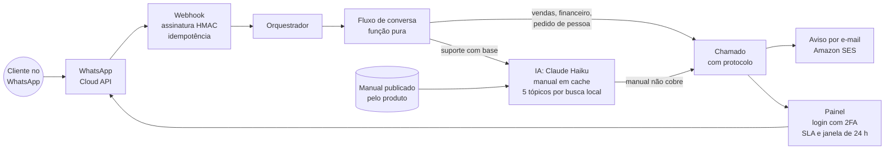

# Central de Atendimento: um WhatsApp, três produtos e IA que responde pelo manual

**Período:** novembro de 2026 até hoje · **Papel:** idealização, arquitetura, código, integração com a Meta e operação · **Estado:** no ar desde 10/11/2026; número oficial na WhatsApp Cloud API desde 11/11/2026

> Resumo em uma frase: um único número de WhatsApp atende três produtos da Asset Tecnologia, responde na hora as dúvidas de uso com base no manual do próprio produto, recusa o que está fora do assunto e, quando a pergunta precisa de uma pessoa, abre um chamado com protocolo e prazo medido em minutos úteis.

## 1. Contexto e problema

A Asset Tecnologia tem três produtos: o [Escrituro](escrituro.md), sistema para escritórios de contabilidade, o [Clinalta](clinalta.md), sistema para clínicas, e um terceiro em fase piloto. A equipe é pequena, e os três prometem a mesma coisa nas suas definições: suporte humano com prazo e ajuda em toda tela.

Três problemas apareceram juntos:

- **A dúvida de uso não deveria virar chamado.** O Escrituro tem um manual com cerca de 200 tópicos, e "como gero a agenda de obrigações?" já está respondido lá. Quem pergunta pelo WhatsApp não vai abrir o manual.
- **Um número por produto não escala.** Três números, três aparelhos e três caixas de conversa para uma equipe de uma pessoa é receita para perder mensagem.
- **WhatsApp tem regra própria.** Texto livre só dentro da janela de 24 horas desde a última mensagem do cliente; fora dela, só modelo aprovado. Perder a janela é perder a conversa.

A decisão: um serviço próprio, separado dos três sistemas, com um número oficial na API da Meta, e a IA só onde existe base para ela responder.

## 2. Resultado

| Indicador | Valor |
|---|---|
| Produtos atendidos por um número | 3 |
| Do primeiro commit ao serviço no ar | mesmo dia (10/11/2026) |
| Número oficial ligado na WhatsApp Cloud API | 11/11/2026 |
| Base de ajuda do Escrituro | cerca de 200 tópicos, publicados pelo próprio sistema |
| Custo por pergunta respondida pela IA | de cerca de US$ 0,09 para cerca de US$ 0,0004 |
| Suítes de teste | 6 (fluxo, WhatsApp, IA, login, e-mail e SLA) |

A queda de custo veio de duas trocas medidas na primeira semana: a primeira pergunta real foi respondida certo pelo modelo maior, sem cache, a cerca de US$ 0,09; com o Claude Haiku e as instruções e o índice do manual em cache de prompt, a mesma classe de pergunta passou a custar cerca de US$ 0,0004. Duas ordens de grandeza, sem trocar a regra de só responder pelo manual.

## 3. Arquitetura

| Parte | Como funciona |
|---|---|
| Webhook | A Meta chama a rota com o corpo e o cabeçalho de assinatura. A rota confere o HMAC SHA-256 com o segredo do app em tempo constante, responde 200 na hora e processa depois. Cada mensagem tem o id da Meta; a repetida é ignorada, então reentrega não gera resposta dupla |
| Fluxo de conversa | Uma máquina de estados pura: recebe a conversa e a entrada e devolve o novo estado e a lista de ações (responder texto, mostrar botões, chamar a IA, abrir chamado). Sem banco, sem rede, sem relógio implícito. Por isso dá para testar todos os caminhos em milissegundos |
| Menu | Produto, depois assunto (suporte técnico, financeiro, vendas), em botões do WhatsApp. "menu" volta ao começo, pedir atendente passa para uma pessoa, 30 minutos parado reinicia |
| IA de suporte | Busca local no estilo BM25 escolhe até 5 tópicos do manual; o Claude Haiku responde só com eles, em resposta estruturada (texto, tópicos usados, se o manual cobre, se está fora do assunto, confiança, se precisa de pessoa). CPF, e-mail e telefone são pseudonimizados antes do envio. Limite de perguntas por contato por dia e teto diário no total |
| Base de ajuda | Cada produto publica o próprio manual numa rota, em JSON, sem dado de cliente. A Central baixa ao subir e a cada hora. O manual que o cliente lê no sistema é o mesmo que a IA usa |
| Vendas | O fluxo qualifica o lead (nome, empresa e porte, com a pergunta de porte adaptada a cada produto) e abre o chamado com o resumo pronto |
| Chamado | Protocolo no formato AAAAMMDD-NNNN, mensagem com o horário do atendimento humano e aviso por e-mail pelo Amazon SES com o link da conversa |
| Painel | Login com senha e verificação em duas etapas (TOTP). Quem responde pelo painel assume a conversa e o robô para |
| SLA | Indicadores de 7, 30 e 90 dias por produto, com meta de resposta em minutos úteis (dias úteis, das 9h às 18h); coluna com a contagem regressiva da janela de 24 horas e alerta por e-mail antes de ela fechar |

## 4. Decisões de engenharia

- **Fluxo puro, efeitos no orquestrador.** A regra de conversa é a parte que mais muda e a que mais quebra. Isolada numa função pura, ela é testada sem WhatsApp, sem banco e sem IA; o orquestrador só executa as ações devolvidas.
- **A IA só onde há base.** No começo, só o suporte do Escrituro tinha manual publicado; os outros produtos abriam chamado direto. A regra para ligar a IA de um produto é ter o manual publicado, não ter vontade.
- **Recusar é uma resposta.** Pergunta fora do assunto recebe uma recusa educada e não abre chamado, para a fila humana não encher de conversa geral. O botão de falar com consultor fica a um toque.
- **"O manual não cobre" vira chamado, não invenção.** Quando a resposta estruturada diz que o manual não cobre, ou que parece erro do sistema, a Central responde o que sabe e passa para uma pessoa.
- **Modelo trocável por variável de ambiente.** A troca de modelo que derrubou o custo foi uma mudança de configuração, medida antes e depois, sem tocar na regra.
- **E-mail com reserva.** O aviso de chamado sai pelo Amazon SES, com outro provedor de reserva. Serviço externo entra por API e pode ser trocado.

## 5. Um incidente real e o plano de contingência

Em 12/11/2026, todas as chamadas à API da Meta passaram a voltar "API access blocked", inclusive as de leitura. Testado de dois servidores diferentes, não era endereço de rede: era o app ou o token. No mesmo período, o Microsoft 365 teve uma queda global, e os códigos de verificação da Meta chegavam justamente por um e-mail hospedado lá, o que impedia até de investigar pelo painel.

A API voltou sozinha no dia seguinte, depois que o Microsoft 365 voltou, sem nenhuma mudança da nossa parte. As mensagens enviadas durante o bloqueio não chegaram.

O que ficou:

- **Plano de contingência do suporte**, com número reserva, para o canal não depender de um único app numa única plataforma.
- **Dependências cruzadas no mapa de riscos.** O canal de suporte dependia, sem que isso estivesse escrito, do e-mail corporativo para recuperar acesso. Agora está escrito.
- **Monitorar o canal, não só o servidor.** O servidor estava saudável o tempo todo; quem estava fora era a API do outro lado.

## 6. Lições

- **Janela de 24 horas é regra de produto.** O WhatsApp cobra e restringe por janela; o painel mostra a contagem regressiva e avisa antes de fechar, porque perder a janela é perder a conversa.
- **Medir custo por pergunta desde a primeira.** O primeiro número real (US$ 0,09) mostrou que o modelo maior sem cache não fechava a conta; a troca saiu medida, não por intuição.
- **O manual é infraestrutura.** A IA de suporte só ficou boa porque o manual foi escrito tela por tela e é publicado pelo próprio sistema. Melhorar o manual melhora a ajuda dentro do produto e o WhatsApp ao mesmo tempo.
- **Plataforma de terceiro falha de jeitos que você não controla.** Webhook assinado, idempotência e testes não ajudam quando a API do outro lado bloqueia. Só contingência ajuda.

## 7. Próximos passos

1. **Contingência ativa:** número reserva pronto para assumir o canal.
2. **IA nos outros produtos:** ligar a resposta automática do Clinalta quando a base de ajuda dele estiver publicada para a Central.
3. **Modelos aprovados:** mensagens fora da janela de 24 horas por modelo aprovado pela Meta.
4. **Financeiro automático:** segunda via e situação da fatura pelo próprio WhatsApp.
5. **Medição:** cada resposta da IA guarda se resolveu ou se a pessoa pediu um consultor; a taxa de resolução sem humano por produto é a métrica que decide se a IA ajuda.

## 8. Stack e código

Next.js 16 · React 19 · TypeScript · Drizzle ORM · PostgreSQL (PGlite no desenvolvimento) · WhatsApp Cloud API · Claude Haiku com cache de prompt e saída estruturada · Amazon SES · Docker numa VM ARM na Oracle Cloud em São Paulo, atrás do Caddy.

O código é privado; mostro em entrevista, com o simulador de conversa do ambiente de desenvolvimento.
