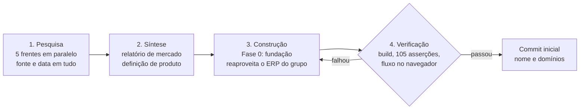
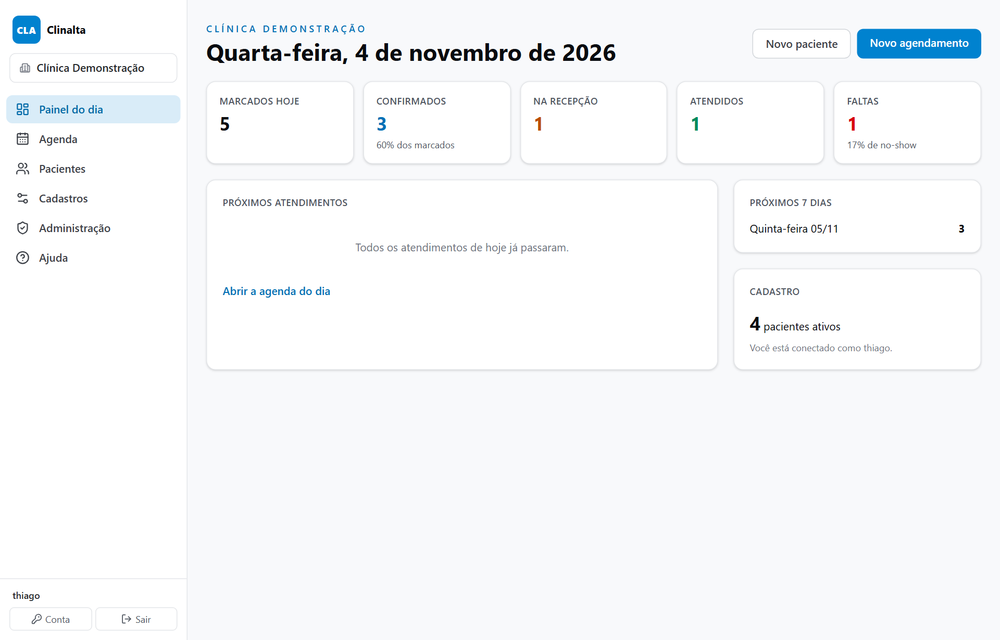
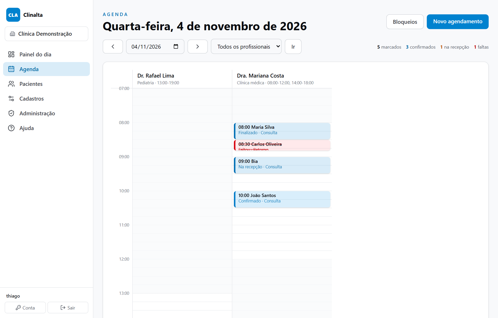
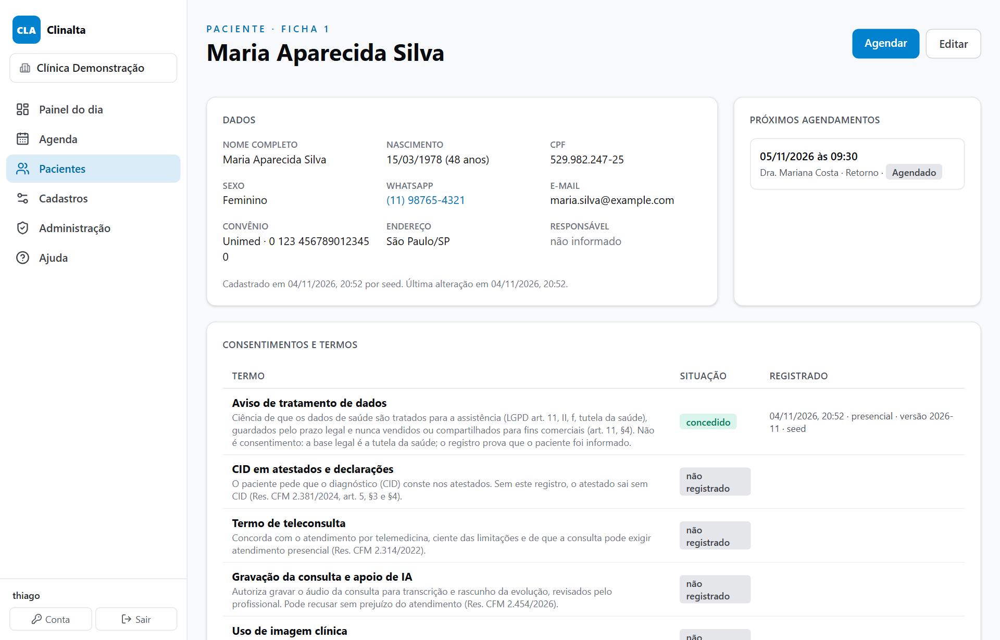

# Clinalta: do mercado ao produto em um dia

**Período:** novembro de 2026 até hoje · **Papel:** idealização, direção da pesquisa, arquitetura, código e verificação · **Estado:** no ar em app.clinalta.com.br desde 05/11/2026; Fase 1 (prontuário) em construção

> Resumo em uma frase: em um único dia de trabalho, saí de uma pergunta ("dá para construir um sistema de gestão para clínicas melhor que os do mercado?") para um produto com nome, domínios registrados, pesquisa de mercado com fontes datadas, definição de produto e a primeira fase do sistema funcionando, testada e versionada.

## 1. Contexto e problema

Depois de reconstruir com IA o ERP do grupo industrial que dirijo, em seis semanas e após um ransomware, quis testar se o mesmo método serviria para um produto comercial, fora do grupo, num mercado regulado e com concorrentes estabelecidos.

O alvo escolhido foi a gestão de consultórios e clínicas de até 20 profissionais, particular e convênio. Três motivos: o mercado é grande (635 mil médicos no Brasil), a dor é conhecida (um médico da minha rede topou validar o produto) e há um conjunto de obrigações legais recentes que os sistemas atuais ainda absorvem mal: recibo Receita Saúde desde 2025, NFS-e nacional em 2026, numeração de receitas controladas pelo SNCR e a resolução do CFM sobre uso de IA na consulta.

A condição que eu coloquei: não fazer "mais um". Primeiro entender como funcionam os líderes de hoje, no Brasil e no mundo, e só então decidir o que construir.

## 2. Método em quatro etapas

Quatro etapas encadeadas, cada uma com um critério de saída, todas no mesmo dia. A verificação devolve o trabalho à construção quando algo falha; nada segue sem passar por ela.

1. **Pesquisa em cinco frentes paralelas** (cerca de dez minutos de parede). Cinco agentes de pesquisa, cada um com um recorte e perguntas fechadas: líderes no Brasil, líderes no mundo, exigências legais e fiscais, mapa de módulos e dores dos usuários, integrações e tecnologia. Regra: toda afirmação com fonte e data, e lacuna declarada em vez de inventada.
2. **Síntese em dois documentos.** Um relatório de mercado e uma definição de produto, escritos por agentes separados a partir das mesmas notas, com restrições fixas que eu dei: stack do grupo, público inicial, princípios inegociáveis e estrutura das seções.
3. **Construção da Fase 0.** Reaproveitei do ERP do grupo o que já estava provado em produção (login, verificação em duas etapas, sessões, auditoria, multiempresa) e escrevi o resto: esquema de dados, agenda, pacientes, cadastros, administração, ajuda, dados de demonstração e testes.
4. **Verificação.** Build limpo, 105 asserções em quatro suítes e teste manual no navegador do fluxo completo: agendar em três cliques, confirmar, registrar a chegada, login de recepção barrado na administração, exportação baixada.

O que ficou comigo em todas as etapas: a pergunta certa, as restrições, a leitura crítica dos resultados e as decisões de produto. O que ficou com a IA: volume, paralelismo e consistência.

## 3. O que a pesquisa revelou

A briga no consultório brasileiro não é por função. Todos os líderes têm agenda, prontuário, prescrição assinada, WhatsApp, financeiro, faturamento de convênio e teleconsulta, e a IA de transcrição virou piso em 18 meses. A diferença está em confiabilidade, relação comercial e nas obrigações legais novas que ninguém cobre bem.

| Achado | Evidência (04/11/2026) | O que muda no produto |
|---|---|---|
| Três grupos dominam o consultório | Cada um usa o software como porta de entrada para outro negócio (educação médica, marketplace de agendamento, marketing) | Competir pela relação com o cliente, não pelo subsídio |
| Preço de R$ 89 a R$ 299 por profissional ao mês | Planos escalonados; WhatsApp, assinatura digital e IA cobrados à parte como complementos | Plano único, público, tudo incluso |
| Reclamações são sobre confiança | Nos canais públicos de reclamação: prontuário bloqueado por pendência de centavos, impossibilidade de exportar prontuários ao sair, resposta em mais de duas semanas | Nunca bloquear dados; exportação total a um clique; suporte com prazo |
| Instabilidade é a dor número um | 51% dos médicos sofrem lentidão ou queda todo mês (Black Book 2025) | App instalável tolerante a queda de rede, página em menos de 1 s |
| Falta e glosa pesam no caixa | 48% das clínicas citam a falta do paciente como maior desafio; glosa inicial de 7,3% (ANS) | Confirmação pela API oficial do WhatsApp e checagem anti-glosa na recepção |
| Obrigações novas sem resposta no mercado | Receita Saúde obrigatório desde 2025 e sem API; NFS-e nacional em 2026; SNCR para controlados até março de 2027; Res. CFM 2.454/2026 sobre IA | Conformidade nativa como barreira de entrada |
| No mundo, o padrão subiu | Portal do paciente em mais da metade dos pacientes dos EUA; IA ambiente dentro do prontuário em todos os líderes | Portal do paciente e IA com consentimento desde o desenho |

Uma lição de processo: a pesquisa com fontes datadas evitou duas decisões erradas. Sem ela, eu teria tratado a certificação SBIS como obrigatória (é voluntária) e o recibo Receita Saúde como automatizável por API (não existe API).

## 4. Decisões de produto

Oito princípios inegociáveis, cada um ligado a uma dor comprovada e com uma meta medível. Entraram na definição antes da primeira linha de código.

- **Nunca bloquear o prontuário por cobrança.** Inadimplência reduz a conta a modo leitura com exportação. A guarda legal é de 20 anos; o dado é do médico, não do sistema.
- **Exportação total a um clique.** Pacientes, agenda, consentimentos, auditoria e acessos em CSV, sem pedir ao suporte. Prontuário em PDF assinado e FHIR nas próximas fases.
- **Preço único e público**, cobrado só por profissional de saúde; recepção e contador sem custo. Custos de terceiros repassados a custo e visíveis na fatura.
- **Poucos cliques, com meta.** Agendar em 3, finalizar consulta com receita assinada em 5, receber e emitir recibo em 2.
- **Tolerante a queda de rede.** Agenda do dia e prontuários dos agendados em cache; o que for escrito sem rede entra numa fila e sobe depois, sem sobrescrever.
- **Conformidade nativa.** Assinatura ICP-Brasil, CPF nos documentos, consentimento para CID, termos de teleconsulta e de IA fazem parte do fluxo, não de módulo pago.
- **IA sempre revisada.** Transcrição e rascunho da evolução só com consentimento registrado, nunca sugestão de diagnóstico ao paciente, para o produto não virar software como dispositivo médico (RDC 657/2022).
- **Suporte humano com prazo.** Resposta no mesmo dia útil e ajuda em toda tela.

Duas decisões de escopo: começar por consultórios e clínicas de até 20 profissionais, e deixar odontologia fora, porque é um mercado à parte com seus próprios líderes.

## 5. O que foi construído na Fase 0

A fundação: tudo o que as outras fases vão usar e que uma clínica já consegue operar no dia a dia da recepção. A camada do proxy decide quem entra e em qual clínica; as de baixo confiam nela e filtram tudo pela clínica ativa.

| Módulo | O que faz | Origem |
|---|---|---|
| Acesso | Login com senha, verificação em duas etapas (TOTP), sessões por aparelho, dispositivos conectados com desconexão remota | Reaproveitado do ERP do grupo |
| Perfis por clínica | Um login, um perfil em cada clínica: administrador, profissional de saúde, recepção, financeiro, contador só leitura | Adaptado: o modelo era por módulo, virou por perfil e por clínica |
| Clínica | CNPJ, CNES, regime tributário, encarregado LGPD; unidades, salas, tipos de atendimento com duração e preço | Adaptado do multiempresa |
| Profissionais | Conselho, número, UF, RQE, CBO, cor na agenda, grade semanal de atendimento por unidade | Novo |
| Pacientes | CPF validado e único por clínica, nome social, responsável legal, convênio; consentimentos versionados por tipo, canal e signatário | Novo |
| Agenda | Grade do dia por profissional em blocos de 15 min; agendar em 3 cliques; conflito de horário e de sala; bloqueios; encaixe; fluxo do dia com carimbos de hora; sala de espera | Novo |
| Painel | Marcados, confirmados, na recepção, atendidos, faltas e no-show de hoje; próximos atendimentos; próximos 7 dias | Novo |
| Auditoria | Toda alteração campo a campo; registro de quem abriu cada ficha com finalidade (LGPD art. 37); exportação em CSV | Auditoria reaproveitada; acesso ao prontuário e exportação novos |
| Infra | PWA instalável, rota de saúde, Docker com Postgres e backup diário, ajuda por capítulo, clínica de demonstração | Reaproveitado |

### Telas da clínica de demonstração

Os dados abaixo são fictícios, gerados pelo script de demonstração do sistema.

*Painel do dia. Os indicadores são calculados sobre a agenda da clínica ativa.*

*Agenda do dia por profissional, em blocos de 15 minutos. Cada atendimento mostra o estágio do fluxo: finalizado, faltou, na recepção, confirmado, agendado.*

*Ficha de paciente. Os consentimentos são versionados por tipo, com a norma que os exige; abrir a ficha grava quem acessou e com que finalidade.*

### Conformidade embutida

A pesquisa levantou 22 normas e as transformou em requisitos de software, classificados em obrigatório, diferencial e incerto. Exemplos que já moldaram a Fase 0:

| Norma | O que exige | Como está no sistema |
|---|---|---|
| LGPD art. 11 §4 | Dados de saúde não se compartilham entre controladores para fins comerciais | Pacientes são da clínica, não do grupo: toda tabela carrega o id da clínica e toda consulta filtra por ele |
| LGPD art. 37 | Registro das operações de tratamento | Log de acesso ao prontuário por usuário, paciente, finalidade e tela |
| LGPD art. 14 §1 | Consentimento específico do responsável para menores | Responsável legal no cadastro; consentimento registrado como dado pelo responsável; aviso na ficha de menor sem responsável |
| Res. CFM 2.381/2024 | CPF do paciente e RQE do médico nos documentos; CID só por pedido do paciente | CPF validado por dígito; RQE e CBO no cadastro do profissional; consentimento "CID em documento" como tipo próprio |
| Res. CFM 1.821/2007 e Lei 13.787/2018 | Guarda do prontuário por 20 anos | Nada se apaga: pacientes e agendamentos são inativados ou cancelados, nunca excluídos |
| Res. CFM 2.454/2026 | Paciente informado e podendo recusar IA; uso registrado | Consentimento "gravação e IA" já no catálogo, para a Fase 3 |

## 6. Depois do primeiro dia: no ar e a Fase 1 em andamento

A Fase 0 entrou em produção no dia seguinte, e a Fase 1 começou pelo que mais pesa para o médico: o prontuário. Cada entrega saiu com teste, nota datada na ajuda e backup antes da troca.

| Data | Entrega |
|---|---|
| 04/11/2026 | CID-10 embutida: a tabela oficial do DATASUS, com 14.233 códigos, busca por nome ou por código, com ou sem ponto |
| 05/11/2026 | No ar em app.clinalta.com.br, com domínio, certificado, backup diário e restauração testada (dump restaurado num banco novo, com as mesmas tabelas e os 14.233 códigos da CID-10). No mesmo dia: fila de espera da recepção, tarefas com prazo e responsável e atalhos de teclado |
| 09/11/2026 | Marca depositada no INPI, classe 42 |
| 12/11/2026 | Servidor no Brasil: o sistema passou a rodar numa VM na Oracle Cloud em São Paulo. Ajuda por tela (F1 abre a explicação da tela atual, com busca no manual) |
| 12/11/2026 | Prescrição pela Memed integrada ao atendimento, em homologação (detalhes abaixo) |
| 13/11/2026 | Prontuário com linha do tempo única do paciente: evoluções, receitas, anexos e atendimentos, com filtro por tipo |
| 13/11/2026 | Evolução por modelo: 7 modelos (SOAP, texto livre e cinco especialidades), com CID-10; o rascunho se salva sozinho e fica guardado no aparelho se a internet cair |
| 13/11/2026 | Anexos no prontuário (PDF e imagem, até 10 MB), incluídos no backup diário; enviado por engano fica marcado, nunca apagado |
| 13/11/2026 | Senha provisória: o administrador não digita mais a senha de ninguém; o sistema sorteia uma senha válida por 7 dias e exige a troca no primeiro acesso |
| 13/11/2026 | Ajuda revista tela por tela contra o sistema, com a seção "Quando der problema" em cada tópico, para o suporte |

### Evolução imutável em três camadas

O prontuário tem guarda legal de 20 anos e não pode ser reescrito em silêncio. A evolução finalizada não se edita: correção é uma versão nova com motivo, e a anterior continua visível. A proteção tem três camadas independentes:

1. **Aplicação.** Não existe tela nem ação para alterar ou apagar uma versão.
2. **Hash SHA-256 encadeado.** Cada versão grava o hash do seu conteúdo canônico e o hash da versão anterior. Ao abrir a evolução, o sistema recalcula a cadeia e aponta a primeira versão que não confere.
3. **Banco de dados.** Um gatilho no PostgreSQL recusa qualquer UPDATE ou DELETE na tabela de versões, mesmo para quem acessa o banco direto.

A exportação leva todas as versões com o hash, para que a clínica possa conferir fora do sistema.

### Prescrição pela Memed, dita com honestidade

O médico clica em Prescrever no atendimento, a Memed abre com o paciente preenchido (inclusive o endereço que a Anvisa exige junto com o CPF), e a receita emitida fica gravada no atendimento e na linha do tempo; receita excluída na Memed fica marcada, nunca some. A integração roda no ambiente de homologação da Memed: **as receitas ainda não têm valor legal**, e só terão quando as chaves de produção forem liberadas. Integrar em vez de construir resolve desde já a receita de controlados, que a Memed cobre; a prescrição própria, com numeração SNCR, ficou para a Fase 3.

## 7. Números

No primeiro dia, 4 de novembro de 2026, entre a primeira pergunta e o commit inicial:

| Medida | Valor |
|---|---|
| Frentes de pesquisa em paralelo | 5 |
| Palavras de notas de pesquisa | 28.500 |
| Fontes distintas citadas com URL | 501 |
| Definição do produto | 5.400 palavras, 13 módulos, 22 normas, 17 integrações, 5 fases |
| Arquivos versionados no commit inicial | 116 |
| Linhas de TypeScript | 6.444 |
| Tabelas no banco | 18 |
| Telas e rotas | 31 |
| Asserções automatizadas | 105, em 4 suítes |
| Cliques para agendar | 3, verificado no navegador |
| Nomes testados no Registro.br | 150, 33 livres |

Dez dias depois, em 14 de novembro de 2026, recontado no repositório:

| Medida | Valor |
|---|---|
| Commits | 24 |
| Arquivos versionados | 211 |
| Linhas de TypeScript | 16.421 |
| Tabelas no banco | 24 |
| Telas e rotas | 44 |
| Asserções automatizadas | 377, em 10 suítes |
| Modelos de evolução | 7 |
| Códigos da CID-10 embutidos | 14.233 |

O que não está feito, dito com a mesma clareza: a prescrição pela Memed ainda está em homologação e as receitas não têm valor legal até a liberação das chaves de produção; faltam a assinatura digital da evolução e os documentos assinados com certificado ICP-Brasil (atestado, pedido de exame, encaminhamento), o financeiro com Pix, o recibo Receita Saúde e o WhatsApp da clínica; e o CPF ainda fica em claro no banco (a cifra existe e protege, por enquanto, só o segredo da verificação em duas etapas).

## 8. Lições

- **Fuso horário é requisito, não detalhe.** O servidor de produção roda em UTC; "hoje" e "08:30" mudam de dia se calculados no fuso do processo. Uma biblioteca de datas calcula tudo em São Paulo, com teste que prova que 22:30 em SP ainda é o mesmo dia.
- **Fonte bloqueada vira lacuna declarada.** Sites de vários fornecedores recusaram o acesso automatizado. Os preços deles ficaram marcados como "fonte terciária, com data" e não como oficiais.
- **Nome genérico é dívida.** O primeiro impulso foi um nome de categoria, que mistura idiomas e dificilmente passaria no INPI. A escolha final saiu de critérios (curto, pronunciável, que caiba num ícone, com .com.br livre), 150 candidatos verificados automaticamente no Registro.br e um racional, não um gosto.
- **Pesquisa com data evita decisões caras.** Duas normas que eu daria como certas estavam erradas na minha cabeça; a pesquisa corrigiu antes do código.
- **Integrar antes de construir, e dizer o estado real.** A prescrição pela Memed resolveu os controlados sem esperar a prescrição própria, mas a integração em homologação não tem valor legal. O case, a ajuda e o roteiro dizem isso com as mesmas palavras.

## 9. Próximos passos

Cinco fases, cada uma com critério de pronto verificável e sem datas prometidas. Cada fase só começa com a anterior em uso real.

1. **Fase 0, fundação (no ar desde 05/11/2026).** Publicada com domínio, backup e restauração testada; marca depositada no INPI. Portão cumprido: a clínica de demonstração agenda, cadastra e vê a auditoria em produção.
2. **Fase 1, MVP para consultório particular (em construção).** Feito: prontuário com linha do tempo, SOAP e modelos por especialidade, CID-10 com busca, versões imutáveis com hash encadeado, anexos e prescrição pela Memed em homologação. Falta: documentos assinados com certificado digital e validados no ITI, receitas com valor legal (chaves de produção da Memed), financeiro simples com Pix, recibo Receita Saúde por recebimento, WhatsApp oficial e leitura completa sem rede. Portão: um consultório real usa por 30 dias sem perder nenhum atendimento.
3. **Fase 2, clínicas e convênios.** Guias TISS validadas, lotes, glosas e recurso; NFS-e nacional; DMED; repasse médico; portal do paciente; recall e NPS. Portão: um mês fechado numa clínica com convênio, lote aceito pela operadora e repasse conferido pelo contador.
4. **Fase 3, IA, teleconsulta, BI e estoque.** Transcrição ambiente com termo e registro; teleconsulta; prescrição própria com numeração SNCR; painéis de falta, glosa e DRE. Portão: médico piloto aprova o rascunho de IA em 20 consultas com edição mínima.
5. **Fase 4, certificação e ecossistema.** Preparação SBIS, RNDS em FHIR, API pública, agente de WhatsApp, CID-11.

## 10. Stack

Next.js 16 com server actions · React 19 · TypeScript · Tailwind 4 · Drizzle ORM · PGlite em desenvolvimento e PostgreSQL em produção · Docker numa VM ARM na Oracle Cloud em São Paulo, atrás do Caddy. Convenções herdadas do grupo: dinheiro em centavos, datas sempre no fuso de São Paulo, toda tabela com o id da clínica, toda ação grava auditoria, nada se apaga.

## 11. Código

O repositório é privado: o produto é comercial e lida com dados de saúde. Pode ser apresentado em entrevista ou avaliação acadêmica com a clínica de demonstração. Documentos de definição do produto e de arquitetura existem no repositório e seguem este case.
