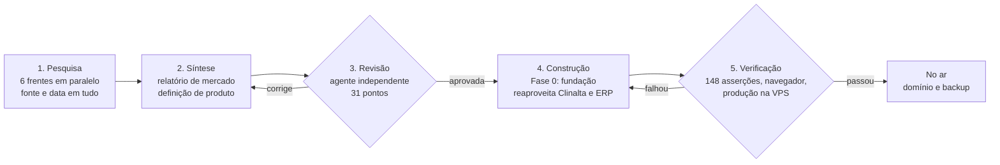
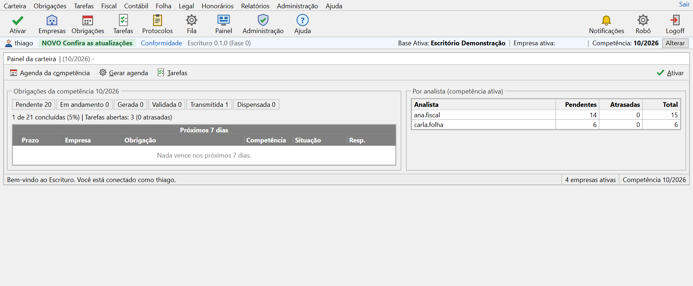
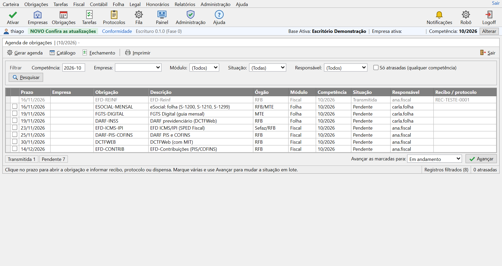
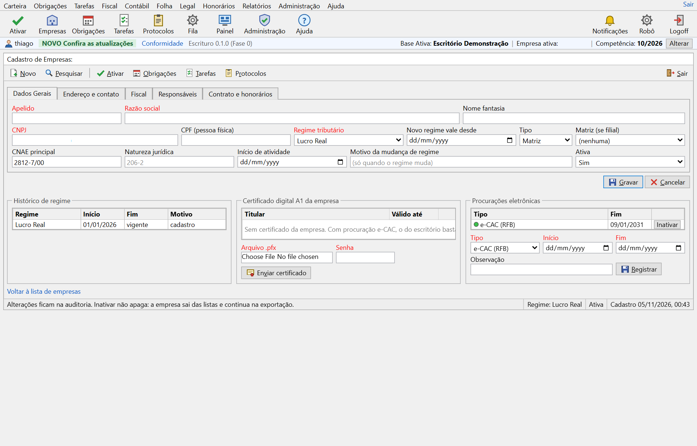
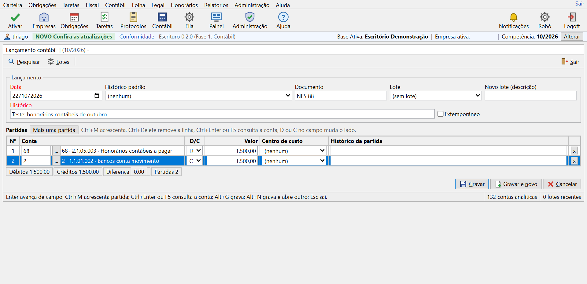
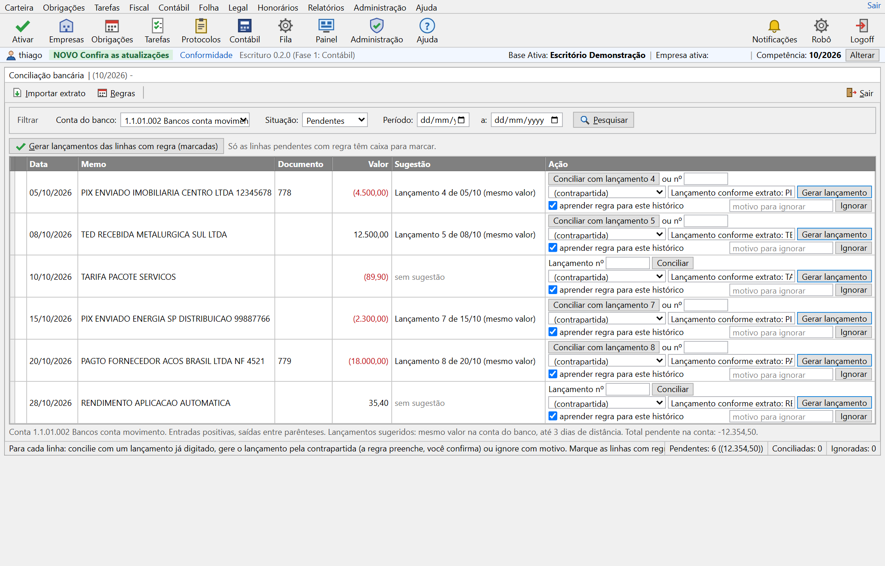
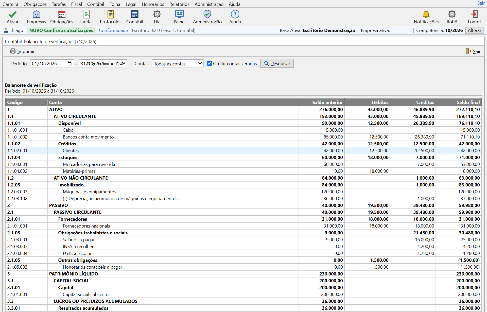

# Escrituro: do mercado ao produto no ar em dois dias

**Período:** novembro de 2026 até hoje · **Papel:** idealização, direção da pesquisa, arquitetura, código, verificação e publicação · **Estado:** versão 0.65.0 no ar (14/11/2026), Fases 0 a 3 entregues, piloto no próprio grupo do autor

> Resumo em uma frase: em dois dias de trabalho, saí de uma pergunta ("dá para construir um sistema para escritórios de contabilidade igual ou melhor que o Contmatic Phoenix?") para um produto com nome, domínio registrado, pesquisa de mercado com 659 fontes datadas, definição de produto revisada por um agente independente e a primeira fase do sistema funcionando em produção, com domínio, certificado e backup. No mesmo dia, o módulo Contábil da Fase 1 entrou no ar, construído sobre um inventário de 233 funções dos sistemas líderes. Dez dias depois, o sistema chegou à versão 0.65.0, com SPED, Lucro Presumido e Real, folha e eSocial, departamento legal, IA e reforma de 2027.

## 1. Contexto e problema

No dia anterior eu tinha construído o [Clinalta](clinalta.md), um sistema para clínicas, em um dia, para testar se o método que usei no ERP do meu grupo industrial servia a um produto comercial. Serviu. A pergunta seguinte foi se ele aguentava um mercado maior, mais regulado e com um produto de sete módulos que conversam entre si: o escritório de contabilidade.

A régua escolhida foi o Contmatic Phoenix, o sistema de escritório mais conhecido do Brasil. Três motivos para o alvo: o meu grupo paga um escritório externo, e seus sete CNPJs servem de primeiro cliente real; fiscal, contábil, folha, patrimônio, legal, honorários e portal exigem arquitetura, não só telas; e a reforma tributária (CBS e IBS informativos em 2026, CBS plena e Simples híbrido em 2027) obriga todos os fornecedores a reescrever o motor fiscal, o que abre uma janela para quem nasce sem legado.

Duas condições que eu coloquei: não fazer "mais um", entendendo antes como os sete líderes funcionam; e apostar no visual cinza, denso e governado por teclado do Phoenix, contra a maré do flat branco, porque é o que o analista de escritório conhece e porque densidade é produtividade.

## 2. Método em cinco etapas

As quatro etapas do Clinalta ganharam uma quinta, a revisão independente da definição antes de qualquer código, e a verificação passou a incluir a publicação. Cada etapa tem critério de saída; nada segue sem passar por ele.

1. **Pesquisa em seis frentes paralelas.** Seis agentes, cada um com um recorte e perguntas fechadas: líderes de mercado; fiscal e reforma tributária; contábil, patrimônio e legal; folha e eSocial; dores, preços e integrações; e o padrão visual do Phoenix, com cores medidas pixel a pixel nas capturas. Regra: toda afirmação com fonte e data, lacuna declarada em vez de inventada.
2. **Síntese em dois documentos.** Um relatório de mercado com uma tabela obrigação x leiaute x prazo x fonte e doze lacunas ordenadas, e uma definição de produto em onze seções: visão, personas, módulos por fase, normas como requisitos, integrações, arquitetura, padrão visual, modelo comercial, roteiro, riscos e nomes.
3. **Revisão independente.** Um agente que não escreveu a definição a conferiu contra as notas e o relatório. Apontou 31 problemas, todos corrigidos: fases desalinhadas, critérios de pronto amarrados a datas de 2027, LALUR citado no Lucro Presumido, cota de IA por empresa que custaria mais que a mensalidade, política "nunca bloquear" sem definição exata.
4. **Construção da Fase 0.** Reaproveitei do Clinalta e do ERP o que já estava provado (login, 2FA, sessões, auditoria, unidade de isolamento) e escrevi o resto: carteira de empresas, motor de obrigações, catálogo com fonte, tarefas, protocolos, fila, biblioteca de componentes Phoenix.
5. **Verificação e publicação.** Tipos e lint limpos, 148 asserções em quatro suítes, fluxo completo no navegador e, no dia seguinte, publicação na VPS com domínio, certificado, backup diário e banco incluído na rotina de dumps.

O que ficou comigo: a pergunta, as restrições, a leitura crítica, as decisões de produto e a aceitação. O que ficou com a IA: volume, paralelismo, consistência e a revisão cruzada.

## 3. O que a pesquisa revelou

A disputa no escritório de contabilidade não é por função. Os sete líderes (Contmatic, Domínio, Alterdata com Prosoft, Fortes, Questor, SCI, Makro) cobrem o tripé fiscal, contábil e folha há décadas. A diferença está em desempenho, relação comercial, previsibilidade das atualizações e na reforma tributária que ninguém absorveu de forma nativa.

| Achado | Evidência (04/11/2026) | O que muda no produto |
|---|---|---|
| "Nuvem" é virtualização de aplicativo Windows | Phoenix Cloud e Domínio Web entregam programas Delphi por virtualização; relatos de "lerdo demais", "cai muito", ECF de quatro horas num servidor de 64 GB | Web nativa com a densidade e o teclado do desktop, SPED gerado em segundo plano com fila visível |
| Contratos prendem e preço é sob consulta | Fidelidade de 12 meses com multa de 100%, IGP-M com piso de 4%, dados removidos na rescisão; só a Makro publica tabela | Tabela pública por faixa de empresas, sem fidelidade, exportação completa inclusive após o cancelamento |
| Atualização quebra o que funcionava | Regressões no SPED da Contmatic (07/2026) e na NF da Fortes (06/2026); eSocial trocou de esquema quatro vezes em quatro meses; nenhum fornecedor publica quais leiautes suporta | Página pública de conformidade por obrigação, versão, nota técnica e vigência; regras parametrizadas por período de apuração, não por versão do software |
| A reforma é módulo colado | EFD ICMS/IPI e EFD-Contribuições não apuram CBS e IBS; Simples híbrido em 2027; CNPJ alfanumérico em todos os leiautes | IBS e CBS modelados no documento, na apuração e no plano de contas desde o início; CNPJ como texto em todo o banco |
| A automação federal tem preço conhecido | Integra Contador custa de R$ 3 a R$ 5 por empresa ao mês; procurações e-CAC expiram em cinco anos | Carteira de certificados e procurações com alerta de vencimento desde a Fase 0; custo do Serpro repassado sem margem oculta |
| Gestão do escritório é "ferramenta paralela" | Usuários do Domínio precisam de outra ferramenta; Acessórias, Nibo e Gestta vivem dessa lacuna | Agenda de obrigações gerada por regra, protocolo, tarefas, honorários e portal no núcleo do produto |
| O Phoenix é cinza, denso e governado por teclado | Fundo #F0F0F0, cabeçalho de grade #808080, seleção #0078D7, Segoe UI 12 px, 18 px por linha, raio zero, Ctrl+Enter abre consulta | Biblioteca de componentes com esses tokens medidos, não "inspirada" neles |

Uma lição de processo: a revisão independente pegou erros que eu mesmo teria deixado passar. Dois exemplos: o LALUR só existe no Lucro Real, e o MIT da DCTFWeb é um JSON que o sistema gera, não um arquivo que ele lê.

## 4. Decisões de produto

Oito princípios inegociáveis, cada um ligado a uma dor comprovada. Entraram na definição antes da primeira linha de código.

- **Os dados são do escritório e do cliente dele.** Exportação total a um clique: arquivos SPED, eventos eSocial com recibos, leiautes TXT dos concorrentes, CSV de tudo.
- **Nunca bloquear por cobrança.** Inadimplência nunca para o que tem prazo legal; o que para, depois de 60 dias, é abrir empresa, usuário e competência novos.
- **Preço público e previsível.** Cinco faixas, de R$ 149 por mês para até 10 empresas a R$ 2.490 para até 500, todos os módulos, usuários ilimitados, sem fidelidade, reajuste só pelo IPCA.
- **Rápido e denso.** Página em menos de um segundo, grade de 18 px por linha, Enter avança, Esc cancela, Alt+letra aciona o botão.
- **Nada se perde.** Lançamento, documento e evento nunca sofrem alteração de conteúdo; correção gera estorno ou nova versão com motivo; auditoria em toda tabela.
- **Conformidade por leiaute versionado e pública.** Cada obrigação tem versão com vigência e o sistema escolhe pela competência; uma página pública lista o que é suportado.
- **Relacionamento dentro do sistema.** Portal, WhatsApp, protocolo, tarefas e honorários fazem parte do produto.
- **Suporte humano com prazo.** Chamado com número, resposta no mesmo dia útil, notas de versão antes de cada atualização, janela fora do fechamento.

Três decisões de escopo: começar pelo contábil e pelo fiscal do Simples, com as empresas do meu grupo como primeiro cliente; deixar as declarações estaduais legadas para a carteira real, não para o catálogo; e manter o visual Phoenix contra a maré, testando as cinco telas principais com contadores ao lado das capturas originais.

## 5. O que foi construído na Fase 0

A fundação: o que todas as fases vão usar e o que um escritório já consegue operar para controlar prazos. O escritório é a unidade de isolamento; toda tabela carrega o seu id, e a empresa cliente e a competência ativas vivem na sessão, como no Phoenix.

| Módulo | O que faz | Origem |
|---|---|---|
| Acesso | Login com senha, verificação em duas etapas, sessões por aparelho, desconexão remota | Reaproveitado do Clinalta |
| Escritório e perfis | Um login, um perfil por escritório (administrador, gerente, fiscal, contábil, folha, legal, financeiro, consulta), restrito a todas as empresas ou às marcadas; compromisso de acesso do suporte escrito na ajuda | Adaptado: a clínica virou escritório, e a empresa cliente é um segundo nível |
| Carteira | Empresas com apelido, CNPJ numérico ou alfanumérico validado, regime por vigência (mudar abre nova linha, nunca sobrescreve), indicadores que ligam obrigações (funcionários, ICMS, ST, IPI, ISS, retenções), analistas responsáveis, certificado A1 cifrado, procurações com alerta de vencimento | Novo |
| Agenda de obrigações | Catálogo de 20 obrigações federais com norma, leiaute e versão; regras de prazo como funções puras (dia fixo, último dia útil, enésimo dia útil, data anual, 13º) com feriados nacionais e bancários e Páscoa calculada; posterga ou antecipa; geração por competência idempotente; situações com recibo e dispensa; avanço em lote; fechamento por módulo | Novo |
| Tarefas e protocolos | Pendências com responsável, prioridade e prazo; protocolos de entrega e recebimento com numeração sequencial e via para assinatura | Novo |
| Fila de trabalho | Rotinas longas enfileiradas com situação visível, preparadas para a geração de SPED em segundo plano | Novo |
| Painel e relatórios | Obrigações da competência por situação, próximos sete dias, carga por analista, vencimentos | Novo |
| Auditoria e exportação | Toda alteração campo a campo; acessos por empresa; nove tabelas em CSV, na hora | Reaproveitado |
| Padrão visual Phoenix | Tokens medidos, cerca de 40 ícones coloridos, menus de texto em cascata, toolbar com rótulos, janela com barra de status, faixa "Base ativa, Empresa ativa, Competência", teclado primeiro | Novo |
| Infra | Docker com Postgres e backup diário, rota de saúde, ajuda por capítulo, página de conformidade, escritório de demonstração | Reaproveitado |

### Telas do escritório de demonstração

Os dados abaixo são do escritório de demonstração. O nome e o CNPJ da empresa ativa foram cobertos nas capturas.

*Painel da carteira. A faixa superior mostra a base, a empresa e a competência ativas, como no Phoenix; os contadores são calculados sobre a agenda gerada.*

*Agenda de obrigações. O PGDAS-D caiu em 23/11 porque 20/11 é feriado e a regra posterga; o FGTS Digital foi antecipado para 19/11 pela regra inversa. Cada linha abre a obrigação para recibo, protocolo ou dispensa.*

*Cadastro de empresa. Campos obrigatórios em vermelho, abas, histórico de regime por vigência, certificado A1 e procurações e-CAC com data de fim. Nada se apaga: inativar tira das listas e mantém na exportação.*

### Conformidade embutida

A definição mapeou 31 normas e leiautes como requisitos de software, com versão e vigência. As que já moldaram a Fase 0:

| Norma ou leiaute | O que exige | Como está no sistema |
|---|---|---|
| IN RFB 2.237/2024 alterada pela IN 2.248/2025 | DCTFWeb até o último dia útil do mês seguinte | Regra "último dia útil" no catálogo, com fonte |
| Res. CGSN 140/2018 e 183/2025 | PGDAS-D até o dia 20, com multa por atraso desde 01/01/2026 | Regra "dia 20 postergado" e aviso de atraso no painel |
| FAQ do FGTS Digital (Lei 8.036, art. 18) | Vencimento no dia 20, antecipado em feriado nacional ou bancário | Regra "dia 20 antecipado", com feriados bancários no calendário |
| EFD ICMS/IPI leiaute 020 e 021 | Leiaute 021 a partir de 01/01/2027 | Catálogo com vigência por versão; a competência escolhe o leiaute |
| CNPJ alfanumérico (IN RFB 2.229/2024) | Novos CNPJs com letras a partir de julho de 2026 | CNPJ como texto em todo o banco, validação com peso ASCII, formatação única |
| IN RFB 1.751/2017 (procuração e-CAC) | Procuração com prazo, exigida para transmitir pelo escritório | Procurações por empresa com data de fim e alerta 30 dias antes |
| LGPD arts. 37 e 46 | Registro das operações e segurança | Auditoria campo a campo, acessos por empresa, certificado e segredo de 2FA cifrados |

## 6. Fase 1, módulo Contábil: o piso do mercado e as lacunas que ninguém entrega

Com a Fase 0 no ar, a pergunta seguinte foi o que um módulo precisa ter para um contador considerá-lo completo. Em vez de adivinhar, uma segunda pesquisa, em seis frentes paralelas, inventariou função a função o que Contmatic, Domínio, Alterdata, Fortes, Questor, SCI, Makro e IOB documentam em público: 233 funções, classificadas em piso (quatro ou mais fornecedores), diferencial (um a três) e lacuna (ninguém). A Folhamatic, citada como referência, não existe mais: virou IOB Online Sistemas em 2020. O módulo Contábil foi construído a partir dessa lista, com o piso inteiro e as lacunas que cabem na fase.

O método mudou de escala: o núcleo (esquema de dez tabelas, funções puras de plano, partida dobrada, balancete, DRE, balanço e encerramento, leitor de OFX, regras de conciliação e 64 verificações novas) ficou comigo e com um agente; as 23 telas foram divididas entre quatro agentes em paralelo, cada um dono de uma pasta, sem tocar nos arquivos dos outros. A integração, os menus, a ajuda e a verificação ponta a ponta no navegador, com Playwright digitando o lançamento e importando o extrato, fecharam o ciclo.

| Piso do mercado | Como está no Escrituro |
|---|---|
| Plano de contas modelo com referencial da RFB, plano por empresa, código reduzido, natureza por conta | Modelo ITG 1000 com 182 contas em quatro níveis, copiado para cada empresa na primeira abertura; referencial da RFB preenchido na Fase 2 com a tabela oficial, nunca inventado |
| Lançamento com várias partidas, históricos padrão com variáveis, centros de custo, lotes, saldos iniciais | Partidas ilimitadas, Ctrl+M acrescenta linha, Ctrl+Enter ou F5 abre a consulta de conta, débitos e créditos precisam fechar na tela |
| Importação de OFX e conciliação por data, valor e histórico | Leitor OFX sem dependências; sugestão por lançamento existente de mesmo valor em até três dias ou por regra; o analista aprova, o sistema não grava sozinho |
| Balancete, razão, diário, DRE, balanço, apuração e zeramento | Todos em vídeo e impressão; encerramento mostra a simulação antes de gravar |
| Fechamento por competência com bloqueio | Competência fechada bloqueia gravar, excluir e restaurar |

| Lacuna que nenhum fornecedor documenta | Resposta no Escrituro |
|---|---|
| Numeração sequencial por livro conforme a ITG 2000 e estorno vinculado | Número por empresa que nunca se repete; estorno gera lançamento novo ligado ao original nos dois sentidos |
| Reabertura de período com motivo e trilha | Reabrir exige motivo e fica na auditoria, campo a campo |
| Lixeira com restauração | Excluir manda para a lixeira com motivo; restaurar devolve com o mesmo número |
| Regras de conciliação aprendidas das conciliações manuais | A regra nasce da conciliação feita pelo analista, por trecho do histórico, e vale para a empresa ou para todas |
| Painel de consistências antes da ECD | Saldos invertidos, lançamentos sem histórico, contas sem referencial, sem movimento, competências abertas e lixeira, num painel só |

### Telas do módulo Contábil

*Lançamento contábil. A conta é digitada pelo código reduzido ou escolhida na consulta; a diferença entre débitos e créditos aparece até fechar, e Gravar só libera quando fecha.*

*Conciliação bancária. Cada linha do extrato traz a sugestão: um lançamento já digitado de mesmo valor ou a regra aprendida; o analista concilia, gera o lançamento ou ignora com motivo.*

*Balancete de verificação. Sintéticas em negrito somam as analíticas pelo código; o saldo anterior inclui a implantação de saldos; débitos e créditos do período fecham.*

## 7. IA que responde pelo manual (RAG)

O Escrituro tem um manual com mais de duzentos tópicos, e a pergunta de uso ("como lanço a provisão de férias?") não deveria virar chamado. A Pergunte à Ajuda responde com RAG (Retrieval-Augmented Generation): primeiro recupera os trechos certos do manual, depois pede ao modelo que responda usando só esses trechos e citando de onde tirou.

| Etapa | Como funciona |
|---|---|
| Recuperação | BM25 local, sem custo e sem chamada externa: palavras sem acento reduzidas ao radical, siglas e códigos inteiros (S-1200, R-4010, CFOP), peso 4 para o título, 3 para o caminho da tela, 2 para o resumo e 1 para o corpo. Os 5 tópicos mais relevantes vão para o contexto, junto com o índice de todos os títulos |
| Geração | Claude responde só com o que está nesses tópicos; se o manual não cobre a dúvida, a resposta diz isso em vez de inventar |
| Conferência | Os tópicos citados na resposta são conferidos contra os enviados e viram links para o manual |
| Privacidade e custo | Vai só a pergunta, com CPF, e-mail e telefone mascarados; pergunta repetida na mesma versão vem do cache; limite de 100 por escritório por dia; cerca de US$ 0,05 por pergunta nova |
| Avaliação | Cada resposta tem "Ajudou? Sim ou Não". Os "Não" mostram onde o manual ou a busca falham |

Por que busca por palavra-chave e não por embeddings: o manual usa o mesmo vocabulário das telas, e quem pergunta usa os nomes que vê na tela. Nesse cenário o BM25 com radicais acerta bem e não tem custo nem dependência. A troca por busca híbrida (palavra-chave mais embeddings, com reranker) fica condicionada a medição: se os "Não" mostrarem perguntas que a busca não achou, monta-se um conjunto de teste com a resposta certa de cada pergunta e compara-se o acerto entre os 5 primeiros antes de mudar.

Além da Pergunte à Ajuda, a IA do Escrituro sugere a classificação de itens de nota e a conta da conciliação bancária usando como exemplos as regras que o próprio escritório já aprovou, e explica em linguagem simples os erros devolvidos pelo eSocial e pela EFD-Reinf. Antes de qualquer chamada, CPF, e-mail, telefone e chave Pix são pseudonimizados, e a resposta é reidratada no servidor. Em todos os casos a IA só sugere: quem grava é o analista, e cada decisão fica registrada.

## 8. Da fundação à 0.65 em cerca de dez dias

Entre 5 e 14 de novembro de 2026, o Escrituro foi da Fase 0 à versão 0.65.0, em 97 commits. O método dos dois primeiros dias virou rotina:

- **Entregas diárias e versionadas.** Cada versão tem número, nota datada nas Novidades da ajuda e commit próprio; a produção recebe a versão inteira, nunca pedaços.
- **Backup antes de cada versão.** Um dump do banco de produção antes de toda troca, além do backup de hora em hora, para que qualquer versão possa ser desfeita.
- **Testes por suíte.** Cada módulo nasce com a sua suíte (folha, eSocial, Reinf, ECD, importação e assim por diante), e todas rodam antes de publicar: de 4 suítes na Fase 0 para 65.
- **Validação na fonte oficial.** Arquivos SPED conferidos nos validadores da Receita (EFD ICMS/IPI no PVA; EFD-Contribuições e ECF no PGE) e eventos do eSocial e da EFD-Reinf enviados à produção restrita do governo, com recibo e totalizadores iguais à folha, centavo a centavo.
- **Regra escrita onde a norma deixa dúvida.** O que não está claro vira "regra adotada", documentada na ajuda e levada a um contador, em vez de suposição silenciosa.

| Área | O que está no ar na 0.65.0 |
|---|---|
| Contábil | Plano de contas, lançamentos, conciliação por OFX, balancete, DRE, balanço, demonstrações (DFC, DMPL/DLPA, notas explicativas), provisões de férias e 13º, patrimônio e CIAP |
| SPED e declarações | ECD, ECF, EFD ICMS/IPI, EFD-Contribuições, EFD-Reinf, DeSTDA e DEFIS |
| Regimes | Simples Nacional, Lucro Presumido e Lucro Real com e-Lalur e e-Lacs; PIS/COFINS só no regime cumulativo |
| Folha | Cálculo mensal, férias, 13º, rescisão, afastamentos, SST, dissídio e processo trabalhista; eSocial validado na produção restrita; DCTFWeb, FGTS Digital e pagamento pelo banco em CNAB 240 |
| Legal e federal | Departamento legal pela Redesim; certidões e caixa postal do e-CAC e do DTE pelo Integra Contador, com monitor diário |
| IA | Classificação de itens de nota e da conciliação a partir das regras já aprovadas, explicação dos erros do eSocial e da Reinf e Pergunte à Ajuda, com CPF, e-mail, telefone e chave Pix pseudonimizados antes de ir ao modelo |
| Relacionamento | Honorários, portal e app do cliente (PWA com a marca do escritório), painel do cliente, BI do escritório com metas por analista e pesquisa NPS |
| Reforma 2027 | CBS e IBS no regime regular com créditos de transição e simulador do Simples híbrido |
| ICMS ST e comércio exterior | Consulta de ICMS ST dos 27 estados; conferência das notas de importação, processo de importação com câmbio e simulador de custo de importação |
| Rotina fiscal | Captura de NF-e por NSU e pela chave de acesso, boletim fiscal semanal e PIS/COFINS monofásico no Simples (0.65.0, 14/11/2026) |

O piloto é o próprio grupo do autor, desde a competência 11/2026: roda em paralelo à contabilidade atual, sem transmitir declarações pelo Escrituro até a conferência dos primeiros meses.

## 9. Números

Entre 4 e 5 de novembro de 2026, da primeira pergunta à publicação:

| Medida | Valor |
|---|---|
| Frentes de pesquisa em paralelo | 6 |
| Palavras de notas de pesquisa | 42.300 |
| Fontes distintas citadas com URL | 659 |
| Relatório de mercado | 8.500 palavras, 12 lacunas ordenadas |
| Definição do produto | 11.600 palavras, 11 seções, 31 normas e leiautes, 20 integrações, 6 fases, 13 riscos |
| Pontos da revisão independente aplicados | 31 |
| Arquivos versionados no commit inicial | 122 |
| Linhas de TypeScript | 7.876 |
| Tabelas no banco | 21 |
| Telas e rotas | 36 |
| Obrigações no catálogo padrão, com fonte | 20 |
| Asserções automatizadas | 148, em 4 suítes |
| Nomes candidatos checados no Registro.br | 10 |
| Tempo da decisão de publicar ao sistema respondendo na VPS | cerca de 30 minutos |

Depois do módulo Contábil, no mesmo 5 de novembro:

| Medida | Valor |
|---|---|
| Funções inventariadas nos sistemas líderes | 233 (103 piso, 97 diferenciais, 33 lacunas), 518 citações |
| Contas no plano modelo | 182, 132 analíticas |
| Tabelas no banco | 30 |
| Telas e rotas | 60, das quais 23 do contábil |
| Linhas de TypeScript | 14.460 |
| Asserções automatizadas | 212, em 5 suítes |
| Agentes construindo telas em paralelo | 4 |

Na versão 0.65.0, em 14 de novembro de 2026, recontado no repositório:

| Medida | Valor |
|---|---|
| Commits | 97 |
| Arquivos versionados | 1.030 |
| Linhas de TypeScript | 121.911 |
| Tabelas no banco | 159 |
| Migrations | 59 |
| Telas e rotas | 251 |
| Asserções automatizadas | 3.635, em 65 suítes |
| Tópicos do manual | mais de 200 |

O que não está feito, dito com a mesma clareza: a transmissão do PGDAS-D em produção está bloqueada até a confirmação de um parâmetro da tabela de atividades do Serpro (o ambiente de demonstração só aceita o exemplo oficial); o PIS/COFINS não cumulativo do Lucro Real não é apurado, e a EFD-Contribuições sai só no regime cumulativo; eSocial e EFD-Reinf foram validados na produção restrita, mas ainda não têm movimento real em produção; a remessa CNAB 240 ainda precisa ser homologada com um banco; a alíquota da CBS de 2027 é parâmetro provisório até a resolução do Senado; e o piloto ainda não transmite nada pelo Escrituro.

## 10. Lições

- **Medir vale mais que descrever.** O agente do padrão visual leu as cores das capturas do Phoenix pixel a pixel. Os tokens saíram exatos, e a primeira tela já parecia o original em vez de "inspirada" nele.
- **Revisão independente antes do código.** Trinta e um pontos corrigidos numa definição de 11 mil palavras, por um agente que não a escreveu. É barato comparado a descobrir no código que a cota de IA custaria mais que a mensalidade.
- **Datas externas não esperam o roteiro.** A definição amarrava critérios de pronto a janeiro de 2027. A revisão desamarrou: o leiaute 021 e o simulador do Simples híbrido entram na Fase 2, e a competência 01/2027 pode ser refeita depois a partir dos arquivos.
- **Dia útil é regra de negócio.** PGDAS-D posterga, FGTS Digital antecipa, e feriado bancário conta. O motor de prazos é função pura, testada contra o calendário real de 2026.
- **O validador oficial é o teste final.** A primeira rodada da ECF do Lucro Real no PGE devolveu dezenas de erros; a segunda, só os do ambiente. Um dos erros de outra declaração vinha de um traço longo copiado das descrições oficiais, que o próprio validador recusa.
- **O domínio certo é o .com.br.** O escrituro.com estava com um especulador desde abril. Para um produto brasileiro, o .com.br registrado direto no Registro.br resolve, depois de desfazer o vínculo do CPF com o provedor anterior.

## 11. Roteiro: entregue e o que falta

As seis fases da definição, com o que já foi entregue e o que falta. Os portões continuam os mesmos: só contam com uso real.

1. **Fase 0, fundação.** No ar desde 05/11/2026; marca depositada no INPI em 09/11/2026, classe 42.
2. **Fase 1, contábil e fiscal do Simples.** Entregue entre 05 e 06/11/2026 (0.2 a 0.7): contábil, captura de NF-e e CT-e, NFS-e nacional, apuração do Simples e DEFIS, honorários e portal. Falta a transmissão do PGDAS-D em produção. Portão: um mês inteiro das empresas do piloto escriturado no sistema.
3. **Fase 2, regime normal e SPED.** Entregue entre 06 e 07/11/2026 (0.8 a 0.17): ICMS, IPI, ST e DIFAL, EFD ICMS/IPI, EFD-Contribuições, ECD, ECF, Reinf, DeSTDA, patrimônio e CIAP; EFD ICMS/IPI, EFD-Contribuições e ECF validadas nos programas oficiais. Falta o PIS/COFINS não cumulativo.
4. **Fase 3, folha e eSocial.** Entregue entre 07 e 09/11/2026 (0.18 a 0.45), com o Lucro Real, o e-Lalur e o e-Lacs: eventos aceitos na produção restrita e totalizadores conferidos com a folha. Portão: a folha de uma empresa do piloto fechada no sistema, com movimento real.
5. **Fase 4, legal, IA e carteira completa.** Entregue em 09 e 10/11/2026 (0.46 a 0.56): departamento legal, caixa postal federal, IA, app do cliente, BI, NPS e o roteiro de implantação do escritório piloto. Portão em andamento: o piloto operando a carteira inteira.
6. **Fase 5, reforma plena e ecossistema.** Começou na 0.58.0 com a reforma de 2027 no regime regular e o simulador do Simples híbrido. Falta a alíquota definitiva da CBS, o split payment e a API pública. Portão: competência 01/2027 em diante apurada sem retrabalho.

## 12. Stack

Next.js 16 com server actions · React 19 · TypeScript · Tailwind 4 · Drizzle ORM · PGlite em desenvolvimento e PostgreSQL em produção · Docker numa VM ARM na Oracle Cloud em São Paulo, atrás do Caddy. Convenções herdadas do grupo: dinheiro em centavos, datas sempre no fuso de São Paulo, toda tabela com o id do escritório, toda ação grava auditoria, nada se apaga.

## 13. Código

O repositório é privado: o produto é comercial e vai operar dados fiscais, contábeis e trabalhistas de terceiros. Pode ser apresentado em entrevista ou avaliação acadêmica com o escritório de demonstração. A definição do produto, o relatório de mercado e as notas de pesquisa existem no repositório e seguem este case.
