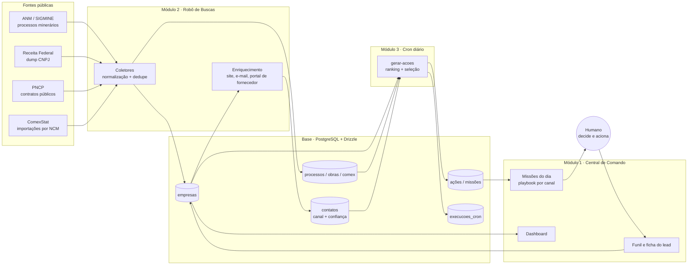

# Genesis: agentes de prospecção comercial B2B em produção

**Período:** julho de 2026 até hoje · **Papel:** idealização, arquitetura, código, operação e uso diário · **Estado:** em produção numa VPS própria, três instâncias

> Resumo em uma frase: um motor de agentes que lê fontes públicas de dados (concessões minerárias, cadastro de CNPJ, contratos públicos, importações), descobre quem compra o que eu vendo, encontra o canal de entrada e me entrega todo dia uma lista curta de missões comerciais com roteiro pronto.

## 1. Contexto e problema

Vendo suprimentos industriais (engates rápidos, abraçadeiras, mangueiras, válvulas) para mineradoras, empreiteiras e distribuidores. O gargalo nunca foi produto nem preço. Era saber **quem** acionar, **por onde** (portal de fornecedor, e-mail de suprimentos, telefone) e **quando**, com uma equipe comercial pequena.

Prospecção manual tinha três custos:

- Horas por semana pesquisando empresa por empresa, sem memória do que já foi feito.
- Leads frios: muita empresa listada, pouca com sinal de compra real.
- Zero rastreabilidade: nenhuma métrica de qual canal convertia.

Ferramentas de CRM e prospecção prontas não resolviam porque não conhecem as fontes brasileiras que importam neste nicho (ANM/SIGMINE, dump de CNPJ da Receita, PNCP, ComexStat) nem o conceito de "canal de entrada" em empresa industrial de grande porte, onde o caminho é o portal de homologação de fornecedores, e não um vendedor.

Restrição autoimposta: **100% open-source e self-hosted**. Nada de plataforma gerenciada paga. O sistema tinha que rodar local no começo (máquina sem Docker) e depois na VPS, sem reescrever.

## 2. Resultado até agora

| Indicador | Valor |
|---|---|
| Empresas carregadas (instância mineração, 7 UFs) | 35,8 mil |
| Processos minerários cruzados com empresas | 156 mil |
| Mineradoras com canal de entrada verificado (seed curado) | 25 |
| Missões geradas por dia (configurável) | 5 |
| Instâncias em produção | 3 (mineração, válvulas, obras do Metrô-SP) |
| Dependências pagas | 0 |

O que mudou na prática: a rotina comercial começa abrindo a Central de Comando, que já mostra as cinco empresas do dia, por que elas (fase do processo minerário, contrato vigente, UF importadora), o canal de entrada com link e o roteiro de contato. O funil (novo, contatado, cadastrado, aprovado, cotação, cliente) fica registrado por empresa, com anotações datadas.

As métricas de conversão por canal e de precisão da priorização ainda não foram consolidadas. É o que a seção 7 propõe medir, e é a parte que interessa ao trabalho acadêmico.

## 3. Arquitetura

### Módulos e fronteiras

- **Módulo 1, Interface** (Next.js 16, React 19, Tailwind 4). Server Components leem o banco direto via Drizzle; mutações por Server Actions. O frontend nunca fala com fonte externa.
- **Módulo 2, Robô de Buscas** (processos Node com `tsx`, Playwright e cheerio). Um coletor por fonte, cada um com `config`, `collect`, `normaliza` e `run`. Grava em `empresas` e nas tabelas de evidência (`processos_minerarios`, `obras_contratos`, `comex_importacoes`).
- **Módulo 3, Cron diário** (worker standalone com node-cron, sem Redis). Dois jobs: `coleta` e `gerar-acoes`. Cada rodada é registrada em `execucoes_cron` com detalhe em JSON.
- **Base transversal** (`lib/db`). Mesmo esquema e mesma API com dois drivers: PGlite embarcado em dev (Postgres em WASM, sem Docker) e PostgreSQL + pgvector na VPS. A troca é uma variável de ambiente.
- **Deploy**: Docker Compose com Postgres, app e worker; Postgres sem porta exposta; HTTPS por Caddy com certificado automático; autenticação básica no middleware; rota de health check; runbook de restauração testado.

### O padrão de instância

Cada nicho é um fork do motor com banco, porta e coletores próprios. A instância de mineração usa ANM + Receita; a de válvulas usa Receita (CNAE 2813-3 e razão social) + ComexStat (NCM 8481.80.95 por UF e município, porque não existe mais dado público por importador); a do Metrô usa a API do PNCP filtrada pelo CNPJ do órgão, onde cada contrato já traz o fornecedor vencedor. O código de interface, funil, cron e playbook é o mesmo. Mudar de nicho é escrever um coletor e ajustar a função de ranking.

## 4. O ciclo do agente

Uso a definição clássica de agente: percebe o ambiente, mantém estado, decide e age, e é avaliado por uma medida de desempenho. No Genesis cada parte está num módulo:

| Função cognitiva | Onde está | Como funciona hoje |
|---|---|---|
| **Percepção** | Coletores do Módulo 2 | Leitura periódica das fontes públicas; normalização de nomes (SIGMINE não tem CNPJ, o cruzamento com a Receita é por razão social normalizada) |
| **Memória** | Banco (empresas, contatos com confiança, funil, anotações, log do cron) | Idempotência por chave única em `contatos`; histórico de estágio por empresa; auditoria de cada rodada |
| **Raciocínio / decisão** | `gerar-acoes` | Ranking determinístico por sinais: canal conhecido, depois fase quente do processo (concessão de lavra), depois contrato vigente, depois porte. Exclui quem já tem ação aberta. Seleciona N por dia |
| **Ação** | Central de Comando + playbook | Gera a missão com objetivo (cadastrar no portal ou abrir relacionamento), tempo estimado e roteiro por tipo de canal, incluindo mensagem pronta. A ação externa é humana |
| **Aprendizado** | Ainda não existe em malha fechada | O funil registra o desfecho, mas o ranking ainda não é ajustado por ele. É o próximo passo |

Duas escolhas de projeto são deliberadas:

1. **Humano no circuito.** O agente não envia e-mail nem preenche portal sozinho. Em venda industrial B2B um primeiro contato ruim fecha a porta por anos. O agente reduz o custo de decidir; não decide.
2. **Sem dados pessoais raspados.** Contatos de pessoas são inseridos manualmente pelo usuário. O enriquecimento automático busca apenas canais institucionais (site, e-mail de suprimentos, portal de fornecedor).

## 5. Decisões de engenharia

- **PGlite em dev, Postgres em produção, mesmo código.** Permitiu começar numa máquina corporativa sem Docker e migrar para a VPS sem mudar uma linha de consulta. Custo: PGlite aceita um processo por vez, então app e worker não rodam juntos em dev.
- **Cron como processo Node, não como fila.** Sem Redis nem broker. O volume (algumas coletas e uma geração por dia) não justifica a complexidade; o log em tabela dá a observabilidade necessária.
- **Confiança por contato, não por empresa.** Cada canal tem fonte (curado, web, receita) e um número de 0 a 1. A missão mostra o canal de maior confiança. Isso separa dado verificado à mão de dado inferido.
- **Priorização explicável.** O ranking é uma soma de pesos legíveis. Quando a missão aparece, o usuário entende por que aquela empresa veio primeiro. Isso vai importar na comparação com um ranking por LLM (seção 7).
- **Fork por nicho em vez de multi-tenant.** Mais simples de operar e isolar falhas; o custo é duplicar correções. Aceitável com três instâncias; acima disso, vira um pacote compartilhado.

## 6. Lições

- **Raspar buscador não escala.** DuckDuckGo responde 202 (anti-bot); o Bing via Playwright só atende a primeira consulta da sessão. O pipeline de enriquecimento web ficou pronto e foi desativado. A fonte robusta é determinística: o cadastro da Receita traz e-mail e telefone oficiais; o custo é o dump de 5 GB e o cruzamento por nome.
- **Cada API pública tem regra escondida.** O PNCP recusa janelas de data maiores que um ano (HTTP 422) e devolve 204 para período vazio; o coletor fatia por ano e trata o vazio como normal.
- **Dado curado vale mais que volume.** 25 mineradoras com portal verificado geraram mais ação útil que 35 mil empresas sem canal. A métrica que importa é "leads acionáveis", não "leads".
- **Grandes obras não aparecem onde se espera.** Os consórcios das linhas do Metrô foram licitados antes de 2025 ou por outra via e não estão no PNCP do órgão. Entram por seed curado, com a obra ligada à construtora membro.
- **Operação faz parte do sistema.** Depois de um incidente de segurança que inutilizou os servidores físicos da empresa em setembro de 2026, este projeto e os demais passaram a ter backup com retenção imutável (Object Lock) e runbook de restauração testado. Um agente em produção que não volta de um desastre não é um agente em produção.

## 7. Próximos passos e plano de avaliação

A camada cognitiva planejada (Fase 4 do backlog) é onde o projeto encontra a pós-graduação. A proposta é tratar cada adição como um experimento com métrica definida antes de codar.

### Camadas a adicionar

1. **Personalização da mensagem por LLM local** (Ollama, Llama 3.1 ou Qwen 2.5). O playbook hoje é um template por canal. O LLM recebe empresa, substância ou obra, UF e canal, e gera a mensagem. Avaliação: taxa de resposta por mensagem gerada contra template, em teste A/B por semana.
2. **RAG sobre documentos do nicho** (pgvector, nomic-embed-text, 768 dimensões). Editais, normas de homologação de fornecedores, páginas de portal. Objetivo: o agente responder "o que esta empresa exige para homologar" a partir de fonte citada.
3. **Qualificação do lead por LLM** em paralelo ao ranking determinístico. Mesmos candidatos, duas listas. Avaliação: concordância entre as listas e, no desfecho do funil, qual lista acertou mais quem virou cotação.
4. **Malha fechada de aprendizado.** O desfecho do funil (cadastrado, aprovado, cotação, descartado) realimenta os pesos do ranking. Começa com ajuste manual mensal e evolui para ajuste automático.

### Métricas que passam a ser coletadas

| Métrica | Como medir | Por que importa |
|---|---|---|
| Precisão da priorização | % das missões do dia que avançam no funil em 30 dias | Mede se o raciocínio escolhe bem |
| Taxa de resposta por canal | respostas / contatos, por tipo de canal | Define onde o agente deve concentrar esforço |
| Conversão por etapa | novo, contatado, cadastrado, cotação, cliente | Funil completo, por instância |
| Custo por lead acionável | horas humanas + infra / leads com canal verificado | Compara com prospecção manual |
| Tempo humano por missão | estimado vs. real, registrado na conclusão | Mede o ganho operacional de verdade |
| Concordância regra vs. LLM | sobreposição das listas e acerto no desfecho | Decide se o LLM entra no ranking ou só na mensagem |

### Possíveis recortes para trabalho acadêmico

- Agente híbrido (regras explicáveis + LLM) para priorização de leads B2B: comparação controlada em produção.
- Arquitetura de agente com humano no circuito para decisões de alto custo de erro: quando o agente deve parar.
- Percepção a partir de dados públicos brasileiros fragmentados: integração ANM, Receita, PNCP e ComexStat como ambiente do agente.

## 8. Stack

Next.js 16 · React 19 · TypeScript · Tailwind 4 · Drizzle ORM · PostgreSQL 16 + pgvector · PGlite · Playwright · cheerio · node-cron · Ollama · Docker Compose · Caddy · Ubuntu numa VPS própria.

## 9. Código

O código das três instâncias é privado: contém a lógica de priorização e o seed curado de canais, que são a vantagem comercial do negócio. Pode ser apresentado em entrevista ou avaliação acadêmica com dados sintéticos. Documentos de arquitetura, banco, deploy e runbook de restauração existem no repositório e seguem este case.
