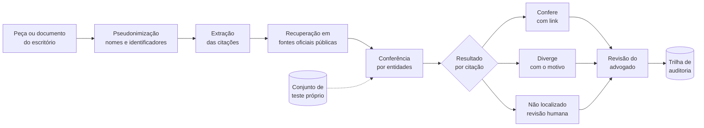

# IA jurídica que cita ou se abstém: cada citação conferida na fonte oficial

**Período:** novembro de 2026 até hoje · **Papel:** idealização, pesquisa, arquitetura, código e operação · **Estado:** piloto fechado, sob confidencialidade

> Resumo em uma frase: um produto de IA para advogados, construído em torno de uma regra simples: nenhuma citação passa sem ser conferida numa fonte oficial, e quando a fonte não confirma, o sistema diz "não localizado" em vez de dar um palpite.

**Sobre este case.** O produto está em piloto fechado, e a estratégia (área de entrada, fontes, método interno, preço) fica sob confidencialidade até o lançamento. Por isso este case mostra os princípios, a arquitetura em alto nível e a forma de trabalhar, e não mostra código, prompts, conjunto de teste nem números de avaliação. Em entrevista, posso mostrar a arquitetura com mais detalhe.

## 1. O problema

Os modelos de linguagem já redigem bem uma petição. O problema está nas citações: eles citam precedentes que não existem, ou que existem mas não dizem o que a peça afirma, com número, relator e data plausíveis. Para o advogado, o erro custa caro, e tribunais brasileiros já aplicaram multas por jurisprudência inexistente e oficiaram a OAB.

A literatura confirma o risco. Estudos de Stanford mediram alucinação em perguntas jurídicas tanto em modelos de uso geral (Dahl et al., 2024) quanto em ferramentas jurídicas especializadas com recuperação de documentos (Magesh et al., 2024). Ou seja, ligar um buscador ao modelo reduz o problema, mas não resolve.

A pergunta de produto passou a ser: **como fazer uma IA jurídica em que o advogado possa confiar sem reler tudo?**

## 2. Os princípios

| Princípio | O que significa na prática |
|---|---|
| **Citar ou se abster** | Toda afirmação que se apoia num precedente precisa de uma fonte oficial recuperada. Sem fonte, o sistema não completa a lacuna: marca o item para revisão |
| **Conferir por entidades, não por semelhança** | Dois acórdãos podem ter texto parecido e ser de outro tribunal, outro relator ou outro ano. A busca por semelhança serve para achar candidatos; a confirmação é feita pelos dados que identificam a decisão (tribunal, número, relator, data) |
| **"Não localizado" é uma resposta válida** | Um falso "confere" custa uma multa; um "não localizado" custa uma conferência manual. O sistema foi desenhado para errar para o lado da dúvida |
| **Dado pessoal não sai sem máscara** | Nomes, CPFs e outros identificadores viram marcadores antes de qualquer envio a um modelo de IA e voltam ao nome real só na resposta, dentro do sistema |
| **Medir antes de prometer** | Um conjunto de teste próprio mede o verificador a cada mudança. O compromisso é publicar o resultado e os limites conhecidos no lançamento |
| **O advogado decide, a ferramenta confere** | Cada resultado vem com o link da fonte oficial, e o que a IA fez e quem revisou fica numa trilha de auditoria |

## 3. Arquitetura em alto nível

| Parte | Como funciona |
|---|---|
| Fontes | Só bases oficiais e públicas. Quando a fonte está fora do ar ou não cobre um tribunal, o sistema diz isso, em vez de tratar a ausência como "não existe" |
| Modelos de IA | Usados onde a linguagem ajuda (ler, extrair, redigir), nunca como fonte de verdade sobre um precedente |
| Pseudonimização | Feita dentro do servidor, antes de qualquer envio a um modelo externo. Na dúvida, mascara |
| Avaliação | Conjunto de teste próprio, rodado a cada mudança do verificador |
| Auditoria | Registro de quem fez o quê, do que a IA produziu e do que foi revisado, exportável pelo escritório |

## 4. Como o produto é construído

- **Uma versão por recurso, cada uma documentada.** Cada mudança tem um documento com o problema, a regra, os testes e o registro da publicação. Da primeira versão no ar, em 09/11/2026, à 0.58.0, em 27/11/2026, foram 19 dias.
- **Regra legal conferida no texto oficial antes do código.** Quando o produto calcula algo previsto em lei, a regra é lida na fonte oficial, e o teste cita o artigo. Onde a lei deixa dúvida, o sistema mostra a dúvida em vez de escolher um lado em silêncio.
- **Testes que acompanham o produto.** Mais de 1.300 verificações automatizadas, entre regras puras, banco de dados temporário por teste e conferências de ponta a ponta. Toda versão passa por elas, além da conferência da tela no navegador.
- **Publicação com volta garantida.** Antes de cada publicação, o código e o banco são copiados e conferidos. O código em produção é comparado, arquivo a arquivo, com a versão anterior do repositório. Depois, saúde, versão, migrações e log são verificados.
- **Confidencialidade como decisão de produto.** No primeiro dia, um documento classificou cada informação: o que pode ser dito agora, o que só sob acordo de confidencialidade e o que nunca sai. Este case segue esse documento.

## 5. Lições

- **Em domínio regulado, "não sei" é um recurso.** O usuário confia mais numa ferramenta que admite não ter achado do que numa que sempre responde.
- **Recuperação não é verificação.** Achar o documento certo é metade do trabalho; confirmar que ele diz o que a peça afirma é a outra metade, e é ela que evita a multa.
- **A avaliação vem antes do marketing.** Sem um conjunto de teste próprio, qualquer frase sobre "confiabilidade" é opinião. Com ele, vira um número que pode ser publicado e cobrado.
- **Construir rápido não é validar.** A velocidade de construção com agentes de IA é real, mas quem decide o roteiro a partir daqui são os escritórios do piloto.

## 6. Próximos passos

1. **Piloto** com escritórios, sob acordo de confidencialidade.
2. **Lançamento** com o resultado do conjunto de teste publicado, o método em alto nível e os limites conhecidos.
3. **Case completo** neste portfólio, no formato do [Escrituro](escrituro.md) e do [Clinalta](clinalta.md), depois do lançamento.

## 7. Stack e código

Next.js 16 · React 19 · TypeScript · Drizzle ORM · PostgreSQL (PGlite no desenvolvimento) · Claude API · Docker numa VM ARM na Oracle Cloud em São Paulo, atrás do Caddy.

O código é privado. Mostro a arquitetura em entrevista, dentro do que a confidencialidade do piloto permite.
