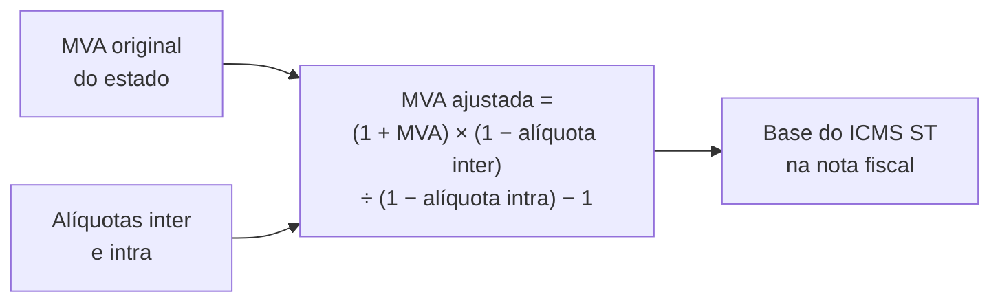
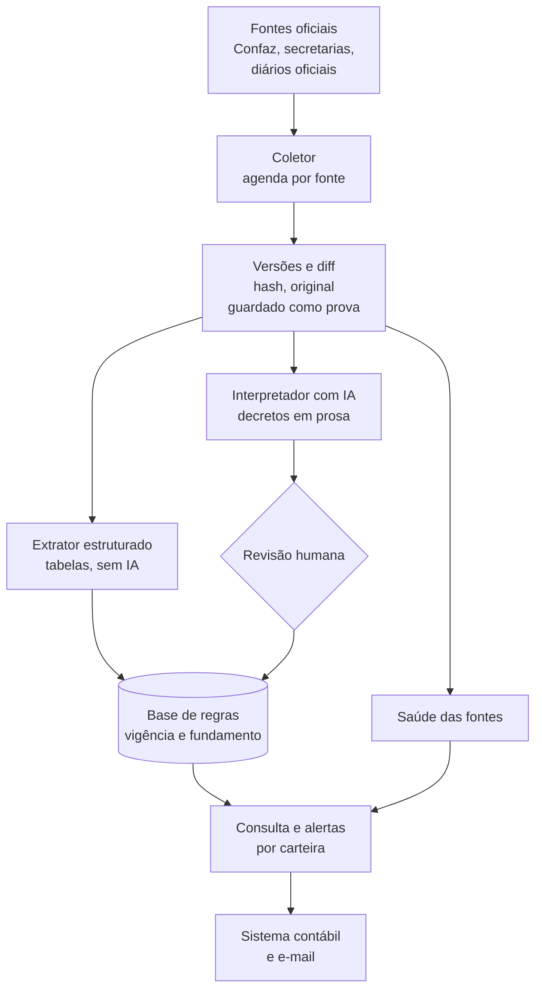

# ICMS ST: vigiar a legislação que muda sem aviso

**Período:** novembro de 2026 até hoje · **Papel:** idealização, levantamento das fontes, arquitetura, código, validação e publicação · **Estado:** Fase 0 em produção (monitor coletando e avisando); Fase 1 em andamento, primeiro conjunto de dados publicado

> Resumo em uma frase: num dia de trabalho saí de uma dor de quem vende mercadoria ("a regra de ICMS ST muda e ninguém me avisa") para um monitor em produção que vigia as normas do Confaz e de São Paulo, guarda cada versão como prova e avisa por e-mail o que mudou e desde quando, mais um conjunto de dados aberto com os 1.043 CESTs vigentes do Convênio 142/2018 e o histórico de cada item, validado contra a lista oficial de São Paulo.

## 1. Contexto e problema

Na substituição tributária do ICMS, quem vende recolhe antecipadamente o imposto da cadeia inteira. Para isso precisa saber, para cada produto e cada estado de destino, se a mercadoria está sujeita ao regime, qual a margem de valor agregado (MVA), qual a alíquota e se há adicional de fundo de pobreza. Essas regras mudam por decreto, portaria ou convênio, em 27 estados e no Confaz, sem aviso a quem é afetado.

Na empresa de distribuição do meu grupo, a cotação de venda já calcula ST por item. O cálculo é bom; o parâmetro é que envelhece. A contabilidade não avisa quando uma MVA muda, porque também não acompanha tudo, e o mercado resolve isso com consultorias tributárias de mais de mil reais por mês, que no fim leem as mesmas fontes públicas.

A inspiração veio de um projeto apresentado na comunidade da pós: um "oráculo" das normas internas de um tribunal, com busca híbrida sobre milhares de resoluções. A diferença importante: aqui a resposta não é um trecho de texto, é um número que entra numa nota fiscal. Erro vira autuação. Por isso o desenho é de monitor com fonte e data, não de chat.

## 2. Como a regra funciona

Uma única resposta ("esta mangueira, de SP para MG, importada, tem MVA ajustada de X%") depende de cinco camadas de norma, cada uma com fonte e ritmo próprios.

| Camada | O que define | Quem publica |
|---|---|---|
| Lista nacional de bens | Quais mercadorias podem ter ST, com CEST, NCM e descrição (Convênio ICMS 142/2018) | Confaz |
| Adoção pelo estado | Quais itens o estado sujeita à ST e com qual MVA original | Cada secretaria da Fazenda |
| Acordo interestadual | Se o vendedor de um estado retém ST para outro, por segmento | Protocolos e convênios do Confaz |
| Alíquotas | Interna do destino, interestadual (4%, 7% ou 12%) e fundo de pobreza | Leis e regulamentos estaduais, Senado |
| Modalidade | Nacional ou importado, remetente do Simples, redução de base | Convênio 142 e regras estaduais |

A MVA ajustada quase nunca é publicada: é calculada a partir da original e das alíquotas.



Duas consequências para o desenho: a chave não é o NCM, é CEST mais descrição (um NCM pode cair em vários itens); e todo número precisa de vigência e fundamento, porque fiscalização é retroativa.

## 3. O que o levantamento das fontes revelou

Antes de código, três agentes em paralelo levantaram como o Confaz e seis estados (SP, MG, RJ, PR, RS, SC) publicam suas regras, abrindo cada página e confirmando cada endereço. Também mapearam o que os fornecedores comerciais entregam.

| Achado | Evidência (novembro de 2026) | O que muda no projeto |
|---|---|---|
| Não existe API nem planilha oficial de ST | Confaz publica o Convênio 142 só como uma página HTML de cerca de 930 KB; nenhum dos seis estados tem dado aberto de ST | O produto é, antes de tudo, um extrator e versionador de páginas |
| São Paulo está saindo da ST | Autopeças, ferramentas, materiais elétricos, pneus e tintas saíram em 01/10/2026; materiais de construção saem em 01/02/2027 | Exclusão de segmento é evento de primeira classe, com data de efeitos, não só mudança de percentual |
| Cada estado publica de um jeito | SC mantém redações passadas no próprio HTML; MG publica PDF com notas de efeitos; RJ guarda a lista consolidada num .doc de 2023; PR tem a MVA num PDF de 565 páginas sem consolidação | Ordem de ataque por qualidade da fonte: SC e MG primeiro, PR por último |
| Alguns portais bloqueiam acesso de fora do Brasil | O portal do RJ recusa endereços estrangeiros; o do RS tem certificado TLS inválido | O coletor roda em servidor no Brasil e trata certificado por fonte |
| Os concorrentes vendem "atualização diária" | Consultas web, simuladores e APIs para grandes empresas; nenhum oferece histórico versionado por item nem alerta cruzado com a carteira de clientes de um escritório | Diferencial: o parâmetro aplicado no sistema contábil, com o que mudou, quando e por qual norma |

Uma correção de rumo honesta: a ideia nasceu para a empresa do grupo, mas o levantamento mostrou que, com a saída de São Paulo, o ganho dela está nas vendas para outros estados. O valor maior está em servir escritórios de contabilidade, que atendem dezenas de empresas, e por isso o monitor nasce como módulo do [Escrituro](escrituro.md).

## 4. Arquitetura

O motor é um serviço separado, com banco próprio; o sistema contábil conversa com ele por uma API interna. Um problema no coletor não derruba o sistema contábil, e o mesmo motor pode servir outros sistemas.



Duas regras de projeto que valem em todas as fases:

- **Nada é sobrescrito.** Uma mudança encerra a vigência de uma regra e abre outra. Consulta em data passada tem que funcionar.
- **Tabela entra direto; texto passa por revisão.** O que vem de tabela é extraído de forma determinística e testável. O que vem de decreto em prosa ("fica alterado o item 12 do Anexo XV") passa pela IA e por revisão humana até a precisão por estado ser medida.

## 5. Fase 0: o monitor em produção

A fundação vigia hoje 12 fontes: o Convênio 142, os índices anuais de convênios, protocolos e preços de combustíveis do Confaz, e em São Paulo a lista de mercadorias, as quatro portarias de MVA ainda vigentes, os artigos de alíquota, a lista de atos recentes e a busca no Diário Oficial filtrada pela Fazenda.

Cada página vira texto com uma linha por item de tabela, para que a mudança de uma MVA apareça como uma linha (exemplo ilustrativo):

```
- 2 | Argamassas | 10.002.00 | 3816.00.1 3824.50.00 | 70%
+ 2 | Argamassas | 10.002.00 | 3816.00.1 3824.50.00 | 75%
```

O trabalho mais fino foi evitar alarme falso, porque um monitor que grita à toa é desligado na primeira semana:

| Regra | Por quê |
|---|---|
| A data de "última atualização" do portal fica fora da comparação | O portal republica a página sem mudar o conteúdo |
| Em listas, só gera aviso o que entrou | Ato que sai da janela de 30 dias não é notícia |
| Uma nova tentativa antes de registrar erro | Portal de governo falha por minutos; na primeira semana isso aconteceu e foi pego |
| Versão do extrator registrada em cada coleta | Melhorar o extrator muda o texto; sem isso, cada melhoria dispararia dezenas de avisos falsos |
| Monitor do monitor | Avisa quando uma fonte erra seguidamente, para de responder, perde o conteúdo esperado ou encolhe de repente |

Os avisos chegam por e-mail: problema de fonte (repetido só se mudar ou depois de 24 horas, e com aviso quando volta ao normal) e cada mudança de norma, uma única vez, com as linhas que entraram e saíram e o link da fonte. A base e as páginas originais entram no backup de hora em hora, com cópia imutável fora do servidor.

## 6. Fase 1: o Convênio 142 em dados abertos

O primeiro conjunto de dados está publicado em [github.com/thiagogardev/icms-st-dados](https://github.com/thiagogardev/icms-st-dados): a lista nacional de bens sujeitos à ST, com a vigência de cada redação. O Confaz marca a história de cada item só por cor e por notas de texto livre:

```
Nova redação dada ao item 42.0 do Anexo II pelo Conv. ICMS 66/22, efeitos a partir de 02.05.22.
42.0 | 01.042.00 | 8421.32.00 | Depuradores ...        (redação atual)
Redação original, efeitos até 01.05.22.
42.0 | 01.042.00 | 8421.39.20 | Depuradores ...        (redação antiga, em verde)
```

O extrator lê essas notas, com erros de digitação e tudo ("sem feitos", "item14"), e transforma cada item em linhas com início e fim de vigência, situação na data de referência e convênio que fez a mudança.

| Resultado | Valor |
|---|---|
| CESTs vigentes | 1.043, um por CEST |
| Redações no histórico | 1.220 (136 anteriores, 12 revogadas, 29 que nunca tiveram efeito) |
| Segmentos | 25 |
| Itens do Anexo XXVII (escala industrial não relevante) | 222 |
| Notas de alteração sem dono | 0 |
| Inconsistências da própria fonte, registradas | 5 |

A validação teve três camadas: casos conhecidos conferidos à mão (os fogões incluídos em 01/11/2026, a troca de NCM da água de coco em 01/06/2024, um item revogado em 01/01/2020); verificações automáticas (cada CEST vigente uma única vez, todo CEST com segmento existente, cada anexo com um só segmento); e cruzamento com uma fonte independente, a lista oficial de São Paulo. Dos 762 CESTs que ela cita, todos existem no conjunto; 756 estão vigentes e os 6 restantes são exatamente itens que o próprio convênio revogou.

A página do Confaz tem erros próprios, e eles não foram "corrigidos" por conta própria: a nota de alteração do item 85.0 repete, por erro de cópia, o número do item 63.0; quatro redações antigas estão formatadas como se valessem hoje. Cada caso foi tratado pelo contexto e registrado num arquivo público, para quem usar os dados saber onde a fonte falha.

## 7. Como se mede

O sistema só vale se for medido com um padrão de comparação independente e com métricas que um escritório entende. São quatro perguntas:

| Pergunta | Métrica | Como medir | Meta inicial |
|---|---|---|---|
| Percebe quando uma norma muda? | Recall de detecção | Lista de alterações do mês montada a partir do diário oficial, comparada com os eventos gerados | 98% em SP, 95% nos demais |
| Avisa à toa? | Precisão de detecção | Proporção de eventos que correspondem a mudança real de parâmetro | 90% |
| O número extraído está certo? | Exatidão por campo | Amostra conferida na norma e na apuração real, separada por caminho (tabela ou texto) | 99% tabela, 95% texto antes da revisão |
| Chega a tempo? | Latência | Diferença entre a publicação e a detecção | Mediana abaixo de 24 horas |

A fila de revisão humana é o instrumento de medida: cada aprovação, correção e rejeição é um rótulo, e em poucos meses o sistema gera o seu próprio conjunto de teste por estado e por tipo de norma.

Para a pós, o experimento central é a extração de parâmetros fiscais a partir de texto normativo: comparar a IA com esquema de saída fixo contra uma linha de base por expressões regulares e contra a extração de tabelas, medindo exatidão por campo e por estado. Um segundo experimento é o enquadramento de NCM em CEST por similaridade de descrição, avaliado por Precision@K, a mesma métrica do [Genesis](genesis.md).

O que já foi medido na Fase 0: três coletas completas seguidas sem nenhum aviso falso nas 12 fontes, e o mesmo resultado, caractere por caractere, no computador de desenvolvimento e no servidor. O critério para encerrar a fase é de 30 dias de coleta sem falha silenciosa.

## 8. Números

Tudo em 8 de novembro de 2026.

| Medida | Valor |
|---|---|
| Agentes de pesquisa em paralelo no levantamento das fontes | 3 |
| Estados com fontes mapeadas | 6, mais o Confaz |
| Fontes vigiadas em produção | 12 |
| Testes automatizados | 19 no monitor, 10 no extrator do convênio |
| Coletas completas seguidas sem aviso falso | 3 |
| CESTs vigentes no conjunto de dados | 1.043 |
| CESTs da lista de SP encontrados no conjunto | 762 de 762 |
| Defeitos do meu próprio código pegos pelos testes e pela validação antes de publicar | 7 (3 no monitor, 4 no extrator) |

O último número é o que mais importa. No monitor: duas versões coletadas no mesmo segundo gravavam o original uma por cima da outra; quebras de linha dentro das células do Confaz partiam cada item em pedaços; e cada melhoria do extrator disparava avisos falsos. No extrator do convênio: o segmento deduzido pelo número do anexo (os códigos têm lacunas), linhas de item com formatação de título ignoradas, uma checagem de validação no lugar errado e o pior deles: a página do Confaz mantém o item revogado como uma linha normal com a descrição "REVOGADO", e a primeira versão do extrator publicava essas linhas como itens vigentes. A validação cruzada pegou antes da publicação, e um teste impede que volte.

O que não está feito, dito com a mesma clareza: a Fase 0 ainda não completou os 30 dias; o e-mail de mudança real foi testado só com dados simulados, porque nenhuma norma vigiada mudou desde a entrada em produção; a matriz de protocolos entre estados ainda não existe; a MVA de nenhum estado está estruturada; o interpretador com IA e a fila de revisão ainda não foram construídos.

## 9. Lições

- **Tempo real não existe em legislação.** O que existe é "detectado em até tantas horas depois da publicação, com efeitos a partir de tal data". É mais honesto e é o que importa para quem aplica.
- **A validação cruzada pega o que o teste não pega.** Os testes passavam; foi o cruzamento com a lista de São Paulo e a contagem de CESTs vigentes que mostrou que itens revogados estavam saindo como vigentes.
- **A fonte oficial também erra.** Nota copiada com o número errado, redação antiga formatada como atual. Registrar a inconsistência em público vale mais do que escondê-la numa correção silenciosa.
- **Silêncio não é saúde.** Um coletor que parou e um coletor que não encontrou mudança produzem o mesmo log. Sem o monitor do monitor, 30 dias de "nenhuma mudança" não provariam nada.
- **Pesquisar antes de prometer.** A suposição inicial era cobrir a ST interna de São Paulo; o levantamento mostrou o estado saindo do regime. Mudou o foco antes de uma linha de código.

## 10. Próximos passos

Cada fase tem um critério de pronto verificável.

1. **Fase 0, fundação (no ar).** Portão: 30 dias de coleta sem falha silenciosa e toda mudança detectada em até 24 horas.
2. **Fase 1, base nacional (em andamento).** Convênio 142 publicado; falta a matriz de protocolos e convênios entre estados por segmento, que não existe pronta em lugar nenhum. Portão: matriz conferida manualmente em 20 pares de estados e publicada como dado aberto.
3. **Fase 2, São Paulo.** Segmentos que ainda têm ST, revogações de 2026 e 2027 com regra de estoque, interpretador com IA e fila de revisão, consulta por NCM com MVA ajustada. Portão: 50 consultas batendo com a apuração real.
4. **Fase 3, Sul e Sudeste.** SC, MG, RJ, RS e PR, nessa ordem, com alerta por carteira e integração no sistema contábil. Portão: precisão acima de 95% por estado e um escritório piloto usando.
5. **Fase 4, demais estados**, por ordem de demanda, com revisão por amostragem onde a precisão permitir.

O horizonte também está no desenho: a reforma tributária reduz o ICMS a partir de 2029 e a ST tende a encolher. O motor de vigilância legislativa (coletar, versionar, detectar, interpretar, avisar) é o mesmo que os escritórios vão precisar para o IBS e a CBS.

## 11. Stack e código

Python 3 · httpx · lxml · SQLite na Fase 0, desenhado para PostgreSQL · agendamento por cron em servidor no Brasil · avisos por e-mail via Resend · backup horário com cópia imutável.

O conjunto de dados e o extrator do Convênio 142 são públicos, com licença aberta: [github.com/thiagogardev/icms-st-dados](https://github.com/thiagogardev/icms-st-dados). O monitor é privado, porque vai operar dentro de um produto comercial; pode ser apresentado em entrevista ou avaliação acadêmica.
