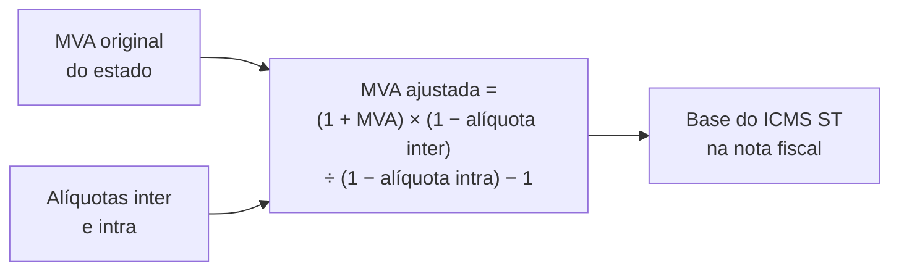
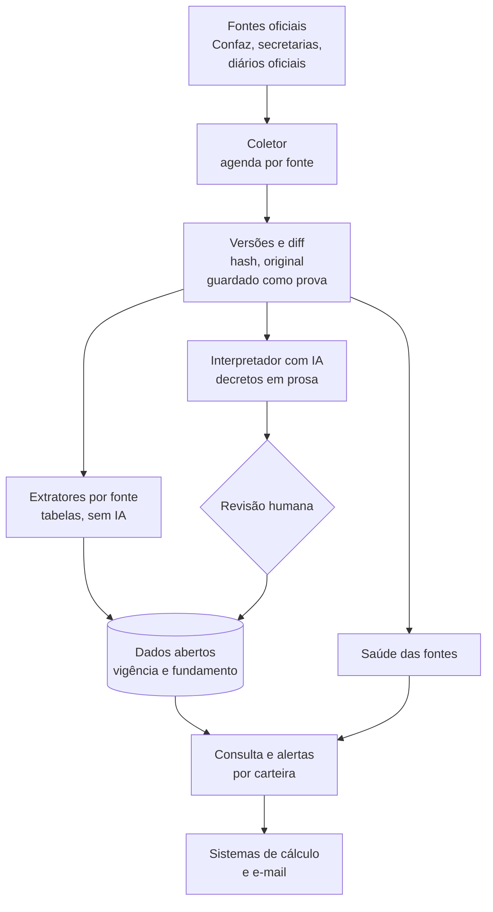

# ICMS ST: vigiar a legislação que muda sem aviso

**Período:** novembro de 2026 até hoje · **Papel:** idealização, levantamento das fontes, arquitetura, código, validação e publicação · **Estado:** Fase 0 em produção (37 fontes vigiadas); Fase 1 publicada (Convênio 142 e matriz de protocolos origem para destino); sete estados com lista e MVA estruturadas; parâmetros já conferidos contra o sistema de cotação de uma empresa real

> Resumo em uma frase: em dois dias saí de uma dor de quem vende mercadoria ("a regra de ICMS ST muda e ninguém me avisa") para um monitor em produção que vigia 37 fontes oficiais e avisa o que mudou e desde quando, mais dados abertos com o histórico de cada item, a matriz que diz de qual estado para qual o remetente retém o imposto e a MVA de sete estados, cruzados entre si e já usados para conferir o cálculo de um sistema em produção.

## 1. Contexto e problema

Na substituição tributária do ICMS, quem vende recolhe antecipadamente o imposto da cadeia inteira. Para isso precisa saber, para cada produto e cada estado de destino, se a mercadoria está sujeita ao regime, qual a margem de valor agregado (MVA), qual a alíquota e se há adicional de fundo de pobreza. Essas regras mudam por decreto, portaria ou convênio, em 27 estados e no Confaz, sem aviso a quem é afetado.

Na empresa de distribuição do meu grupo, a cotação de venda já calcula ST por item. O cálculo é bom; o parâmetro é que envelhece. A contabilidade não avisa quando uma MVA muda, porque também não acompanha tudo, e o mercado resolve isso com consultorias tributárias de mais de mil reais por mês, que no fim leem as mesmas fontes públicas.

A inspiração veio de um projeto apresentado na comunidade da pós: um "oráculo" das normas internas de um tribunal, com busca híbrida sobre milhares de resoluções. A diferença importante: aqui a resposta não é um trecho de texto, é um número que entra numa nota fiscal. Erro vira autuação. Por isso o desenho é de monitor com fonte e data, não de chat.

## 2. Como a regra funciona

Uma única resposta ("esta abraçadeira, de SP para MG, tem MVA de X%") depende de cinco camadas de norma, cada uma com fonte e ritmo próprios.

| Camada | O que define | Quem publica |
|---|---|---|
| Lista nacional de bens | Quais mercadorias podem ter ST, com CEST, NCM e descrição (Convênio ICMS 142/2018) | Confaz |
| Adoção pelo estado | Quais itens o estado sujeita à ST e com qual MVA original | Cada secretaria da Fazenda |
| Acordo interestadual | Se o vendedor de um estado retém ST para outro, por segmento | Protocolos e convênios do Confaz |
| Alíquotas | Interna do destino, interestadual (4%, 7% ou 12%) e fundo de pobreza | Leis e regulamentos estaduais, Senado |
| Modalidade | Nacional ou importado, remetente do Simples, redução de base | Convênio 142 e regras estaduais |

A MVA ajustada quase nunca é publicada: é calculada a partir da original e das alíquotas.



Duas consequências para o desenho: a chave não é o NCM, é CEST mais descrição (um NCM pode cair em vários itens); e todo número precisa de vigência e fundamento, porque fiscalização é retroativa.

## 3. O que o levantamento das fontes revelou

Antes de código, três agentes em paralelo levantaram como o Confaz e seis estados publicam suas regras, abrindo cada página e confirmando cada endereço. Depois, cada estado lido trouxe sua surpresa.

| Achado | Evidência (novembro de 2026) | O que muda no projeto |
|---|---|---|
| Não existe API nem planilha oficial de ST | Confaz publica o Convênio 142 só como uma página HTML de cerca de 930 KB; nenhum estado lido tem dado aberto de ST | O produto é, antes de tudo, um extrator e versionador de páginas |
| São Paulo está saindo da ST | Autopeças, ferramentas, materiais elétricos, pneus e tintas saíram em 01/10/2026; materiais de construção saem em 01/02/2027 | Exclusão de segmento é evento de primeira classe, com data de efeitos |
| Cada estado publica num formato | MG em HTML por capítulo; PR num PDF consolidado de cerca de 590 páginas; RS o regulamento inteiro numa página de 10 MB; BA um PDF por período, de 2012 até hoje | Um leitor por estado, todos com a mesma saída: item, CEST, NCM, MVA e vigência |
| Servidores incompletos ou fechados | Dois portais não enviam o certificado intermediário no TLS; um terceiro só responde a navegador e recusa coleta automática até de servidor no Brasil | Cadeia de certificados completada a partir do endereço que o próprio certificado indica, com a verificação ligada; o estado fechado fica fora do monitor até haver outra fonte |
| Os concorrentes vendem "atualização diária" | Consultas web e simuladores; nenhum oferece histórico versionado por item nem alerta cruzado com a carteira de clientes de um escritório | Diferencial: o parâmetro aplicado no sistema, com o que mudou, quando e por qual norma |

A ideia nasceu para a empresa do grupo, mas o levantamento mostrou que o valor maior está em servir escritórios de contabilidade, que atendem dezenas de empresas, e por isso o monitor nasce como módulo do [Escrituro](escrituro.md).

## 4. Arquitetura

O motor é um serviço separado, com banco próprio; o sistema contábil conversa com ele por uma API interna. Um problema no coletor não derruba o sistema contábil, e o mesmo motor pode servir outros sistemas.



Três regras de projeto que valem em todas as fases:

- **Nada é sobrescrito.** Uma mudança encerra a vigência de uma regra e abre outra. Consulta em data passada tem que funcionar.
- **Tabela entra direto; texto passa por revisão.** O que vem de tabela é extraído de forma determinística e testável. O que vem de decreto em prosa ("fica alterado o item 12 do Anexo XV") passa pela IA e por revisão humana até a precisão por estado ser medida.
- **Dado e decisão ficam separados.** Os dados abertos dizem o que a norma diz. Quando a empresa decide não aplicar uma regra a um produto, isso fica numa lista de decisões, com motivo e data, no sistema que usa os dados.

## 5. Fase 0: o monitor em produção

O monitor vigia hoje 37 fontes: o Convênio 142 e os índices anuais do Confaz; os 13 protocolos vigentes que São Paulo assina (11 de materiais de construção, autopeças e eletrônicos); a lista e as portarias de MVA de São Paulo, os artigos de alíquota, os atos recentes e a busca no Diário Oficial; e as leis de ST de MG, PR, RS, BA, MT, PE e AL. Cada página vira texto com uma linha por item de tabela, para que a mudança de uma MVA apareça como uma linha:

```
- 2 | Argamassas | 10.002.00 | 3816.00.1 3824.50.00 | 70%
+ 2 | Argamassas | 10.002.00 | 3816.00.1 3824.50.00 | 75%
```

O trabalho mais fino foi evitar alarme falso, porque um monitor que grita à toa é desligado na primeira semana:

| Regra | Por quê |
|---|---|
| A data de "última atualização" do portal fica fora da comparação | O portal republica a página sem mudar o conteúdo |
| Em listas, só gera aviso o que entrou | Ato que sai da janela de 30 dias não é notícia |
| Uma nova tentativa antes de registrar erro | Portal de governo falha por minutos |
| Versão do extrator registrada em cada coleta | Melhorar o extrator muda o texto; sem isso, cada melhoria dispararia dezenas de avisos falsos |
| Monitor do monitor | Avisa quando uma fonte erra seguidamente, para de responder, perde o conteúdo esperado ou encolhe de repente |
| Normas em PDF lidas como texto | Um PDF regerado com o mesmo conteúdo não gera aviso, e o aviso de mudança mostra o trecho, não só "o arquivo mudou" |

O monitor do monitor já pagou o investimento: quando entrou a página única de 10 MB do RS, a verificação de saúde acusou na hora que a tabela de construção não estava no texto vigiado (o título usava um espaço não separável que o seletor não reconhecia). Sem ela, o estado teria ficado meses "sem mudança" sem estar sendo vigiado.

## 6. Fase 1: dados abertos

Tudo está publicado em [github.com/thiagogardev/icms-st-dados](https://github.com/thiagogardev/icms-st-dados), com código, testes e licença aberta.

### 6.1 Convênio 142 com vigência por redação

A lista nacional de bens sujeitos à ST. O Confaz marca a história de cada item só por cor e por notas de texto livre; o extrator lê essas notas, com erros de digitação e tudo, e transforma cada item em linhas com início e fim de vigência.

| Resultado | Valor |
|---|---|
| CESTs vigentes | 1.043, um por CEST |
| Redações no histórico | 1.220 |
| CESTs da lista oficial de São Paulo encontrados | 762 de 762 |
| Inconsistências da própria fonte, registradas em público | 5 |

### 6.2 A matriz de protocolos: de SP para quais estados

Os 11 protocolos de materiais de construção com SP, lidos com a vigência de cada item, viram uma matriz: para cada NCM e estado de destino, se o vendedor paulista retém a ST, por qual protocolo e com qual MVA, quando o protocolo a fixa. São 2.290 redações, 486 itens vigentes e 672 linhas para 12 estados.

O que a leitura mostrou e não estava em lugar nenhum:

- **Dois modelos de lista.** Nove protocolos têm lista própria. RS e AP/PA trocaram a lista por uma referência ao anexo de construção do Convênio 142, menos os CESTs que a cláusula primeira exclui. Quem lê só "Anexo Único revogado" conclui, errado, que a ST para o RS acabou.
- **A MVA nem sempre está no protocolo.** Em 6 dos 11 ela vem da lei do estado de destino, o que definiu a etapa seguinte.
- **A limpeza de 2026.** Em 01/01/2026 e 01/08/2026 os protocolos perderam dezenas de itens. Exemplo concreto: a abraçadeira saiu do protocolo com Mato Grosso, e a base comercial de referência consultada ainda o listava.
- **Três erros nas páginas do Confaz**, como a nota que revoga o item 69 seguida da linha "80. REVOGADO", registrados em público.

Depois de construção, a mesma leitura passou para os outros segmentos. Autopeças entraram pelo protocolo multilateral que SP assina: a lista inteira de autopeças do Convênio 142, menos seis códigos, para 15 estados de destino. Os seis protocolos que SP tinha com o RJ em outros segmentos trouxeram outra lição: cinco foram revogados em 2026 (bebidas, farmacêuticos, cosméticos, limpeza e ferramentas), e só o de eletrônicos segue. O leitor não percebia a revogação do protocolo inteiro, que fica numa nota no cabeçalho da página, e passou a perceber. Um caso concreto: de SP para o RJ, o alicate perdeu a ST com o fim do protocolo de ferramentas, mas a furadeira elétrica continua, porque também está no de eletrônicos.

Por fim, a matriz deixou de ser só de São Paulo. O sentido de cada protocolo está na redação: "destinadas ao Estado de MG **ou** ao Estado de SP" vale nos dois sentidos, "destinadas ao Estado do ES" só de SP para lá. Com isso a matriz responde para qualquer remetente signatário: são 24.512 linhas entre 16 origens. As linhas com destino SP ficam marcadas, porque a aplicação nas entradas em SP depende de um ato do Secretário da Fazenda que nunca foi editado.

### 6.3 A MVA dos estados, cruzada com os protocolos

Para os estados cujo protocolo não traz MVA, o passo seguinte foi ler a lei estadual. Cada um tem um formato, e cada leitor devolve a mesma estrutura.

| Estado | Fonte e formato | Itens | Cruzamento com o protocolo de SP |
|---|---|---|---|
| MG | RICMS/2023, Anexo VII, HTML por capítulo | 1.032 | 69 coerentes, 4 conflitos reais, 3 que casam só pelo NCM |
| PR | Resolução SEFA 571/2019, PDF consolidado | 817 redações com vigência | 43 com MVA única, 9 com mais de uma (a descrição decide), 2 sem MVA |
| RS | RICMS, Apêndice II, página única de 10 MB | 288 | 100% coerente nas exclusões de SP |
| BA | RICMS-BA, Anexo 1, PDF por período | 311 redações | 77 coerentes, 2 conflitos reais, 4 só pelo NCM |
| MT | Apêndice do Anexo X do RICMS (lista) e portaria de MVA numa base Lotus Notes | 1.006 vigentes | 39 coerentes, nenhum CEST do protocolo fora da lista |
| PE | Decreto consolidado, Anexo 37-C, HTML de 14 MB | 73 | 47 iguais, 7 iguais em um dos CESTs, 1 diferença |
| AL | Decreto de ST consolidado, PDF entregue por API | 83 | 52 coerentes, nenhuma diferença |

Os conflitos reais são o tipo de coisa que nenhuma das duas fontes mostra sozinha. Exemplo: o protocolo SP-MG deixou de listar telhas de concreto e acessórios de cobre, mas a lei de MG ainda diz que a ST vale para mercadoria vinda de SP; no caminho inverso, o protocolo ainda lista ladrilhos e tubos de cobre que MG trata como exceção a SP. A BA ainda cita SP para tubos de cobre que o protocolo revogou em 01/08/2026.

Cada estado acrescentou uma regra que não aparece no protocolo. O MT tem duas MVAs para o mesmo item, conforme o regime do comprador, e não usa MVA ajustada. AL e o protocolo do PE separam a MVA com e sem frete na base de cálculo, e isso explicou a "diferença" do PE: o protocolo traz 41% e 56% para o fibrocimento, e o PE só adotou os 41%. AL calcula a MVA ajustada somando o fundo de pobreza à alíquota interna, e o RJ não soma.

Os PDFs pediram leitura pela posição de cada palavra na página: no texto corrido, a MVA fica centralizada na célula e cai entre as linhas dos itens. As redações anteriores da BA vêm entre aspas no meio da tabela e são separadas com suas datas; no PR, a troca de tabela de 01/04/2026 fica no histórico com os dois valores.

### 6.4 Os estados que não deixam ler

Nem toda fonte oficial pode ser vigiada por um programa, e o case registra isso em vez de esconder:

| Estado | Por quê |
|---|---|
| RJ | O portal de legislação só responde a navegador, e a lista de ST é um arquivo .doc |
| DF | O sistema de normas responde com bloqueio de firewall a qualquer cliente que não seja navegador |
| ES | A base que publica as MVAs saiu do DNS |
| PA | O sistema de legislação só atende navegador |
| AP | Não publica texto consolidado encontrável |

Nesses casos a cobertura de SP para lá continua vindo do protocolo, que está no Confaz. Contornar o bloqueio de um órgão público imitando um navegador não é opção. No RJ, a conferência dos produtos da empresa foi feita uma vez à mão, contra o arquivo oficial e a base comercial, e confirmou que a atualização de 01/11/2026 não mudou as MVAs deles.

### 6.5 Comparação com uma base comercial

Durante um período de avaliação de uma base tributária comercial, conferi item a item os produtos de uma empresa real. A base estava em dia em boa parte, mas desatualizada em pontos que a matriz pegou, como o protocolo com Mato Grosso citado acima e duas portarias de base de cálculo de SP revogadas meses antes. A base comercial serve de régua de comparação; nada do conteúdo dela entra nos dados abertos, que vêm só das fontes oficiais.

### 6.6 Uso real: o sistema de cotação

O sistema de cotação da empresa de distribuição passou a conferir as suas regras de ST contra os dados abertos: um script baixa a matriz e as MVAs estaduais publicadas, monta as regras por NCM e estado, compara com o cadastro e só grava com ordem explícita.

A primeira conferência manual, ainda antes do script, achou estados que faltavam no cadastro de produtos vendidos, e a correção foi aplicada. Depois disso, com o script, o resultado em produção foi: 63 regras iguais aos dados abertos, nenhuma diferente, 14 mantidas onde o protocolo cobre mas a MVA do estado ainda não foi lida, e três produtos sem regra apresentados como sugestão, porque ST depende de NCM **e** descrição. A decisão sobre eles foi humana: um passou a ter ST, dois ficaram registrados como sem. Com a lei do MT lida, duas conexões ganharam a MVA que faltava para lá, e a gravação também foi decidida pela pessoa: hoje são 65 regras iguais aos dados abertos e nenhuma diferente.

## 7. Como se mede

O sistema só vale se for medido com um padrão de comparação independente e com métricas que um escritório entende.

| Pergunta | Métrica | Como medir | Meta inicial |
|---|---|---|---|
| Percebe quando uma norma muda? | Recall de detecção | Alterações do mês montadas a partir do diário oficial, comparadas com os eventos gerados | 98% em SP, 95% nos demais |
| Avisa à toa? | Precisão de detecção | Proporção de eventos que correspondem a mudança real de parâmetro | 90% |
| O número extraído está certo? | Exatidão por campo | Amostra conferida na norma e na apuração real, por caminho (tabela ou texto) | 99% tabela, 95% texto antes da revisão |
| Chega a tempo? | Latência | Diferença entre a publicação e a detecção | Mediana abaixo de 24 horas |

O que já está medido:

- **Gabarito da matriz:** 44 casos de NCM por estado conferidos à mão no texto do protocolo e numa base comercial; a matriz acerta os 44, incluindo os difíceis (Mato Grosso sem a abraçadeira desde 01/01/2026 e com os niples, o NCM do cabo quebrado em duas linhas no protocolo de Alagoas).
- **MVA estadual:** os valores dos produtos da empresa conferem com a norma em sete estados, e com a base comercial onde ela tem a tabela, para a redação vigente e a anterior.
- **Cruzamento entre fontes independentes:** lei estadual contra protocolo, com as taxas de coerência da tabela da seção 6.3. É a forma de medir exatidão sem depender de um gabarito feito à mão.
- **Monitor:** coletas repetidas sem aviso falso nas 37 fontes; o mesmo resultado no computador de desenvolvimento e no servidor.

Para a pós, o experimento central segue sendo a extração de parâmetros a partir de texto normativo: comparar a IA com esquema de saída fixo contra a extração determinística, medindo exatidão por campo e por estado. Os leitores de tabela deste case viraram a linha de base e o gerador de rótulos desse experimento.

## 8. Números

Tudo em 10 de novembro de 2026.

| Medida | Valor |
|---|---|
| Fontes oficiais vigiadas em produção | 37 |
| Protocolos lidos com vigência por item | 18 (13 vigentes, 5 revogados em 2026) |
| Estados com lista e MVA estruturadas | 7 (MG, PR, RS, BA, MT, PE, AL) |
| Linhas da matriz SP para destino | 2.648, para 18 estados |
| Linhas da matriz origem para destino | 24.512, entre 16 origens |
| Casos do gabarito da matriz acertados | 44 de 44 |
| Testes automatizados | 20 no monitor, 47 nos dados abertos |
| Regras do sistema de cotação confirmadas pelos dados abertos | 65, nenhuma divergente |
| Conflitos reais entre lei estadual e protocolo, publicados | 7 |

O que não está feito, dito com a mesma clareza: RJ, DF, ES, AP e PA não têm fonte que um programa possa ler (seção 6.4); a vigência no RS só existe onde a página anota a mudança item a item; bebidas, combustíveis e medicamentos na BA têm casos para revisão; o e-mail de mudança real ainda não disparou com uma norma vigiada mudando de verdade; o interpretador com IA e a fila de revisão ainda não foram construídos.

## 9. Lições

- **Tempo real não existe em legislação.** O que existe é "detectado em até tantas horas depois da publicação, com efeitos a partir de tal data".
- **Duas fontes oficiais se fiscalizam.** Lei estadual e protocolo deveriam dizer a mesma coisa; quando não dizem, um dos dois está atrasado, e nenhuma das fontes sozinha mostra isso.
- **A fonte oficial também erra.** Nota com o número errado, redação antiga formatada como atual, dois NCMs grudados numa célula. Registrar em público vale mais do que corrigir em silêncio.
- **Silêncio não é saúde.** Um coletor que parou e um coletor que não encontrou mudança produzem o mesmo log. O monitor do monitor pegou uma fonte vigiada pela metade no mesmo dia em que ela entrou.
- **Verificação de certificado não se desliga.** Dois portais com cadeia incompleta foram resolvidos completando a cadeia a partir do próprio certificado.
- **A revogação também é dado.** Cinco dos protocolos lidos tinham sido revogados inteiros em 2026, e um leitor que só olha as tabelas teria continuado a mostrar a ST de ferramentas e cosméticos.
- **O sentido está na redação.** "Ao Estado de MG ou ao Estado de SP" e "ao Estado do ES" parecem iguais e não são: um vale nos dois sentidos, o outro só em um.
- **Dado não decide sozinho.** A matriz casa por NCM; a ST depende também da descrição do produto. O sistema sugere, a pessoa decide, e a decisão fica registrada com motivo.

## 10. Próximos passos

1. **Fase 0, fundação (no ar).** Portão: 30 dias de coleta sem falha silenciosa e toda mudança detectada em até 24 horas.
2. **Fase 1, base nacional (publicada).** Próximo: os protocolos que SP não assina, para completar a matriz entre os demais estados.
3. **Estados.** SC e os que não têm protocolo com SP; RJ, DF, ES, AP e PA quando houver fonte que um programa possa ler. Portão: lista e MVA cruzadas com o protocolo, como nos sete primeiros.
4. **Interpretador com IA e fila de revisão** para decretos em prosa, medido contra os leitores de tabela.
5. **Escrituro.** Alerta por carteira de clientes do escritório e consulta por NCM com MVA ajustada.

O horizonte também está no desenho: a reforma tributária reduz o ICMS a partir de 2029 e a ST tende a encolher. O motor de vigilância legislativa (coletar, versionar, detectar, interpretar, avisar) é o mesmo que os escritórios vão precisar para o IBS e a CBS.

## 11. Stack e código

Python 3 · httpx · lxml · pdfplumber e pypdf para as normas em PDF · SQLite no monitor, desenhado para PostgreSQL · agendamento por cron em servidor no Brasil · avisos por e-mail via Resend · backup horário com cópia imutável · TypeScript no sistema de cotação.

Os dados abertos e os leitores (Convênio 142, protocolos, MG, PR, RS, BA, MT, PE e AL) são públicos: [github.com/thiagogardev/icms-st-dados](https://github.com/thiagogardev/icms-st-dados). O monitor é privado, porque vai operar dentro de um produto comercial; pode ser apresentado em entrevista ou avaliação acadêmica.
