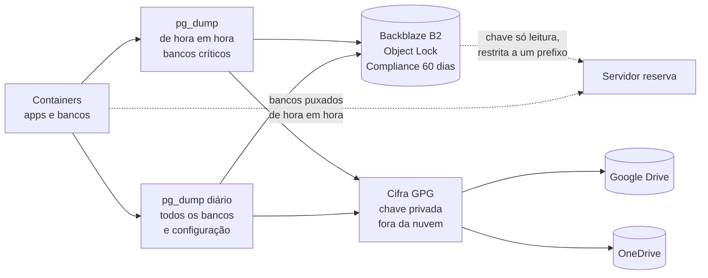

# Infraestrutura e recuperação de desastre: do ransomware a três nuvens em cinco dias

**Período:** setembro de 2026 até hoje · **Papel:** arquitetura, operação, testes de restauração e migrações · **Estado:** em produção numa VM ARM na Oracle Cloud em São Paulo desde 12/11/2026, com servidor reserva

> Resumo em uma frase: depois que um ransomware criptografou os servidores físicos do grupo, reconstruí a operação em containers numa nuvem, com backup de hora em hora, uma cópia que nem eu consigo apagar, restauração testada de verdade e a capacidade de mudar de provedor em uma manhã, o que foi feito duas vezes em cinco dias.

## 1. Contexto e problema

Em 23/09/2026, um ransomware atingiu a rede do grupo industrial que dirijo. O hospedeiro de virtualização foi comprometido e as máquinas virtuais, inclusive a do banco de dados do ERP comercial, foram criptografadas. O ERP não voltou.

A reconstrução começou pelo que faturava: um sistema de cotação com ICMS ST, em produção em 30/09/2026, numa VPS com Docker. Em seguida vieram a contabilidade gerencial, os sites e os sistemas da Asset Tecnologia. A pergunta de infraestrutura passou a ser uma só: **se acontecer de novo, amanhã, o que se perde e quanto tempo leva para voltar?**

A resposta exigia três coisas: uma cópia que um invasor com acesso total não consegue apagar, restauração provada (não presumida) e independência de um provedor só.

## 2. Resultado

| Indicador | Hoje |
|---|---|
| Perda máxima de dados nos bancos críticos | 1 hora |
| Cópia imutável | Object Lock em modo Compliance, 60 dias |
| Restauração | testada em container descartável, com contagens iguais à produção |
| Cópias fora do provedor principal | três destinos, dois deles com cópia cifrada, e um servidor reserva |
| Tempo de virada para outro provedor | cerca de 16 minutos, medidos em 12/11/2026 |
| Custo do servidor principal | dentro da franquia gratuita da Oracle Cloud |

## 3. Arquitetura do backup

- **De hora em hora.** Desde 05/11/2026, os bancos críticos (cotação, contabilidade gerencial e os dois sistemas da Asset com dados de clientes) são exportados a cada hora. A perda máxima numa queda caiu de 24 horas para 1 hora. Os bancos que podem ser recarregados da fonte pública ficam no diário.
- **Imutável.** Desde 07/10/2026, uma cópia vai para o Backblaze B2 com Object Lock em modo Compliance e retenção de 60 dias. Nesse modo, nem a conta dona consegue encurtar a retenção ou apagar o objeto antes do prazo.
- **Cifrado.** Desde 13/11/2026, tudo o que vai para o Google Drive e o OneDrive sai cifrado com GPG. A chave privada e a senha ficam fora dessas nuvens.
- **Menor privilégio.** A chave do servidor reserva só lê, e só o prefixo dos dumps horários: não enxerga o pacote de configuração, que contém as chaves de escrita. Testado: gravar com ela devolve acesso negado.

## 4. Testes que provam, não presumem

| Teste | Data | Resultado |
|---|---|---|
| Apagar definitivamente um objeto no B2 | 07/10/2026 | Negado pelo provedor. Sobrescrever criou uma versão nova e guardou a original |
| Restaurar o banco do ERP a partir do B2 | 07/10/2026 e 02/11/2026 | Dump baixado e restaurado num container descartável, com as contagens das tabelas iguais às da produção |
| Restaurar o banco de um sistema novo antes de abrir para uso | 05/11/2026 | Banco novo com as mesmas tabelas, migrations e dados de referência |
| Chave do reserva gravar fora do permitido | 06/11/2026 | Acesso negado |

## 5. Três nuvens em cinco dias

O desenho em containers, com cada sistema num compose próprio e os dados em dumps, foi posto à prova duas vezes na mesma semana.

| Data | De | Para | Motivo | Como |
|---|---|---|---|---|
| 07/11/2026 | VPS na Hetzner (Europa) | AWS em São Paulo | Latência: a primeira resposta caiu de cerca de 0,75 s para 0,05 s, uma diferença que o usuário percebia | Sistema a sistema, com a contagem de tabelas igual antes da troca de DNS; cerca de 30 containers; certificados emitidos em cerca de 1 minuto |
| 12/11/2026 | AWS em São Paulo | VM ARM na Oracle Cloud em São Paulo | Custo zero na franquia ARM, com mais memória, mantendo os dados no Brasil | Imagens ARM compiladas no servidor novo e testadas paradas; na virada, 9 bancos copiados com contagens idênticas, 36 containers, DNS trocado e certificados reemitidos em cerca de 16 minutos |

Depois da segunda migração, a AWS ficou como reserva parada, com os bancos da virada, e um servidor na Hetzner puxa os bancos da produção de hora em hora. Se a Oracle cair, há para onde voltar sem depender do backup em nuvem.

## 6. Decisões de engenharia

- **Containers e dumps, não imagens de máquina.** O que precisa sobreviver é o banco e a configuração. Todo o resto se reconstrói a partir do código. Por isso a migração é copiar dumps e subir composes, não clonar discos.
- **Imutabilidade no provedor, não na disciplina.** Uma cópia que depende de ninguém apagar não protege contra quem tomou o servidor. O modo Compliance tira essa decisão de qualquer pessoa, inclusive de mim.
- **Nuvem sincronizada não é backup.** Drive e OneDrive replicam o que chega, inclusive arquivo criptografado. Ficaram como cópia extra, cifrada, e não como a cópia principal.
- **Medir antes de migrar.** A primeira migração saiu de uma medição de latência; a segunda, de uma conta de custo e capacidade. Nenhuma das duas por preferência de marca.
- **Virada ensaiada.** Na Oracle, tudo foi compilado e testado com os apps parados horas antes; a virada foi só parar, copiar os bancos, conferir e trocar o DNS.

## 7. Lições

- **Um destino de backup falhou em silêncio.** Em 02/11/2026, uma conferência mostrou que a autorização de um dos destinos tinha sido revogada oito dias antes, depois de uma troca de senha. Os outros dois seguiram funcionando, o buraco foi reposto, e a lição ficou: backup sem alerta de falha é esperança, não backup.
- **Certificado não emite sozinho em todo caso.** Recarregar o proxy não emitiu o certificado de um domínio novo; reiniciar resolveu. Entrou no roteiro de publicação.
- **O servidor oficial também erra.** Um portal do governo entrega a cadeia TLS sem o certificado intermediário. A correção foi incluir o intermediário como autoridade adicional, sem desligar a verificação.
- **Chave em tela é chave vazada.** Colar segredo em terminal ou em captura de tela expôs chaves duas vezes; todas foram revogadas na hora. Desde então, segredo entra por script que não mostra o valor.

## 8. Próximos passos

1. **Alerta de falha por destino de backup**, para o próximo silêncio durar minutos, não dias.
2. **Restauração periódica automática**, com a contagem conferida e o resultado registrado, em vez de teste manual.
3. **Ensaio de queda do principal**, subindo o reserva com o último dump e medindo o tempo real até os sistemas responderem.

## 9. Stack

Docker Compose · PostgreSQL 16 · Caddy com certificados automáticos · nginx nos sites estáticos · Ubuntu 24.04 em ARM (Oracle Cloud, São Paulo) · rclone · Backblaze B2 com Object Lock · GPG · cron com trava contra execução simultânea.
