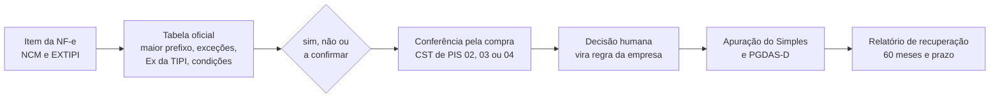

# Motor tributário com fonte oficial: PIS/COFINS monofásico no Simples

**Período:** novembro de 2026 · **Papel:** levantamento das normas, regra de decisão, código, testes com notas reais e publicação · **Estado:** no ar no [Escrituro](escrituro.md) 0.65.0 desde 14/11/2026; a classificação e o cálculo da recuperação publicados como [ferramenta de código aberto](https://github.com/thiagogardev/monofasico-br)

> Resumo em uma frase: a empresa do Simples que revende pneu, autopeça, remédio ou cosmético costuma pagar PIS e COFINS duas vezes sobre o mesmo produto; construí o motor que marca cada item vendido como **sim, não ou a confirmar**, sempre com a lei e o artigo, leva a marca até a declaração do Simples e calcula o que dá para recuperar dos últimos cinco anos.

## 1. Contexto e problema

Em alguns produtos, a lei concentra o PIS e a COFINS no começo da cadeia: o fabricante ou o importador paga uma alíquota maior, e quem revende tem alíquota zero. É a tributação monofásica. Vale para combustíveis, medicamentos, perfumaria e higiene pessoal, veículos, autopeças, pneus e câmaras de ar.

No Simples Nacional, o PIS e a COFINS vêm dentro do DAS, embutidos na alíquota única. Quem revende produto monofásico precisa separar essa receita no PGDAS-D e marcá-la como monofásica, para que a parte de PIS e COFINS saia da guia (LC 123/2006, art. 18, §4º-A, I; Res. CGSN 140/2018, art. 25, §6º). Quando a separação não é feita, a empresa paga de novo uma contribuição que o fabricante já pagou.

Na prática a separação raramente é feita, por três motivos:

1. **A lista não é uma lista.** Os produtos estão espalhados em várias leis (9.718, 10.147, 10.485, 13.097), em anexos de instrução normativa e em duas tabelas do SPED. Elas nem sempre concordam.
2. **O NCM sozinho nem sempre decide.** Parte das autopeças só é monofásica quando o item é próprio para trator, escavadeira ou veículo (Anexo II da IN RFB 2.121/2022). Alguns códigos só valem num "Ex" específico da TIPI.
3. **O erro custa caro nos dois sentidos.** Marcar como monofásico o que não é gera débito com multa. Deixar de marcar é pagar em dobro todo mês, em silêncio.

## 2. O que o motor faz



- **Classificação com fonte.** Cada grupo da tabela carrega a lei, o artigo e o código da tabela do SPED. Toda decisão sai com um motivo legível: "Lei 10.485/2002, art. 5º; tabela SPED 4.3.10, código 304" ou "o NCM só é monofásico no Ex 01 ou 02 da TIPI, e a nota não informa o Ex".
- **Três respostas, não duas.** Quando a lei exige uma condição que a nota não prova, ou quando a fonte oficial não confirma o tratamento no Simples (bebidas frias), a resposta é "a confirmar". O item continua pagando PIS e COFINS até uma pessoa decidir, e a apuração avisa quantos itens estão pendentes.
- **Declaração certa.** A receita monofásica vai para o PGDAS-D na atividade de revenda com substituição tributária ou tributação monofásica, com a qualificação 9 para PIS e COFINS.
- **O passado.** Um relatório recalcula os últimos 60 meses, mostra o que foi pago a mais em cada mês e até quando dá para pedir.

## 3. Decisões de projeto

**Tabela oficial primeiro, CST da compra só como conferência.** A tentação era usar o CST de PIS da nota do fornecedor (02, 03 ou 04 indicam produto monofásico) como fonte da verdade. Não usei, porque o fornecedor também erra. A tabela decide; o CST só alerta. Se a tabela diz "não" e o fornecedor vendeu o mesmo NCM com CST monofásico, o item vira "a confirmar". O CST nunca transforma um item em "sim" sozinho, nem rebaixa um "sim".

**Regra do maior prefixo.** A lei lista ora posições de 4 dígitos, ora subitens de 8. Entre todos os grupos, vence o prefixo mais longo que casar com o NCM. Assim o 8431.41.00, que está no Anexo I das autopeças, vence a 8431.49 do Anexo II sem nenhum caso especial no código. Um teste garante que nenhum prefixo aparece em dois grupos.

**A decisão humana vira regra, mas escolhida à parte.** Quando o analista confirma um item, a decisão vira uma regra aprendida da empresa para aquele NCM e vale para todas as vendas dele. O Escrituro já tinha uma grade tributária que escolhe uma regra por item e, com ela, a atividade do Simples, o CFOP de escrituração e as remessas a ignorar. Se a regra de monofásico entrasse na mesma disputa, por ser mais específica (tem NCM), ela venceria e o item perderia a atividade de revenda, ou uma remessa ignorada entraria na receita. Por isso a regra "só de monofásico" é escolhida numa passada separada e decide só a marca.

**Reclassificar o passado sem tocar na escrituração.** Para recuperar, é preciso marcar as vendas antigas. O relatório relê os XMLs guardados (o EXTIPI de cada item vem de lá) e aplica a tabela e as regras às vendas dos últimos 60 meses. Ele só marca os itens: lançamentos, apurações e declarações já feitos não mudam. A retificação é um ato consciente, fora do sistema.

**Recuperação com prazo e origem do número.** Para cada mês: receita monofásica, parte já segregada, PIS e COFINS efetivos da faixa, valor pago a mais e o último dia para pedir (vencimento do DAS mais cinco anos). O relatório diz de onde veio a alíquota: da apuração transmitida, da calculada no sistema ou de uma estimativa pelo histórico de receita. Os itens "a confirmar" ficam fora da soma até serem confirmados.

**Prazo de validade escrito no código.** O PIS e a COFINS do Simples dão lugar à CBS e ao IBS a partir de 01/2027 (Res. CGSN 190/2026). A marca continua existindo, mas de 2027 em diante vira só um aviso na apuração, e o relatório de recuperação vai até 12/2026.

## 4. Erros achados com dados reais

A tabela passou nos testes escritos a partir da lei. Os dois erros abaixo só apareceram quando o motor rodou sobre as notas reais do piloto. Cada um virou teste de regressão.

**8431.43.90: parte de perfuratriz não é parte de escavadeira.** O item 2 do Anexo II alcança partes de máquinas da posição 84.29 (escavadeiras, carregadeiras, tratores de esteira), e essas partes ficam na 84.31. Mas a 84.31 também reúne partes de outras máquinas. O 8431.43.90 apareceu como candidato do Anexo II, e é parte de máquina de sondagem e perfuração (8430.41 e 8430.49), que a lei não alcança. A correção foi ler a estrutura da posição: só a 8431.49 pode ser parte de máquina da 84.29; a 8431.41 e a 8431.42 já estão no Anexo I; o resto da 84.31 fica fora.

**EXTIPI "0" lido como Ex.** Cinco NCMs das autopeças só são monofásicos num Ex da TIPI (por exemplo, o 8481.80.99 só no Ex 01 ou 02). Vários emissores preenchem o campo EXTIPI da NF-e com "0" quando o produto não tem Ex. O código completava com zero à esquerda, lia "Ex 00", não achava na lista e respondia "não é monofásico". Era um falso negativo silencioso, do tipo que faz pagar em dobro sem ninguém perceber. Agora vazio ou só zeros quer dizer "sem Ex", e o item fica "a confirmar".

Um terceiro achado veio da leitura das fontes, não das notas: a tabela 4.3.10 do SPED ainda lista a posição 33.06 (higiene bucal), que saiu da tributação concentrada com a Lei 12.839/2013. Quando a tabela e a lei divergem, vale a lei, e o comentário no código diz por quê.

## 5. Um princípio para a IA fiscal

O motor é determinístico de propósito: a regra é lei, e lei não se resolve por probabilidade. Mas ele deixou claro como uma IA deve entrar nesse domínio. Ela **só responde com fonte**: cada afirmação aponta a lei, o artigo ou a tabela de onde saiu, e a fonte precisa existir na base consultada. Quando nenhuma fonte oficial confirma, a resposta certa é "a confirmar", nunca um palpite bem escrito.

É o mesmo contrato da tabela: o campo de fonte de cada grupo e o estado "a confirmar" são a versão sem modelo dessa ideia. Para uma IA, a regra vira verificação: uma resposta sem citação válida é recusada antes de chegar ao usuário.

## 6. Como se mede

- **Testes a partir da lei:** cada grupo, exceção expressa, Ex da TIPI e condição do Anexo II tem um caso. No Escrituro, a suíte do monofásico vai da tabela ao relatório de recuperação, passando pela grade, pela apuração e pelo PGDAS-D, num banco temporário.
- **Regressão com as notas reais:** os dois erros da seção 4 viraram casos fixos.
- **Conta conferida à mão:** a alíquota efetiva e a partilha de PIS e COFINS de cada faixa do Anexo I batem com a LC 123/2006, e o teste confere a conta de uma faixa inteira.
- **Uso:** o relatório separa o valor estimado do valor de uma apuração transmitida. O número que vale é o do PGDAS-D retificado.

## 7. Números

| Medida | Valor |
|---|---|
| Grupos de produtos | 9, cada um com lei e artigo |
| Prefixos de NCM na tabela | 121 |
| NCMs que dependem de Ex da TIPI | 5 (e 1 excluído só num Ex) |
| Janela da recuperação | 60 meses, até 12/2026 |
| Verificações na suíte do Escrituro | 13 blocos, da tabela ao relatório |
| Testes no repositório público | 20 |
| Erros achados com notas reais | 2, ambos com teste de regressão |

## 8. Lições

- **A dúvida é um estado, não um defeito.** Tratar "a confirmar" como resposta de primeira classe tirou do código a pressão de adivinhar e levou a decisão a quem pode assiná-la.
- **Dados reais acham o que a lei não mostra.** Os testes escritos a partir do texto legal passaram. Os erros estavam na estrutura da nomenclatura e no jeito como os emissores preenchem a nota.
- **Falso negativo também é erro.** Em tributo, o erro que ninguém vê (pagar a mais) dura anos. O EXTIPI "0" só apareceu porque o motor explica cada "não".
- **Quando as fontes oficiais divergem, documente qual vence.** A 33.06 está numa tabela oficial e fora da lei. O comentário no código vale tanto quanto a regra.
- **Corrigir o passado sem reescrevê-lo.** Marcar itens antigos é seguro; mexer em apuração transmitida não é. A separação entre as duas coisas deixou o relatório útil desde o primeiro dia.

## 9. Limites e próximos passos

- **Bebidas frias** continuam "a confirmar" até haver confirmação em fonte oficial do tratamento no PGDAS-D.
- **Fabricante e importador** também separam a receita, mas pagam o PIS e a COFINS concentrados por DARF, fora do Simples. O sistema avisa e não calcula esse DARF.
- **2027:** a Res. CGSN 190/2026 cria a IBS/CBS monofásica. A tabela por vigência está pronta para receber a nova lista quando a regulamentação fechar.
- **Vigilância das fontes:** ligar a tabela ao [monitor de legislação](icms-st.md), para que uma mudança na lei ou na tabela do SPED vire alerta com fonte e data.

## 10. Stack e código

- **No Escrituro:** Next.js 16, React 19, Drizzle, PostgreSQL (PGlite no desenvolvimento), Docker; regra de decisão em funções puras, sem banco, testadas à parte.
- **Fontes oficiais:** LC 123/2006; Res. CGSN 140/2018 e 190/2026; Leis 9.718/1998, 10.147/2000, 10.485/2002, 10.560/2002, 11.116/2005, 12.839/2013 e 13.097/2015; IN RFB 2.121/2022, Anexos I e II; tabelas 4.3.10 e 4.3.11 da EFD-Contribuições; TIPI.
- **Código:** o Escrituro é privado, e o código pode ser mostrado em entrevista ou avaliação com dados sintéticos. A classificação, a CLI e o cálculo da recuperação são públicos, com licença MIT: [thiagogardev/monofasico-br](https://github.com/thiagogardev/monofasico-br).

```text
$ npm run ncm -- 84818099 --ex 0
8481.80.99  A CONFIRMAR  (Autopeças (Anexo I))
  o NCM 84818099 só é monofásico no Ex 01 ou 02 da TIPI, e a nota não informa o Ex
  Fonte: Lei 10.485/2002, art. 3º e Anexo I; IN RFB 2.121/2022, Anexo I (códigos da TIPI atual)
```

- **Ver também:** [case do Escrituro](escrituro.md), o sistema do qual este motor é um módulo, e [case ICMS ST](icms-st.md), da mesma família de regra fiscal com fonte.
