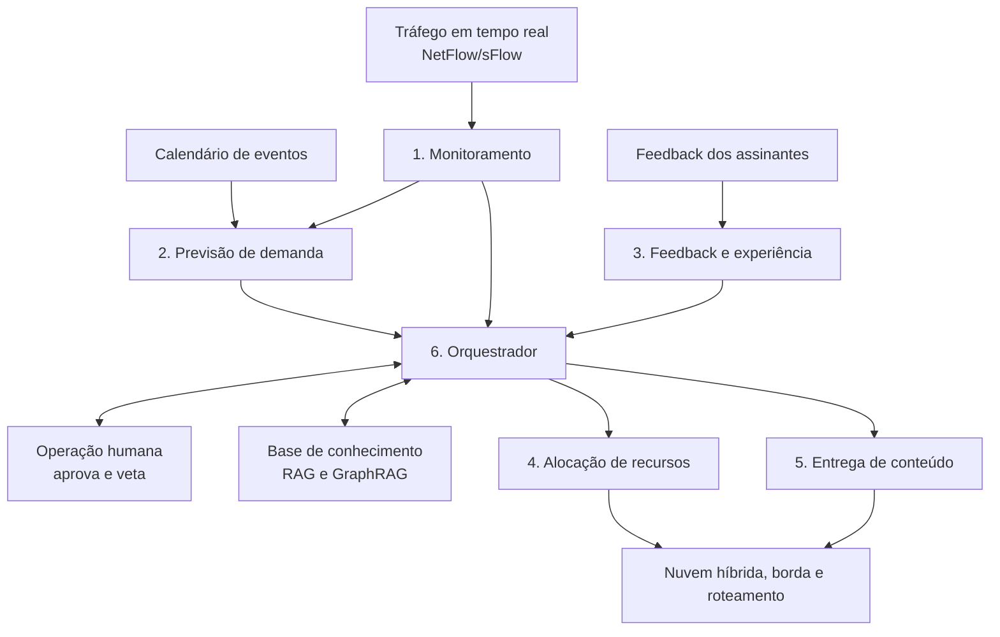

# Rede de streaming com agentes de IA: prever o pico em vez de reagir a ele

**Período:** novembro de 2026 · **Papel:** análise do problema, levantamento das lacunas, arquitetura e documentação · **Estado:** projeto de arquitetura, feito como projeto final da pós-graduação em Sistemas Cognitivos com Agentes de IA (Data Science Academy); não foi implementado. Documento completo no [repositório aberto](https://github.com/thiagogardev/agentes-rede-streaming)

> Resumo em uma frase: uma empresa de streaming trava nos momentos de maior audiência porque só reage ao congestionamento depois que ele aparece; desenhei um sistema de seis agentes que **prevê o pico, prepara a rede antes dele e ajusta a entrega durante ele**, deixando o LLM onde ele é bom (linguagem, contexto, coordenação) e fora das decisões que a rede toma em segundos.

## 1. Contexto e problema

O cenário do projeto é o de uma empresa de telecomunicações voltada a streaming de vídeo. Em eventos ao vivo e lançamentos de séries, o tráfego dispara, a rede congestiona e o assinante vê o vídeo travar. A empresa tem monitoramento de rede em tempo real (NetFlow/sFlow), um data warehouse no BigQuery, Splunk e Apache Spark para análise, e servidores distribuídos numa nuvem híbrida.

O pedido era uma solução com agentes de IA para três coisas: prever picos de demanda, alocar recursos de rede dinamicamente e ajustar a entrega do conteúdo conforme a rede e o retorno dos usuários. O enunciado avisava que parte das informações estava faltando de propósito, como acontece na vida real.

Reduzi o problema a duas perguntas de negócio:

1. **Quanta demanda teremos, onde e quando?** É uma pergunta sobre o futuro, que pede modelo preditivo.
2. **Dada essa demanda e o estado da rede, qual é a melhor ação agora para manter o vídeo fluido ao menor custo?** É uma pergunta de decisão contínua, que pede agentes.

## 2. O que faltava no enunciado

Antes de desenhar qualquer coisa, listei o que o cenário não dizia. Dois itens mudaram o projeto:

- **O calendário de eventos não estava entre os dados disponíveis.** Os picos são causados por eventos ao vivo e lançamentos, mas a lista de dados só trazia tráfego, histórico, feedback e dispositivos. Sem o calendário, um modelo aprende a sazonalidade e é surpreendido justamente pelo que mais importa. A solução pede essa fonte como requisito.
- **O feedback do usuário chega tarde demais para ajuste em tempo real.** Avaliação e comentário são subjetivos, esparsos e vêm depois do problema. A medida direta da experiência é a telemetria do player (tempo travado, qualidade por sessão), que também não estava listada. Na solução, o feedback valida e a telemetria mede.

As outras lacunas viraram premissas explícitas, cada uma com o efeito de estar errada: quais ações a rede aceita por API, metas de qualidade, profundidade do histórico, teto de custo de nuvem, nível de autonomia que a operação aceita.

## 3. A solução em uma página

| Agente | O que faz | Como decide |
|---|---|---|
| 1. Monitoramento | Mantém o estado atual de cada região e detecta tráfego fora do previsto | Agregação em fluxo (Spark) e detecção estatística de anomalia |
| 2. Previsão de demanda | Prevê o tráfego por região, tipo de conteúdo e dispositivo, de minutos a dias | Modelo preditivo com previsão por quantis |
| 3. Feedback e experiência | Transforma avaliações em sinal estruturado e cruza com incidentes | Modelo de linguagem pequeno, com ajuste fino |
| 4. Alocação de recursos | Decide onde escalar capacidade e para onde redirecionar tráfego | Otimização com restrições de custo |
| 5. Entrega de conteúdo | Ajusta a qualidade por região e dispositivo quando capacidade não basta | Políticas com limites |
| 6. Orquestrador | Coordena, resolve conflitos, aplica travas, aciona pessoas e explica | LLM em grafo de estados, com aprovação humana |

Só existe agente onde há uma decisão distinta a tomar. Menos agentes significa menos falha e menos coordenação.

## 4. Decisões de projeto

**Cada decisão no relógio certo.** Um LLM leva segundos para responder, custa por chamada e não dá sempre a mesma resposta. Uma rede de streaming decide em milissegundos. Separei três camadas: o plano de dados (streaming adaptativo do player e balanceadores, sem agentes), o controle tático em segundos a minutos (modelos preditivos e otimização, dentro de limites) e o controle estratégico em minutos a dias (LLM planejando um evento, interpretando feedback, coordenando e explicando). O erro mais comum em projeto de agentes é pôr o LLM para decidir tudo; aqui ele não toca na alocação em tempo real.

**Previsão por quantis, não pela média.** O custo do erro é assimétrico. Prever para menos causa travamento e perda de assinante; prever para mais custa capacidade ociosa por algumas horas. A rede se dimensiona pelo percentil 95 da previsão. O modelo principal é gradient boosting com variáveis de calendário e evento, medido contra uma linha de base estatística simples: se não vencer a régua, não entra.

**Otimização antes de aprendizado por reforço.** Reforço parece a escolha natural para alocação dinâmica, mas aprende explorando, e explorar numa rede de produção derruba cliente. Otimização com restrições é previsível, auditável e respeita teto de custo. Reforço fica como evolução, treinado em simulador com replay de eventos passados.

**RAG para conhecimento que muda, ajuste fino para tarefa que se repete.** O LLM não conhece a rede da empresa nem o que aconteceu nos eventos anteriores. Esse conhecimento muda toda semana, então vai para uma base consultada na hora: busca vetorial com reordenação sobre relatórios e manuais, e um grafo com a topologia (regiões, pontos de presença, enlaces), porque "se este ponto saturar, quais vizinhos absorvem o tráfego?" não é pergunta que busca por similaridade de texto responda. Já classificar feedback é sempre a mesma tarefa, com volume alto: aí compensa um modelo pequeno e aberto com ajuste fino, hospedado na própria empresa, mais barato e sem tirar o texto do assinante de casa.

**Supervisor, não agentes negociando livremente.** Em operação crítica eu quero um responsável único, um fluxo rastreável e um só ponto para travas e auditoria. O orquestrador é um grafo de estados explícito (LangGraph), com estado persistido e pontos de aprovação humana antes de qualquer ação acima do limite. Considerei o CrewAI: é ótimo para protótipo rápido, mas dá menos controle sobre o caminho de cada decisão.

**Degradar onde não se percebe.** Quando a capacidade não chega a tempo, o agente de entrega limita a qualidade onde a diferença é invisível (4K em tela pequena) e libera banda para quem está na TV. É o amortecedor para o dia em que a previsão errar, e ela vai errar.

**Reaproveitar o que a empresa já tem.** NetFlow/sFlow, Spark, BigQuery, Splunk e a nuvem híbrida continuam onde estão. O que se acrescenta é o necessário para os agentes existirem: barramento de mensagens, base vetorial, banco de grafos, publicação dos modelos como API e a operação contínua (avaliação antes de cada versão, rastreamento de cada passo, re-treino).

## 5. Travas

- **Autonomia progressiva.** Modo sombra (o sistema registra o que faria), depois recomendação com aprovação humana, depois automação de ações reversíveis numa região piloto, depois expansão. A confiança se constrói com evidência medida.
- **Limites por ação.** Variação máxima de capacidade e de custo por ciclo; acima disso, uma pessoa aprova.
- **Reversão automática** se a métrica piorar depois de uma ação.
- **Falha segura.** Se os agentes caírem, voltam as regras estáticas de hoje. O sistema nunca fica pior do que o ponto de partida.
- **Texto de usuário é dado não confiável.** Um comentário pode trazer uma instrução maliciosa. O agente que lê feedback só classifica, a saída é validada por esquema e nenhum modelo de linguagem tem permissão de escrita na rede.

## 6. Como provar que funciona

1. Previsão testada no histórico com validação temporal, com atenção separada aos eventos.
2. Replay de picos passados, para ver o que os agentes teriam feito.
3. Modo sombra em produção, comparando com as decisões da operação.
4. Uma região de menor risco primeiro, com grupo de controle.
5. Comparação final contra a operação atual: tempo de vídeo travado, custo por GB entregue e cancelamentos após incidentes.

Implantação estimada em cinco fases, cerca de nove meses, começando pela previsão, que já ajuda a operação a se preparar manualmente antes de qualquer automação.

## 7. Limites deste trabalho

Vale dizer com clareza o que este case é e o que não é.

- **É um projeto de arquitetura.** Não há código rodando nem dados reais. O cenário é o exercício proposto pela pós, e nenhuma decisão foi validada em uma rede de verdade.
- **Prazo e equipe são estimativas minhas**, coerentes com o tamanho da solução, sem referência do cenário.
- **Não há números de ganho.** Sem a linha de base da empresa, qualquer percentual seria inventado. O documento diz como medir, não quanto vai melhorar.
- **O que sustenta as escolhas** é o que já pratiquei em sistemas no ar: saída de modelo validada antes de virar ação, fluxo como função pura com testes, IA respondendo só com fonte, falha segura. Os cases do [Genesis](genesis.md) e da [Central de Atendimento](central-atendimento.md) mostram isso em produção.

## 8. Stack proposta

Python · Apache Spark (Structured Streaming) · Google BigQuery e BigQuery ML · Databricks (pipelines, MLflow, publicação de modelos) · LightGBM · LangGraph e LangChain · MCP · Pydantic · modelo de linguagem pequeno com LoRA · busca vetorial com reordenação · banco de grafos · FastAPI · Docker e Kubernetes · Terraform · Splunk

- **Documento completo:** [github.com/thiagogardev/agentes-rede-streaming](https://github.com/thiagogardev/agentes-rede-streaming), com as lacunas e premissas, os dados fonte a fonte, os dois cenários de funcionamento, a tabela de riscos e a tabela de decisões com a alternativa descartada em cada uma.
- **Ver também:** [case do Genesis](genesis.md), agentes de prospecção em produção, e [case da Central de Atendimento](central-atendimento.md), IA que responde pelo manual.
