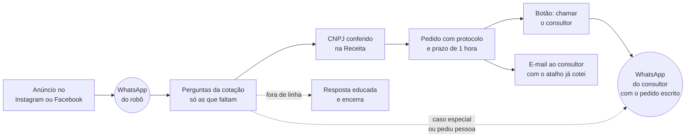

# Robô de vendas no WhatsApp: o lead do anúncio chega ao consultor já qualificado

**Período:** novembro de 2026 · **Papel:** levantamento das regras com o comercial, arquitetura, código, integração com a Meta e operação · **Estado:** no ar desde 14/11/2026; primeiros clientes reais em 15/11/2026

> Resumo em uma frase: os anúncios do Meta da Acoplin traziam conversas que eu respondia à mão, sempre com as mesmas perguntas; agora um robô faz essas perguntas, confere a empresa na Receita e me entrega o pedido pronto para cotar, e o primeiro cliente real chegou ao pedido em 4 minutos, sem ninguém tocar no celular.

## 1. Contexto e problema

A Acoplin fabrica e vende mangueiras industriais, engates e abraçadeiras. Os anúncios de clique para o WhatsApp do Meta funcionam: trazem conversa todos os dias. O problema estava do lado de cá.

- **Toda conversa começava igual.** Para que é a mangueira? Qual a pressão? Qual a bitola? Quantos metros? Tem CNPJ? Entrega onde? Seis ou sete perguntas antes de qualquer cotação, digitadas à mão, no celular de um diretor.
- **Resposta lenta perde o lead.** Quem clica no anúncio está comparando fornecedores. Se a primeira resposta demora, ele já falou com outro.
- **Metade das perguntas não levava a venda.** Item fora de linha, curiosidade, gente que some na terceira pergunta. O desgaste era o mesmo para todas.
- **Não havia medida.** Não dava para saber qual anúncio trazia pedido de verdade e qual trazia só conversa.

A regra que definiu o projeto: **o robô qualifica, mas não cota.** Preço depende de tabela (consumidor ou revenda), de prazo para cliente novo, de frete e de estoque. Isso continua sendo decisão humana. O robô entrega tudo o que a pessoa precisa para cotar em minutos.

## 2. Resultado

| Indicador | Valor |
|---|---|
| Da decisão ao robô no ar | 1 dia (14/11/2026) |
| Primeiro cliente real vindo de anúncio | menos de 1 hora depois de o robô ficar pronto |
| Tempo do primeiro cliente até o pedido qualificado | 4 minutos |
| Prazo prometido ao cliente | cotação em até 1 hora no horário comercial |
| Suítes de teste | 5 (fluxo com 28 casos, WhatsApp, prazos, login e e-mail) |

No primeiro dia, duas pessoas vieram dos anúncios. Uma respondeu tudo e virou pedido com protocolo: produto, bitola, metragem, documento e entrega, sem intervenção. A outra parou na quantidade, e o painel mostra exatamente onde.

## 3. Como funciona para o cliente

1. O cliente clica no anúncio e manda a primeira mensagem. Se o texto ou o próprio anúncio já dizem o produto, o robô pula perguntas.
2. O robô pergunta só o que falta: aplicação, pressão ou bomba, bitola, metragem (arredondada para rolo ou lance fechado), emenda e abraçadeira, material, conexão, quantidade.
3. Pede o CNPJ, consulta na Receita e mostra a razão social para o cliente confirmar. Pessoa física também é atendida.
4. Cria o pedido com protocolo e manda um botão que abre o WhatsApp do consultor **com o pedido já escrito**. É o cliente quem chama o número principal, então não há custo de mensagem nem modelo aprovado.
5. O consultor recebe por e-mail o resumo, o prazo prometido e um atalho para marcar como cotado.

A qualquer momento, "consultor" passa para uma pessoa com o que já foi respondido, e "menu" recomeça. Áudio e foto não travam a conversa. Pedidos especiais, como gotejamento e incêndio, vão direto para o consultor.

## 4. Arquitetura

| Parte | Como funciona |
|---|---|
| Webhook | A Meta chama a rota; a assinatura HMAC SHA-256 é conferida em tempo constante com o segredo do app, a resposta 200 sai na hora e o processamento vem depois. O id de cada mensagem da Meta é único no banco, então reentrega não gera resposta dupla |
| Fluxo como função pura | Recebe a conversa e a entrada e devolve o próximo estado e as ações (texto, botões, lista, link, consultar CNPJ, criar pedido). Sem banco, rede ou relógio implícito. Os 28 casos de teste percorrem os caminhos em milissegundos |
| Regras de produto | Escritas com o comercial antes do código e versionadas: qual produto para cada faixa de pressão, o que perguntar em cada linha, o que está fora de linha e quando chamar uma pessoa. Bitolas e rolos vêm do catálogo do site |
| Anúncio de origem | A Meta manda o anúncio de onde a conversa veio. O robô usa para pular perguntas e grava para o funil por anúncio |
| CNPJ | Três fontes públicas em sequência, para a consulta não cair junto com uma delas |
| Prazo | Segunda a sexta, das 8h às 17h. Se cabe uma hora inteira antes de fechar, promete 1 hora; senão, o próximo horário comercial. Quinze minutos antes de vencer, alerta por e-mail o pedido ainda não cotado |
| Link "já cotei" | Assinado com HMAC e válido só para aquele pedido. Abre uma página com um botão de confirmação, porque leitores de e-mail abrem links sozinhos para checar segurança e um GET não pode mudar nada |
| Painel | Login com verificação em duas etapas. Pedidos (cotado, perdido, reabrir), conversas (assumir, devolver, responder pelo número do robô) e indicadores: chegaram, pediram cotação, pediram consultor, fora de linha e pararam no meio, por anúncio |

## 5. Decisões de engenharia

- **Número novo só para os anúncios, não o número de sempre.** A outra opção era pôr o número principal da empresa na API em modo de coexistência, o que exigia virar provedor de tecnologia na Meta e tirava o WhatsApp do computador. Com um número novo, o número principal não mudou para clientes antigos, site, catálogo e notas fiscais, e o robô ficou com um portfólio e um app próprios, sem análise da Meta.
- **Passagem por link, não por mensagem enviada.** Se o robô mandasse a mensagem ao consultor, seria uma conversa iniciada pela empresa, com modelo aprovado e custo. Com o link wa.me e o texto pronto, quem inicia é o cliente.
- **Serviço separado da Central de Atendimento.** O motor nasceu da [Central de Atendimento](central-atendimento.md) da Asset, mas virou um projeto próprio, com banco, app da Meta e domínio próprios. Um bloqueio num app não derruba o outro.
- **Robô não passa preço.** Cotação errada no primeiro contato custa mais que um minuto de espera. A automação para onde começa a decisão comercial.
- **Segredo nunca passa pela conversa.** Token, segredo do app e senha do painel entram por script no servidor, que confere o token na Meta antes de gravar.

## 6. Lições

- **App não publicado não recebe cliente.** Em modo de desenvolvimento, o app da Meta só recebe webhooks de teste do painel. Estava no aviso, não no passo a passo.
- **"Assinar webhooks" é uma chave separada.** Webhook configurado no app não basta: a conta do WhatsApp precisa ser assinada pelo app. Sem isso, nada chega e nenhum erro aparece.
- **O token permanente pode travar na Meta.** A verificação da conta para gerar o token do usuário do sistema não abria o campo do código. Ficou pronto um plano B, com token provisório trocado pelo de 60 dias, até a Meta liberar no dia seguinte.
- **Domingo também tem lead.** O primeiro pedido real chegou num domingo. A regra do prazo prometeu a cotação para o próximo horário comercial em vez de prometer uma hora que ninguém ia cumprir.

## 7. Próximos passos

1. **Trocar o número em todos os anúncios** e medir o custo por pedido qualificado, não por conversa.
2. **Fase 2:** cadastrar o cliente no ERP pelo CNPJ e deixar a cotação em rascunho para o consultor só conferir preço e condições.
3. **Áudio transcrito** em vez de pedir texto, e IA para entender o texto livre que hoje cai no consultor.

## 8. Stack

Next.js 16 · TypeScript · Drizzle ORM · PostgreSQL 16 (PGlite no desenvolvimento) · WhatsApp Cloud API · Amazon SES · Docker Compose · Caddy · Oracle Cloud em São Paulo.

O código é privado. Este case descreve o desenho e os resultados sem dados de clientes.
