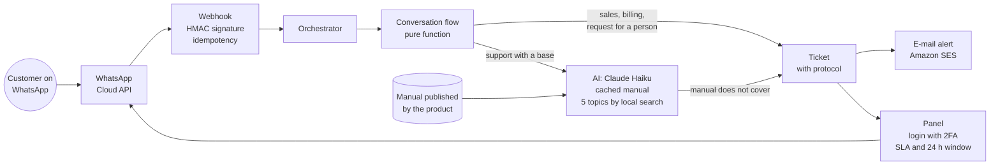

# Support Center: one WhatsApp number, three products and AI that answers from the manual

**Period:** November 2026 to date · **Role:** concept, architecture, code, Meta integration and operations · **Status:** live since 2026-11-10; official number on the WhatsApp Cloud API since 2026-11-11

> One-sentence summary: a single WhatsApp number serves three Asset Tecnologia products, answers usage questions on the spot from the product's own manual, declines what is off topic and, when a question needs a person, opens a ticket with a protocol number and a response time measured in business minutes.

## 1. Context and problem

Asset Tecnologia has three products: [Escrituro](escrituro.md), a system for accounting firms, [Clinalta](clinalta.md), a system for clinics, and a third one in pilot. The team is small, and all three promise the same thing in their definitions: human support with a deadline and help on every screen.

Three problems showed up together:

- **A usage question should not become a ticket.** Escrituro has a manual with about 200 topics, and "how do I generate the obligations calendar?" is already answered there. People asking on WhatsApp will not open the manual.
- **One number per product does not scale.** Three numbers, three phones and three inboxes for a one-person team is a recipe for lost messages.
- **WhatsApp has its own rules.** Free text only within 24 hours of the customer's last message; outside that window, only approved templates. Missing the window means losing the conversation.

The decision: an in-house service, separate from the three systems, with one official number on Meta's API, and AI only where there is a knowledge base for it to answer from.

## 2. Results

| Indicator | Value |
|---|---|
| Products served by one number | 3 |
| From first commit to live service | same day (2026-11-10) |
| Official number connected to the WhatsApp Cloud API | 2026-11-11 |
| Escrituro help base | about 200 topics, published by the system itself |
| Cost per question answered by the AI | from about US$ 0.09 to about US$ 0.0004 |
| Test suites | 6 (flow, WhatsApp, AI, login, e-mail and SLA) |

The cost drop came from two changes measured in the first week: the first real question was answered correctly by the larger model, without caching, at about US$ 0.09; with Claude Haiku and the instructions and manual index in the prompt cache, the same kind of question came down to about US$ 0.0004. Two orders of magnitude, without changing the rule of answering only from the manual.

## 3. Architecture

| Part | How it works |
|---|---|
| Webhook | Meta calls the route with the body and the signature header. The route checks the HMAC SHA-256 against the app secret in constant time, answers 200 immediately and processes afterwards. Every message has Meta's id; a repeated one is ignored, so redelivery never produces a double reply |
| Conversation flow | A pure state machine: it takes the conversation and the input and returns the new state and a list of actions (send text, show buttons, call the AI, open a ticket). No database, no network, no implicit clock. That is why every path can be tested in milliseconds |
| Menu | Product, then subject (technical support, billing, sales), as WhatsApp buttons. "menu" goes back to the start, asking for an agent hands over to a person, 30 minutes idle resets |
| Support AI | A local BM25-style search picks up to 5 manual topics; Claude Haiku answers only from them, with structured output (text, topics used, whether the manual covers it, whether it is off topic, confidence, whether a person is needed). Tax IDs, e-mails and phone numbers are pseudonymized before sending. Limit of questions per contact per day and a total daily cap |
| Help base | Each product publishes its own manual on a route, as JSON, with no customer data. The Center downloads it at startup and every hour. The manual customers read inside the system is the same one the AI uses |
| Sales | The flow qualifies the lead (name, company and size, with the size question adapted to each product) and opens the ticket with a ready summary |
| Ticket | Protocol in the YYYYMMDD-NNNN format, a message with the human support hours and an e-mail alert through Amazon SES with a link to the conversation |
| Panel | Login with password and two-factor verification (TOTP). Whoever replies from the panel takes over the conversation and the bot stops |
| SLA | 7, 30 and 90-day indicators per product, with a response target in business minutes (business days, 9 am to 6 pm); a column with the 24-hour window countdown and an e-mail alert before it closes |

## 4. Engineering decisions

- **Pure flow, side effects in the orchestrator.** Conversation rules are the part that changes most and breaks most. Isolated in a pure function, they are tested without WhatsApp, database or AI; the orchestrator only executes the returned actions.
- **AI only where there is a base.** At first only Escrituro's support had a published manual; the other products opened a ticket directly. The rule for switching on a product's AI is a published manual, not wishful thinking.
- **Declining is an answer.** An off-topic question gets a polite refusal and does not open a ticket, so the human queue does not fill up with small talk. The talk-to-a-consultant button is one tap away.
- **"The manual does not cover it" becomes a ticket, not an invention.** When the structured answer says the manual does not cover the question, or that it looks like a system bug, the Center replies with what it knows and hands over to a person.
- **Model swappable by environment variable.** The model change that cut the cost was a configuration change, measured before and after, without touching the rule.
- **E-mail with a fallback.** Ticket alerts go out through Amazon SES, with another provider as a fallback. External services come in through an API and can be replaced.

## 5. A real incident and the contingency plan

On 2026-11-12, every call to Meta's API started returning "API access blocked", read calls included. Tested from two different servers, it was not the network address: it was the app or the token. In the same period, Microsoft 365 had a global outage, and Meta's verification codes arrived precisely at an e-mail address hosted there, which blocked even investigating through the dashboard.

The API came back by itself the next day, after Microsoft 365 recovered, with no change on our side. Messages sent during the block were not delivered.

What remained:

- **A support contingency plan**, with a backup number, so the channel does not depend on a single app on a single platform.
- **Cross-dependencies on the risk map.** The support channel depended, without anyone writing it down, on corporate e-mail to recover access. Now it is written down.
- **Monitor the channel, not just the server.** The server was healthy the whole time; what was down was the API on the other side.

## 6. Lessons

- **The 24-hour window is a product rule.** WhatsApp charges and restricts by window; the panel shows the countdown and alerts before it closes, because missing the window means losing the conversation.
- **Measure cost per question from the first one.** The first real number (US$ 0.09) showed that the larger model without caching did not pay off; the change was measured, not guessed.
- **The manual is infrastructure.** The support AI only got good because the manual was written screen by screen and is published by the system itself. Improving the manual improves in-product help and WhatsApp at the same time.
- **Third-party platforms fail in ways you do not control.** A signed webhook, idempotency and tests do not help when the API on the other side blocks you. Only a contingency plan helps.

## 7. Next steps

1. **Active contingency:** a backup number ready to take over the channel.
2. **AI for the other products:** switch on Clinalta's automatic answers once its help base is published to the Center.
3. **Approved templates:** messages outside the 24-hour window through templates approved by Meta.
4. **Automatic billing:** invoice copies and status through WhatsApp itself.
5. **Measurement:** every AI answer records whether it solved the question or the person asked for a consultant; the rate of resolution without a human, per product, is the metric that decides whether the AI helps.

## 8. Stack and code

Next.js 16 · React 19 · TypeScript · Drizzle ORM · PostgreSQL (PGlite in development) · WhatsApp Cloud API · Claude Haiku with prompt caching and structured output · Amazon SES · Docker on an ARM VM on Oracle Cloud in São Paulo, behind Caddy.

The code is private; I show it in interviews, with the conversation simulator from the development environment.
