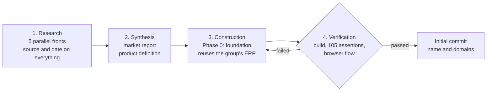
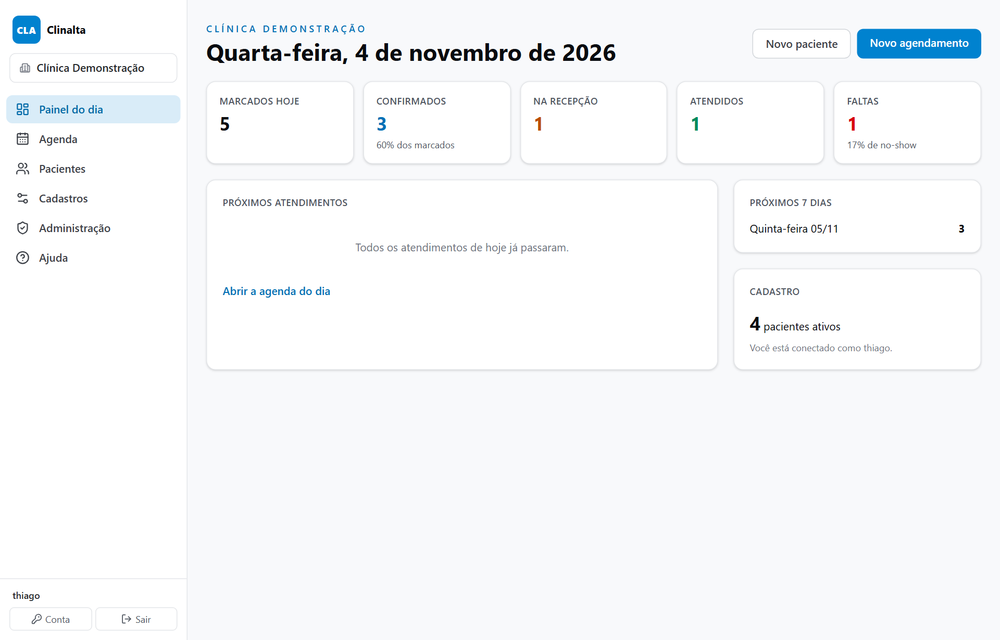
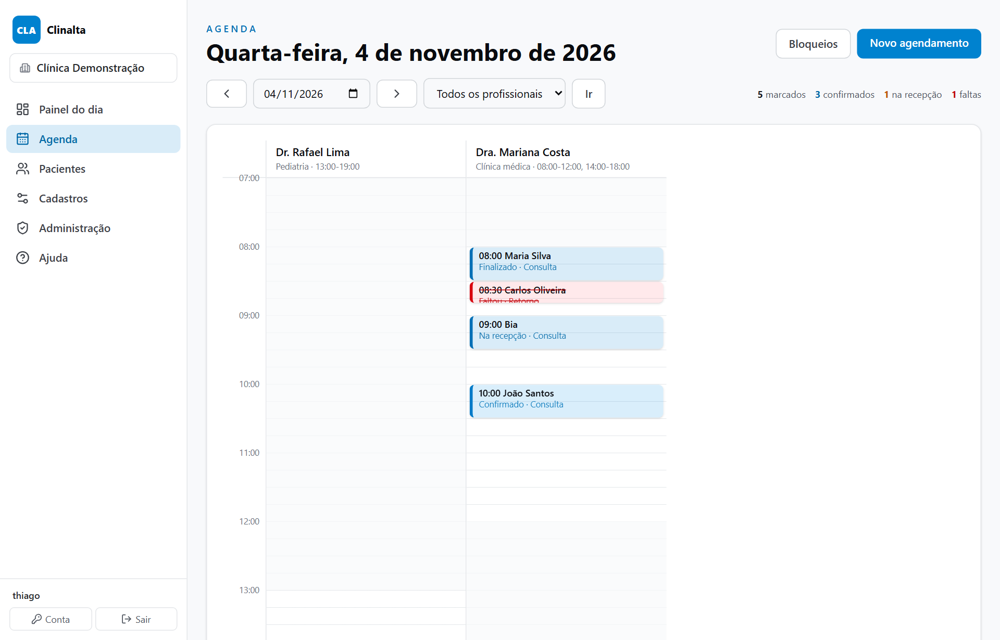
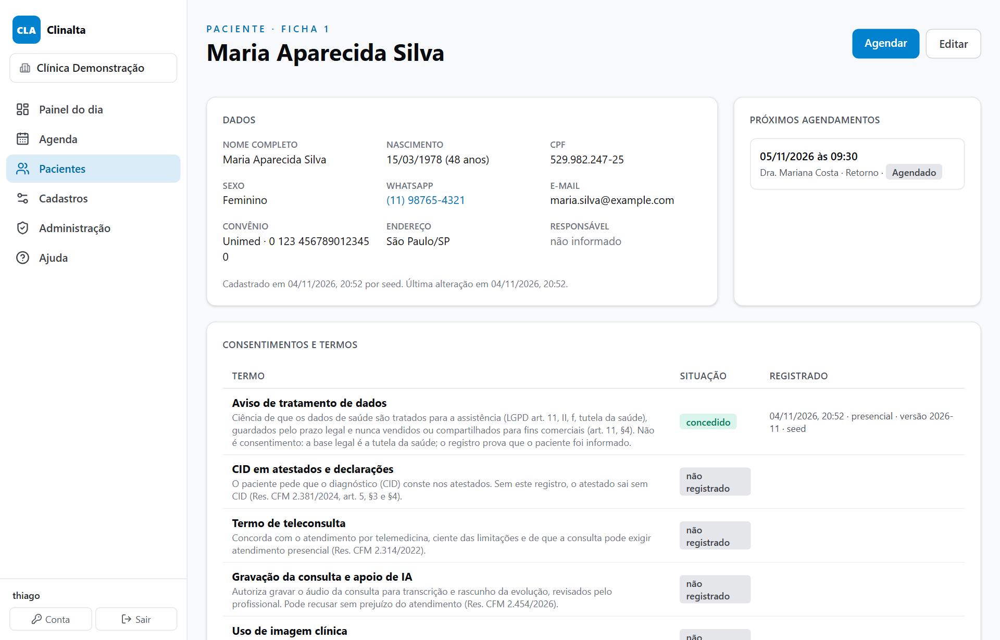

# Clinalta: from market research to a working product in one day

**Period:** November 2026 to date · **Role:** concept, research direction, architecture, code and verification · **Status:** Phase 0 built, evolving

> One-sentence summary: in a single working day I went from a question ("can I build a practice management system better than the market leaders?") to a product with a name, registered domains, market research with dated sources, a product definition and the first phase of the system working, tested and versioned.

## 1. Context and problem

After rebuilding the ERP of the industrial group I run, with AI, in six weeks and after a ransomware attack, I wanted to test whether the same method would work for a commercial product outside the group, in a regulated market with established competitors.

The chosen target was practice management for medical offices and clinics with up to 20 professionals, private and insurance patients. Three reasons: the market is large (635 thousand physicians in Brazil), the pain is known (a physician in my network agreed to validate the product) and there is a set of recent legal obligations that current systems still handle poorly: the Receita Saúde tax receipt since 2025, the national electronic service invoice in 2026, numbering of controlled prescriptions through the national registry (SNCR) and the medical council's resolution on AI in consultations.

The condition I set: not to build "yet another one". First understand how today's leaders work, in Brazil and worldwide, and only then decide what to build.

## 2. A four-step method

Four chained steps, each with an exit criterion, all in the same day. Verification sends the work back to construction when something fails; nothing moves on without passing it.

1. **Research on five parallel fronts** (about ten minutes of wall time). Five research agents, each with a scope and closed questions: leaders in Brazil, leaders worldwide, legal and tax requirements, module map and user pain points, integrations and technology. Rule: every claim with a source and a date, and gaps declared instead of invented.
2. **Synthesis into two documents.** A market report and a product definition, written by separate agents from the same notes, under fixed constraints I gave: the group's stack, the initial audience, non-negotiable principles and the section structure.
3. **Construction of Phase 0.** I reused from the group's ERP what was already proven in production (login, two-factor authentication, sessions, audit trail, multi-company) and wrote the rest: data schema, schedule, patients, master data, administration, help, demo data and tests.
4. **Verification.** Clean build, 105 assertions in four suites and a manual browser test of the full flow: book in three clicks, confirm, check in, a receptionist login blocked from administration, export downloaded.

What stayed with me at every step: the right question, the constraints, the critical reading of the results and the product decisions. What went to the AI: volume, parallelism and consistency.

## 3. What the research revealed

The fight in the Brazilian medical office is not about features. Every leader has scheduling, medical records, signed prescriptions, WhatsApp, finance, insurance billing and telemedicine, and AI transcription became table stakes in 18 months. The difference lies in reliability, the commercial relationship and the new legal obligations that nobody covers well.

| Finding | Evidence (2026-11-04) | What it changes in the product |
|---|---|---|
| Three groups dominate the medical office | Each uses the software as a gateway to another business (medical education, booking marketplace, marketing) | Compete on the customer relationship, not on subsidy |
| Prices from R$ 89 to R$ 299 per professional per month | Tiered plans; WhatsApp, digital signature and AI charged as add-ons | A single, public, all-inclusive plan |
| Complaints are about trust | On public complaint channels: records locked over a few cents of debt, no way to export records when leaving, replies taking more than two weeks | Never lock data; full export in one click; support with a deadline |
| Instability is the number one pain | 51% of physicians suffer slowness or outages every month (Black Book 2025) | Installable app tolerant to network loss, pages under 1 s |
| No-shows and claim denials hurt cash flow | 48% of clinics name no-shows as their biggest challenge; initial denial rate of 7.3% (ANS) | Confirmation through the official WhatsApp API and anti-denial checks at reception |
| New obligations with no answer in the market | Receita Saúde receipt mandatory since 2025 with no API; national service invoice in 2026; SNCR for controlled drugs until March 2027; CFM Resolution 2.454/2026 on AI | Native compliance as a barrier to entry |
| Worldwide, the bar went up | Patient portals reach more than half of US patients; ambient AI inside the record at every leader | Patient portal and AI with consent from the design stage |

A process lesson: research with dated sources avoided two wrong decisions. Without it, I would have treated SBIS certification as mandatory (it is voluntary) and the Receita Saúde receipt as automatable through an API (there is no API).

## 4. Product decisions

Eight non-negotiable principles, each tied to a proven pain and a measurable target. They entered the definition before the first line of code.

- **Never lock the medical record over billing.** Overdue accounts drop to read-only mode with export. Legal retention is 20 years; the data belongs to the physician, not to the system.
- **Full export in one click.** Patients, schedule, consents, audit trail and access log as CSV, without asking support. Signed PDF records and FHIR in later phases.
- **A single public price**, charged only per healthcare professional; reception and accountant at no cost. Third-party costs passed through at cost and shown on the invoice.
- **Few clicks, with targets.** Book in 3, finish a consultation with a signed prescription in 5, receive payment and issue a receipt in 2.
- **Tolerant to network loss.** Today's schedule and the records of booked patients cached; anything written offline enters a queue and syncs later, never overwriting.
- **Native compliance.** ICP-Brasil signature, patient tax ID on documents, consent for diagnosis codes, telemedicine and AI terms are part of the flow, not a paid module.
- **AI always reviewed.** Transcription and draft notes only with recorded consent, never a diagnosis suggestion to the patient, so the product does not become software as a medical device (RDC 657/2022).
- **Human support with a deadline.** Reply on the same business day and help on every screen.

Two scope decisions: start with offices and clinics of up to 20 professionals, and leave dentistry out, because it is a separate market with its own leaders.

## 5. What was built in Phase 0

The foundation: everything the later phases will use, and what a clinic can already operate day to day at the front desk. The proxy layer decides who gets in and into which clinic; the layers below trust it and filter everything by the active clinic.

| Module | What it does | Origin |
|---|---|---|
| Access | Password login, two-factor authentication (TOTP), per-device sessions, connected devices with remote sign-out | Reused from the group's ERP |
| Roles per clinic | One login, one role in each clinic: administrator, healthcare professional, reception, finance, read-only accountant | Adapted: the model was per module, became per role and per clinic |
| Clinic | Tax ID, national health facility code (CNES), tax regime, data protection officer; units, rooms, appointment types with duration and price | Adapted from multi-company |
| Professionals | Council, number, state, specialist registration (RQE), occupation code (CBO), calendar color, weekly availability per unit | New |
| Patients | Validated tax ID, unique per clinic, social name, legal guardian, insurance; versioned consents by type, channel and signer | New |
| Schedule | Daily grid per professional in 15-minute slots; book in 3 clicks; time and room conflicts; blocks; squeeze-ins; daily flow with timestamps; waiting room | New |
| Dashboard | Booked, confirmed, at reception, seen, no-shows for today; next appointments; next 7 days | New |
| Audit | Every change field by field; record of who opened each patient file and why (LGPD art. 37); CSV export | Audit reused; record access and export new |
| Infra | Installable PWA, health route, Docker with Postgres and daily backup, help by chapter, demo clinic | Reused |

### Screens of the demo clinic

The data below is fictitious, generated by the system's demo script.

*Daily dashboard. The indicators are computed over the active clinic's schedule.*

*Daily schedule per professional, in 15-minute slots. Each appointment shows its flow stage: finished, no-show, at reception, confirmed, booked.*

*Patient file. Consents are versioned by type, with the rule that requires each one; opening the file records who accessed it and for what purpose.*

### Built-in compliance

The research surveyed 22 rules and turned them into software requirements, classified as mandatory, differentiator or uncertain. Examples that already shaped Phase 0:

| Rule | What it requires | How it is in the system |
|---|---|---|
| LGPD art. 11 §4 | Health data is not shared between controllers for commercial purposes | Patients belong to the clinic, not to the group: every table carries the clinic id and every query filters by it |
| LGPD art. 37 | Record of processing operations | Access log for medical records by user, patient, purpose and screen |
| LGPD art. 14 §1 | Specific consent from the guardian for minors | Legal guardian in the registration; consent recorded as given by the guardian; warning on a minor's file without a guardian |
| CFM Resolution 2.381/2024 | Patient tax ID and physician's specialist registration on documents; diagnosis code only at the patient's request | Tax ID validated by check digit; RQE and CBO in the professional's registration; "diagnosis code on document" consent as its own type |
| CFM Resolution 1.821/2007 and Law 13.787/2018 | Medical records kept for 20 years | Nothing is deleted: patients and appointments are deactivated or cancelled, never removed |
| CFM Resolution 2.454/2026 | Patient informed and able to refuse AI; usage recorded | "Recording and AI" consent already in the catalog, for Phase 3 |

## 6. Numbers

All on 4 November 2026, between the first question and the initial commit.

| Measure | Value |
|---|---|
| Parallel research fronts | 5 |
| Words of research notes | 28,500 |
| Distinct sources cited with URL | 501 |
| Product definition | 5,400 words, 13 modules, 22 rules, 17 integrations, 5 phases |
| Files in the initial commit | 116 |
| Lines of TypeScript | 6,444 |
| Database tables | 18 |
| Screens and routes | 31 |
| Automated assertions | 105, in 4 suites |
| Clicks to book an appointment | 3, verified in the browser |
| Names tested at the Brazilian domain registry | 150, 33 available |

What is not done, stated just as clearly: Phase 0 has not been deployed to the VPS yet, backup restoration has not been tested, the trademark application has not been filed and the patient tax ID is still stored in plain text (the encryption exists and protects, for now, only the two-factor secret).

## 7. Lessons

- **Time zone is a requirement, not a detail.** The production server runs in UTC; "today" and "08:30" change day if computed in the process's zone. A date library computes everything in São Paulo time, with a test proving that 22:30 in São Paulo is still the same day.
- **A blocked source becomes a declared gap.** Several vendors' sites refused automated access. Their prices were marked as "third-party source, with date" and not as official.
- **A generic name is debt.** The first impulse was a category name that mixed languages and would hardly pass the trademark office. The final choice came from criteria (short, pronounceable, fits in an icon, .com.br available), 150 candidates checked automatically at the registry, and a rationale rather than taste.
- **Dated research avoids expensive decisions.** Two rules I would have taken for granted were wrong in my head; the research corrected them before the code.

## 8. Next steps

Five phases, each with a verifiable completion criterion and no promised dates. Each phase only starts with the previous one in real use.

1. **Phase 0, foundation (built).** Still to do: deploy to the VPS with a domain, test backup restoration and file the trademark. Gate: a fictitious clinic with two physicians and one receptionist books, registers and sees the audit trail in production.
2. **Phase 1, MVP for private practice.** Medical record with timeline, SOAP notes and specialty templates; searchable ICD-10; immutable versions with chained hashes; documents signed with a digital certificate and validated by the national validator; simple finance with Pix; Receita Saúde receipt per payment; official WhatsApp; offline reading. Gate: a real office uses it for 30 days without losing a single appointment.
3. **Phase 2, clinics and insurers.** Validated TISS claims, batches, denials and appeals; national service invoice; DMED annual report; physician payouts; patient portal; recall and NPS. Gate: a full month closed at a clinic with insurance, batch accepted by the insurer and payouts checked by the accountant.
4. **Phase 3, AI, telemedicine, BI and inventory.** Ambient transcription with terms and recording; telemedicine; in-house prescriptions with SNCR numbering; no-show, denial and P&L dashboards. Gate: a pilot physician approves the AI draft in 20 consultations with minimal editing.
5. **Phase 4, certification and ecosystem.** SBIS preparation, national health data network (RNDS) in FHIR, public API, WhatsApp agent, ICD-11.

## 9. Stack

Next.js 16 with server actions · React 19 · TypeScript · Tailwind 4 · Drizzle ORM · PGlite in development and PostgreSQL in production · Docker on the VPS behind Caddy. Conventions inherited from the group: money in cents, dates always in São Paulo time, every table with the clinic id, every action writes to the audit trail, nothing is deleted.

## 10. Code

The repository is private: the product is commercial and handles health data. It can be shown in interviews or academic evaluation with the demo clinic. Product definition and architecture documents exist in the repository and follow this case.
