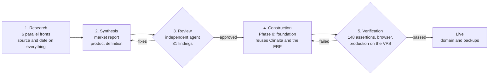
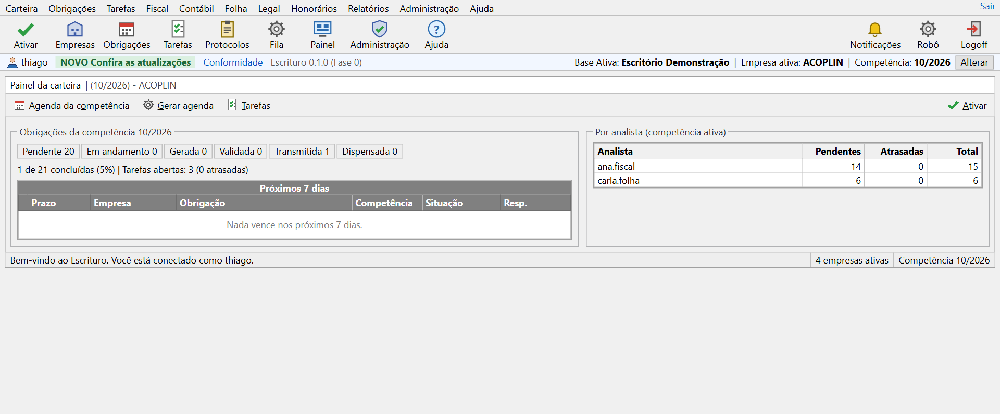
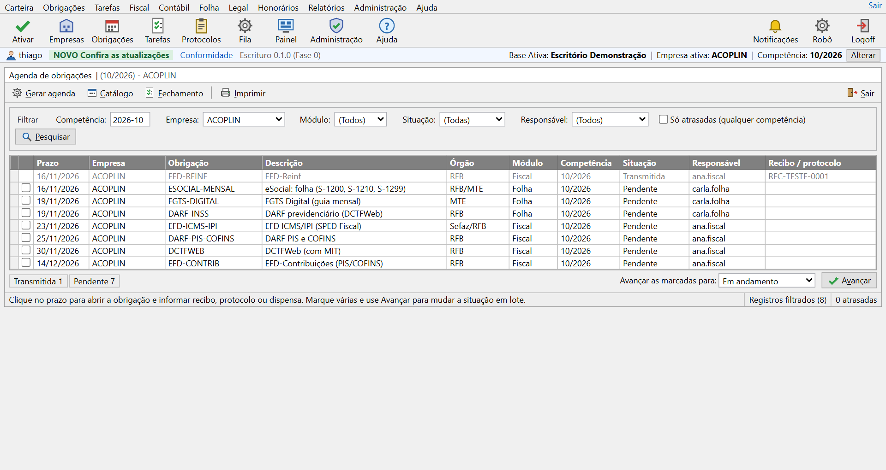
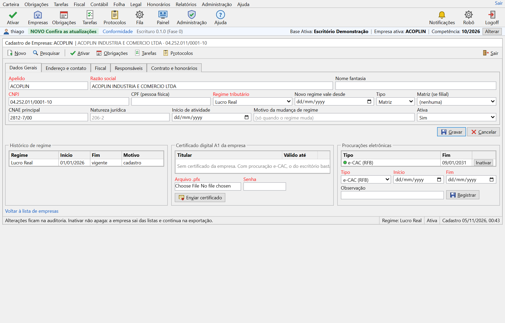

# Escrituro: from market research to a product in production in two days

**Period:** November 2026 to date · **Role:** concept, research direction, architecture, code, verification and deployment · **Status:** Phase 0 in production, evolving

> One-sentence summary: in two working days I went from a question ("can I build a system for accounting firms as good as or better than Contmatic Phoenix?") to a product with a name, a registered domain, market research with 659 dated sources, a product definition reviewed by an independent agent and the first phase of the system running in production, with domain, certificate and backups.

## 1. Context and problem

The day before, I had built [Clinalta](clinalta.md), a practice management system for clinics, in a single day, to test whether the method I used on my industrial group's ERP would work for a commercial product. It did. The next question was whether it could handle a larger, more regulated market and a product with seven modules that talk to each other: the accounting firm.

The benchmark was Contmatic Phoenix, the best-known system for accounting firms in Brazil. Three reasons for the target: my group pays an external accounting firm, and its seven legal entities serve as the first real client; tax, bookkeeping, payroll, fixed assets, corporate records, fees and client portal demand architecture, not just screens; and the Brazilian tax reform (informational CBS and IBS in 2026, full CBS and the hybrid Simples regime in 2027) forces every vendor to rewrite its tax engine, which opens a window for a product born without legacy.

Two conditions I set: not to build "yet another one", understanding first how the seven leaders work; and to bet on the gray, dense, keyboard-driven look of Phoenix, against the tide of flat white, because it is what the firm's analyst knows and because density is productivity.

## 2. A five-step method

The four steps of Clinalta gained a fifth, an independent review of the definition before any code, and verification now includes deployment. Each step has an exit criterion; nothing moves on without passing it.

1. **Research on six parallel fronts.** Six agents, each with a scope and closed questions: market leaders; tax and the tax reform; bookkeeping, fixed assets and corporate records; payroll and eSocial; pain points, prices and integrations; and the Phoenix visual standard, with colors measured pixel by pixel from screenshots. Rule: every claim with a source and a date, gaps declared instead of invented.
2. **Synthesis into two documents.** A market report with an obligation x layout x deadline x source table and twelve ranked gaps, and a product definition in eleven sections: vision, personas, modules by phase, rules as requirements, integrations, architecture, visual standard, commercial model, roadmap, risks and names.
3. **Independent review.** An agent that did not write the definition checked it against the notes and the report. It raised 31 issues, all fixed: misaligned phases, completion criteria tied to 2027 dates, the LALUR tax ledger cited for a regime that does not use it, an AI quota per company that would cost more than the subscription, a "never lock" policy with no exact definition.
4. **Construction of Phase 0.** I reused from Clinalta and the ERP what was already proven (login, two-factor authentication, sessions, audit trail, isolation unit) and wrote the rest: client portfolio, obligations engine, sourced catalog, tasks, delivery receipts, work queue, Phoenix component library.
5. **Verification and deployment.** Clean types and lint, 148 assertions in four suites, the full flow in the browser and, the next day, deployment to the VPS with domain, certificate, daily backups and the database added to the dump routine.

What stayed with me: the question, the constraints, the critical reading, the product decisions and the acceptance. What went to the AI: volume, parallelism, consistency and the cross-review.

## 3. What the research revealed

The fight in the accounting firm is not about features. The seven leaders (Contmatic, Domínio, Alterdata with Prosoft, Fortes, Questor, SCI, Makro) have covered tax, bookkeeping and payroll for decades. The difference lies in performance, the commercial relationship, the predictability of updates and a tax reform that nobody has absorbed natively.

| Finding | Evidence (2026-11-04) | What it changes in the product |
|---|---|---|
| "Cloud" means a virtualized Windows application | Phoenix Cloud and Domínio Web deliver Delphi programs through virtualization; reports of "far too slow", "drops all the time", a four-hour ECF run on a 64 GB server | Native web with desktop density and keyboard, SPED files generated in the background with a visible queue |
| Contracts lock in and prices are on request | 12-month commitment with a 100% penalty, IGP-M indexation with a 4% floor, data removed on termination; only Makro publishes a price list | Public price table by number of companies, no commitment, full export including after cancellation |
| Updates break what worked | Regressions in Contmatic's SPED (07/2026) and Fortes' invoicing (06/2026); eSocial changed its schema four times in four months; no vendor publishes which layouts it supports | Public compliance page per obligation, version, technical note and validity; rules parameterized by assessment period, not by software version |
| The tax reform is a bolted-on module | EFD ICMS/IPI and EFD-Contribuições do not compute CBS and IBS; hybrid Simples in 2027; alphanumeric tax IDs in every layout | IBS and CBS modeled in the document, the assessment and the chart of accounts from the start; tax ID stored as text across the database |
| Federal automation has a known price | Integra Contador costs R$ 3 to R$ 5 per company per month; e-CAC powers of attorney expire after five years | Certificate and power of attorney portfolio with expiry alerts from Phase 0; Serpro cost passed through with no hidden margin |
| Firm management is a "parallel tool" | Domínio users need another tool; Acessórias, Nibo and Gestta live off that gap | Rule-generated obligations calendar, delivery receipts, tasks, fees and portal in the product's core |
| Phoenix is gray, dense and keyboard-driven | Background #F0F0F0, grid header #808080, selection #0078D7, Segoe UI 12 px, 18 px per row, zero radius, Ctrl+Enter opens lookups | A component library with those measured tokens, not "inspired" by them |

A process lesson: the independent review caught errors I would have let through. Two examples: the LALUR ledger exists only under the actual-profit regime, and the DCTFWeb's MIT is a JSON file the system generates, not one it reads.

## 4. Product decisions

Eight non-negotiable principles, each tied to a proven pain. They entered the definition before the first line of code.

- **The data belongs to the firm and its client.** Full export in one click: SPED files, eSocial events with receipts, competitors' TXT layouts, CSV of everything.
- **Never lock over billing.** Overdue accounts never stop anything with a legal deadline; what stops, after 60 days, is creating new companies, users and periods.
- **Public, predictable pricing.** Five tiers, from R$ 149 per month for up to 10 companies to R$ 2,490 for up to 500, all modules, unlimited users, no commitment, adjustments only by the official inflation index.
- **Fast and dense.** Pages under one second, 18 px grid rows, Enter advances, Esc cancels, Alt+letter triggers the button.
- **Nothing is lost.** Entries, documents and events never have their content altered; a correction creates a reversal or a new version with a reason; audit trail on every table.
- **Compliance by versioned, public layout.** Each obligation has a version with validity dates and the system picks it by period; a public page lists what is supported.
- **Relationship inside the system.** Portal, WhatsApp, delivery receipts, tasks and fees are part of the product.
- **Human support with a deadline.** Numbered tickets, reply on the same business day, release notes before every update, update windows outside closing periods.

Three scope decisions: start with bookkeeping and the tax routine of the Simples regime, with my group's companies as the first client; leave legacy state-level returns to the real portfolio, not to the catalog; and keep the Phoenix look against the tide, testing the five main screens with accountants next to the original screenshots.

## 5. What was built in Phase 0

The foundation: what every later phase will use, and what a firm can already operate to control deadlines. The firm is the isolation unit; every table carries its id, and the active client company and period live in the session, as in Phoenix.

| Module | What it does | Origin |
|---|---|---|
| Access | Password login, two-factor authentication, per-device sessions, remote sign-out | Reused from Clinalta |
| Firm and roles | One login, one role per firm (administrator, manager, tax, bookkeeping, payroll, corporate, finance, read-only), restricted to all companies or to selected ones; the support access commitment is written into the help | Adapted: the clinic became the firm, and the client company is a second level |
| Portfolio | Companies with a short alias, numeric or alphanumeric tax ID validated, tax regime by validity period (a change opens a new row, never overwrites), indicators that switch obligations on (employees, ICMS, tax substitution, IPI, ISS, withholdings), responsible analysts, encrypted A1 certificate, powers of attorney with expiry alerts | New |
| Obligations calendar | Catalog of 20 federal obligations with rule, layout and version; deadline rules as pure functions (fixed day, last business day, nth business day, annual date, 13th salary) with national and bank holidays and a computed Easter; postpone or bring forward; idempotent generation per period; statuses with receipt and waiver; batch advance; closing per module | New |
| Tasks and receipts | Open items with owner, priority and deadline; delivery and receipt protocols with sequential numbering and a copy for signature | New |
| Work queue | Long routines queued with visible status, prepared for background SPED generation | New |
| Dashboard and reports | Period obligations by status, next seven days, load per analyst, due dates | New |
| Audit and export | Every change field by field; access per company; nine tables as CSV, instantly | Reused |
| Phoenix visual standard | Measured tokens, about 40 colored icons, cascading text menus, labeled toolbar, window with status bar, "Active base, Active company, Period" strip, keyboard first | New |
| Infra | Docker with Postgres and daily backup, health route, help by chapter, compliance page, demo firm | Reused |

### Screens of the demo firm

The data below comes from the demo firm, with the group's companies registered by the seed script.

*Portfolio dashboard. The top strip shows the active base, company and period, as in Phoenix; the counters are computed over the generated calendar.*

*Obligations calendar. PGDAS-D fell on 23 November because 20 November is a holiday and the rule postpones; FGTS Digital was brought forward to 19 November by the opposite rule. Each row opens the obligation for receipt, protocol or waiver.*

*Company record. Required fields in red, tabs, regime history by validity period, A1 certificate and e-CAC powers of attorney with end dates. Nothing is deleted: deactivating removes from lists and keeps in exports.*

### Built-in compliance

The definition mapped 31 rules and layouts as software requirements, with version and validity. Those that already shaped Phase 0:

| Rule or layout | What it requires | How it is in the system |
|---|---|---|
| IN RFB 2.237/2024 as amended by IN 2.248/2025 | DCTFWeb by the last business day of the following month | "Last business day" rule in the catalog, with source |
| CGSN Resolutions 140/2018 and 183/2025 | PGDAS-D by the 20th, with a late penalty since 2026-01-01 | "20th, postponed" rule and overdue warning on the dashboard |
| FGTS Digital FAQ (Law 8.036, art. 18) | Due on the 20th, brought forward on national or bank holidays | "20th, brought forward" rule, with bank holidays in the calendar |
| EFD ICMS/IPI layouts 020 and 021 | Layout 021 from 2027-01-01 | Catalog with validity per version; the period picks the layout |
| Alphanumeric tax ID (IN RFB 2.229/2024) | New tax IDs with letters from July 2026 | Tax ID as text across the database, ASCII-weighted validation, single formatter |
| IN RFB 1.751/2017 (e-CAC power of attorney) | Power of attorney with a term, required to file on the firm's behalf | Powers of attorney per company with end date and an alert 30 days before |
| LGPD arts. 37 and 46 | Record of processing operations and security | Field-by-field audit trail, access per company, certificate and two-factor secret encrypted |

## 6. Numbers

All between 4 and 5 November 2026, from the first question to deployment.

| Measure | Value |
|---|---|
| Parallel research fronts | 6 |
| Words of research notes | 42,300 |
| Distinct sources cited with URL | 659 |
| Market report | 8,500 words, 12 ranked gaps |
| Product definition | 11,600 words, 11 sections, 31 rules and layouts, 20 integrations, 6 phases, 13 risks |
| Independent review findings applied | 31 |
| Files in the initial commit | 122 |
| Lines of TypeScript | 7,876 |
| Database tables | 21 |
| Screens and routes | 36 |
| Obligations in the default catalog, with sources | 20 |
| Automated assertions | 148, in 4 suites |
| Candidate names checked at the Brazilian registry | 10 |
| Time from the decision to deploy to the system answering on the VPS | about 30 minutes |

What is not done, stated just as clearly: backup restoration in production has not been tested yet, the trademark application has not been filed, the A1 certificate was only tested without a real file, the EFD ICMS/IPI and ISS deadlines use São Paulo's and the catalog has no state-level returns.

## 7. Lessons

- **Measuring beats describing.** The visual-standard agent read the colors from Phoenix screenshots pixel by pixel. The tokens came out exact, and the first screen already looked like the original instead of "inspired" by it.
- **Independent review before code.** Thirty-one points fixed in an 11-thousand-word definition, by an agent that did not write it. Cheap compared to discovering in code that the AI quota would cost more than the subscription.
- **External dates do not wait for the roadmap.** The definition tied completion criteria to January 2027. The review untied them: layout 021 and the hybrid Simples simulator move to Phase 2, and period 01/2027 can be redone later from the files.
- **Business days are a business rule.** PGDAS-D postpones, FGTS Digital brings forward, and bank holidays count. The deadline engine is a pure function, tested against the real 2026 calendar.
- **The right domain is .com.br.** escrituro.com had been with a speculator since April. For a Brazilian product, the .com.br registered directly at the national registry is enough, after unlinking the owner's tax ID from the previous provider.

## 8. Next steps

Six phases, each with a verifiable completion criterion and no promised dates. Each phase only starts with the previous one in real use.

1. **Phase 0, foundation (live).** Still to do: test backup restoration in production, file the trademark and validate the five screens with accountants. Gate: a demo firm with the group's companies, a calendar generated by regime and an analyst marking obligations with receipts in production.
2. **Phase 1, MVP for bookkeeping and the Simples tax routine.** Chart of accounts with reference mapping, entries, reconciliation, trial balance and closing, reusing the group's management accounting; capture of NF-e and CT-e by NSU with acknowledgment; national service invoice; PGDAS-D, DAS and DEFIS through Integra Contador; informational IBS and CBS assessment; fees and client portal. Gate: a full month of the group's companies booked in the system and a small external firm in pilot.
3. **Phase 2, standard regime and SPED.** Assessment of ICMS, tax substitution, DIFAL, IPI, PIS and COFINS; EFD ICMS/IPI 020 and 021 by validity; EFD-Contribuições; Reinf; DCTFWeb with MIT; ECD with signatories; fixed assets with dual depreciation. Gate: EFD and ECD of one group company validated in the official programs and filed.
4. **Phase 3, payroll and eSocial.** S-1.3 events, monthly calculation, vacations, 13th salary, terminations, FGTS Digital and DCTFWeb end to end. Gate: one group company's payroll closed in the system with totals checked.
5. **Phase 4, corporate records, AI and full portfolio.** Corporate department with Redesim, AI assistant with a quota per firm, employee app. Gate: pilot firm operating its whole portfolio.
6. **Phase 5, full tax reform and ecosystem.** Real CBS, hybrid Simples, split payment, public API. Gate: periods from 01/2027 onward assessed without rework.

## 9. Stack

Next.js 16 with server actions · React 19 · TypeScript · Tailwind 4 · Drizzle ORM · PGlite in development and PostgreSQL in production · Docker on the VPS behind Caddy. Conventions inherited from the group: money in cents, dates always in São Paulo time, every table with the firm id, every action writes to the audit trail, nothing is deleted.

## 10. Code

The repository is private: the product is commercial and will process third-party tax, accounting and payroll data. It can be shown in interviews or academic evaluation with the demo firm. The product definition, the market report and the research notes exist in the repository and follow this case.
