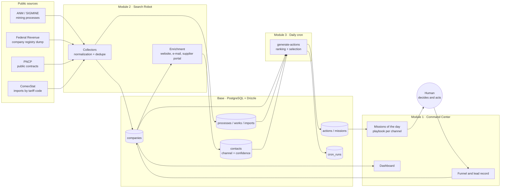

# Genesis: B2B prospecting agents in production

**Period:** July 2026 to date · **Role:** concept, architecture, code, operations and daily use · **Status:** in production on a self-operated VPS, three instances

> One-sentence summary: an engine of agents that reads public data sources (mining concessions, the federal company registry, public procurement contracts, import statistics), discovers who buys what I sell, finds the entry channel and hands me, every day, a short list of commercial missions with a ready-made script.

## 1. Context and problem

I sell industrial supplies (quick couplings, clamps, hoses, valves) to mining companies, contractors and distributors. The bottleneck was never product or price. It was knowing **whom** to approach, **through which channel** (supplier portal, procurement e-mail, phone) and **when**, with a small sales team.

Manual prospecting had three costs:

- Hours per week researching company by company, with no memory of what had already been done.
- Cold leads: many companies listed, few with a real buying signal.
- Zero traceability: no metric of which channel converted.

Off-the-shelf CRM and prospecting tools did not solve it because they do not know the Brazilian sources that matter in this niche (the mining agency ANM/SIGMINE, the federal company registry dump, the public procurement portal PNCP, the ComexStat import statistics), nor the concept of an "entry channel" in a large industrial company, where the path is the supplier qualification portal, not a salesperson.

Self-imposed constraint: **100% open source and self-hosted**. No paid managed platform. The system had to run locally at first (a machine without Docker) and later on the VPS, without a rewrite.

## 2. Results so far

| Indicator | Value |
|---|---|
| Companies loaded (mining instance, 7 states) | 35.8 thousand |
| Mining processes matched to companies | 156 thousand |
| Mining companies with a verified entry channel (curated seed) | 25 |
| Missions generated per day (configurable) | 5 |
| Instances in production | 3 (mining, valves, São Paulo Metro works) |
| Paid dependencies | 0 |

What changed in practice: the commercial routine starts by opening the Command Center, which already shows the five companies of the day, why them (mining process phase, active contract, importing state), the entry channel with a link and the contact script. The funnel (new, contacted, registered, approved, quoting, customer) is recorded per company, with dated notes.

Conversion metrics per channel and prioritization accuracy have not been consolidated yet. That is what section 7 proposes to measure, and it is the part that matters for the academic work.

## 3. Architecture

### Modules and boundaries

- **Module 1, Interface** (Next.js 16, React 19, Tailwind 4). Server Components read the database directly through Drizzle; mutations go through Server Actions. The frontend never talks to an external source.
- **Module 2, Search Robot** (Node processes run with `tsx`, Playwright and cheerio). One collector per source, each with `config`, `collect`, `normalize` and `run`. Writes to `companies` and to the evidence tables (`mining_processes`, `works_contracts`, `comex_imports`).
- **Module 3, Daily cron** (standalone worker with node-cron, no Redis). Two jobs: `collect` and `generate-actions`. Every run is recorded in `cron_runs` with JSON details.
- **Shared base** (`lib/db`). Same schema and same API with two drivers: embedded PGlite in development (Postgres compiled to WASM, no Docker) and PostgreSQL + pgvector on the VPS. Switching is one environment variable.
- **Deployment**: Docker Compose with Postgres, app and worker; Postgres without an exposed port; HTTPS through Caddy with automatic certificates; basic authentication in the middleware; health-check route; tested restore runbook.

### The instance pattern

Each niche is a fork of the engine with its own database, port and collectors. The mining instance uses ANM + the federal registry; the valves instance uses the federal registry (industry code 2813-3 and company name) + ComexStat (tariff code 8481.80.95 by state and municipality, because there is no longer public data per importer); the Metro instance uses the PNCP API filtered by the agency's tax ID, where every contract already names the winning supplier. The interface, funnel, cron and playbook code is the same. Changing niche means writing one collector and adjusting the ranking function.

## 4. The agent loop

I use the classic definition of an agent: it perceives the environment, keeps state, decides and acts, and is evaluated by a performance measure. In Genesis each part lives in a module:

| Cognitive function | Where it lives | How it works today |
|---|---|---|
| **Perception** | Module 2 collectors | Periodic reading of public sources; name normalization (SIGMINE has no tax ID, so matching against the federal registry is by normalized company name) |
| **Memory** | Database (companies, contacts with confidence, funnel, notes, cron log) | Idempotency through a unique key in `contacts`; stage history per company; audit of every run |
| **Reasoning / decision** | `generate-actions` | Deterministic ranking by signals: known channel first, then hot process phase (mining concession), then active contract, then company size. Excludes companies with an open action. Selects N per day |
| **Action** | Command Center + playbook | Generates the mission with an objective (register on the portal or open a relationship), estimated time and a script per channel type, including a ready message. The external action is human |
| **Learning** | Not yet closed-loop | The funnel records the outcome, but the ranking is not adjusted by it yet. That is the next step |

Two design choices are deliberate:

1. **Human in the loop.** The agent does not send e-mails or fill in portals by itself. In industrial B2B sales a bad first contact closes the door for years. The agent lowers the cost of deciding; it does not decide.
2. **No scraped personal data.** Contacts of people are entered manually by the user. Automatic enrichment looks only for institutional channels (website, procurement e-mail, supplier portal).

## 5. Engineering decisions

- **PGlite in development, Postgres in production, same code.** It allowed starting on a corporate machine without Docker and migrating to the VPS without changing a single query. Cost: PGlite accepts one process at a time, so app and worker do not run together in development.
- **Cron as a Node process, not a queue.** No Redis or broker. The volume (a few collections and one generation per day) does not justify the complexity; the log table provides the needed observability.
- **Confidence per contact, not per company.** Each channel has a source (curated, web, registry) and a number from 0 to 1. The mission shows the channel with the highest confidence. This separates hand-verified data from inferred data.
- **Explainable prioritization.** The ranking is a sum of readable weights. When the mission appears, the user understands why that company came first. This will matter in the comparison against an LLM ranking (section 7).
- **Fork per niche instead of multi-tenant.** Simpler to operate and to isolate failures; the cost is duplicating fixes. Acceptable with three instances; beyond that it becomes a shared package.

## 6. Lessons

- **Scraping search engines does not scale.** DuckDuckGo answers 202 (anti-bot); Bing through Playwright serves only the first query of a session. The web enrichment pipeline was finished and then disabled. The robust source is deterministic: the federal registry carries official e-mail and phone; the cost is the 5 GB dump and the name matching.
- **Every public API has a hidden rule.** PNCP rejects date windows longer than one year (HTTP 422) and returns 204 for an empty period; the collector slices by year and treats empty as normal.
- **Curated data beats volume.** 25 mining companies with a verified portal generated more useful action than 35 thousand companies without a channel. The metric that matters is "actionable leads", not "leads".
- **Large works do not show up where expected.** The consortia of the Metro lines were tendered before 2025 or through another route and are not in the agency's PNCP records. They enter through a curated seed, with the work linked to the member contractor.
- **Operations are part of the system.** After a security incident that destroyed the company's physical servers in September 2026, this project and the others gained backups with immutable retention (Object Lock) and a tested restore runbook. An agent in production that does not come back from a disaster is not an agent in production.

## 7. Next steps and evaluation plan

The planned cognitive layer (Phase 4 of the backlog) is where the project meets the graduate program. The proposal is to treat every addition as an experiment with a metric defined before coding.

### Layers to add

1. **Message personalization with a local LLM** (Ollama, Llama 3.1 or Qwen 2.5). Today the playbook is a template per channel. The LLM receives company, substance or work, state and channel, and generates the message. Evaluation: reply rate for generated messages against templates, in weekly A/B tests.
2. **RAG over niche documents** (pgvector, nomic-embed-text, 768 dimensions). Tender notices, supplier qualification rules, portal pages. Goal: the agent answers "what does this company require to qualify a supplier" from a cited source.
3. **Lead qualification by LLM** alongside the deterministic ranking. Same candidates, two lists. Evaluation: agreement between the lists and, at the funnel outcome, which list got more of the companies that reached quotation.
4. **Closed learning loop.** The funnel outcome (registered, approved, quoting, discarded) feeds back into the ranking weights. It starts with a monthly manual adjustment and evolves into automatic adjustment.

### Metrics to start collecting

| Metric | How to measure | Why it matters |
|---|---|---|
| Prioritization precision | % of the day's missions that advance in the funnel within 30 days | Measures whether the reasoning chooses well |
| Reply rate per channel | replies / contacts, by channel type | Defines where the agent should concentrate effort |
| Conversion per stage | new, contacted, registered, quoting, customer | Full funnel, per instance |
| Cost per actionable lead | human hours + infrastructure / leads with a verified channel | Compares against manual prospecting |
| Human time per mission | estimated vs. actual, recorded at completion | Measures the real operational gain |
| Rules vs. LLM agreement | overlap of the lists and accuracy at the outcome | Decides whether the LLM joins the ranking or only the message |

### Possible angles for academic work

- Hybrid agent (explainable rules + LLM) for B2B lead prioritization: a controlled comparison in production.
- Human-in-the-loop agent architecture for decisions with a high cost of error: when the agent must stop.
- Perception from fragmented Brazilian public data: integrating ANM, the federal registry, PNCP and ComexStat as the agent's environment.

## 8. Stack

Next.js 16 · React 19 · TypeScript · Tailwind 4 · Drizzle ORM · PostgreSQL 16 + pgvector · PGlite · Playwright · cheerio · node-cron · Ollama · Docker Compose · Caddy · Ubuntu on a self-operated VPS.

## 9. Code

The code of the three instances is private: it contains the prioritization logic and the curated channel seed, which are the commercial advantage of the business. It can be presented in interviews or academic evaluation with synthetic data. Architecture, database, deployment and restore-runbook documents exist in the repository and follow this case.
