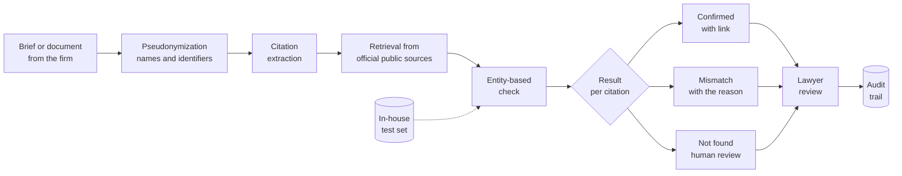

# Legal AI that cites or abstains: every citation checked against the official source

**Period:** November 2026 to date · **Role:** concept, research, architecture, code and operations · **Status:** closed pilot, under confidentiality

> In one sentence: an AI product for lawyers built around one simple rule: no citation goes through without being checked against an official source, and when the source does not confirm it, the system says "not found" instead of guessing.

**About this case study.** The product is in a closed pilot, and the strategy (entry practice area, sources, internal method, pricing) stays confidential until launch. So this case study shows the principles, the high-level architecture and the way of working, and leaves out code, prompts, the test set and evaluation numbers. In an interview, I can walk through the architecture in more detail.

## 1. The problem

Language models already draft a decent brief. The problem is the citations: they cite precedents that do not exist, or that exist but do not say what the brief claims, with a plausible number, judge and date. For the lawyer the mistake is expensive, and Brazilian courts have already fined lawyers for nonexistent case law and reported them to the Bar.

The literature confirms the risk. Stanford studies measured hallucination on legal questions both in general-purpose models (Dahl et al., 2024) and in specialized legal tools with document retrieval (Magesh et al., 2024). In other words, plugging a search engine into the model reduces the problem but does not solve it.

The product question became: **how do you build a legal AI that a lawyer can trust without rereading everything?**

## 2. The principles

| Principle | What it means in practice |
|---|---|
| **Cite or abstain** | Every statement that relies on a precedent needs a retrieved official source. Without one, the system does not fill the gap: it flags the item for review |
| **Check by entities, not by similarity** | Two rulings can read alike and come from another court, another judge or another year. Similarity search is for finding candidates; confirmation uses the data that identifies the ruling (court, number, judge, date) |
| **"Not found" is a valid answer** | A false "confirmed" costs a fine; a "not found" costs a manual check. The system is designed to err on the side of doubt |
| **Personal data never leaves unmasked** | Names, tax IDs and other identifiers become placeholders before anything is sent to an AI model, and go back to the real name only in the answer, inside the system |
| **Measure before promising** | An in-house test set measures the verifier on every change. The commitment is to publish the result and the known limits at launch |
| **The lawyer decides, the tool checks** | Every result comes with a link to the official source, and what the AI did and who reviewed it goes into an audit trail |

## 3. High-level architecture

| Part | How it works |
|---|---|
| Sources | Official, public databases only. When a source is down or does not cover a court, the system says so, instead of treating absence as "does not exist" |
| AI models | Used where language helps (reading, extracting, drafting), never as the source of truth about a precedent |
| Pseudonymization | Done inside the server, before anything is sent to an external model. When in doubt, it masks |
| Evaluation | In-house test set, run on every change to the verifier |
| Audit | Record of who did what, of what the AI produced and of what was reviewed, exportable by the firm |

## 4. How the product is built

- **One version per feature, each one documented.** Every change has a document with the problem, the rule, the tests and the deployment record. From the first version live, on 2026-11-09, to 0.58.0, on 2026-11-27, it took 19 days.
- **Legal rules checked against the official text before the code.** When the product computes something set by law, the rule is read in the official source, and the test cites the article. Where the law leaves room for doubt, the system shows the doubt instead of silently picking a side.
- **Tests that keep up with the product.** More than 1,300 automated checks, from pure rules to a temporary database per test and end-to-end checks. Every version goes through them, plus a check of the screen in the browser.
- **Deployment with a guaranteed way back.** Before every deployment, the code and the database are copied and verified. The code in production is compared, file by file, with the previous version in the repository. Afterwards, health, version, migrations and logs are checked.
- **Confidentiality as a product decision.** On day one, a document classified every piece of information: what can be said now, what only under a confidentiality agreement and what never goes out. This case study follows that document.

## 5. Lessons

- **In a regulated domain, "I don't know" is a feature.** Users trust a tool that admits it found nothing more than one that always answers.
- **Retrieval is not verification.** Finding the right document is half the job; confirming that it says what the brief claims is the other half, and that half is what prevents the fine.
- **Evaluation comes before marketing.** Without an in-house test set, any sentence about "reliability" is opinion. With one, it becomes a number that can be published and held to account.
- **Building fast is not validating.** The speed of building with AI agents is real, but from here on the roadmap is decided by the pilot firms.

## 6. Next steps

1. **Pilot** with law firms, under a confidentiality agreement.
2. **Launch** with the test set result published, the method at a high level and the known limits.
3. **Full case study** in this portfolio, in the format of [Escrituro](escrituro.md) and [Clinalta](clinalta.md), after launch.

## 7. Stack and code

Next.js 16 · React 19 · TypeScript · Drizzle ORM · PostgreSQL (PGlite in development) · Claude API · Docker on an ARM VM on Oracle Cloud in São Paulo, behind Caddy.

The code is private. I walk through the architecture in interviews, within what the pilot's confidentiality allows.
