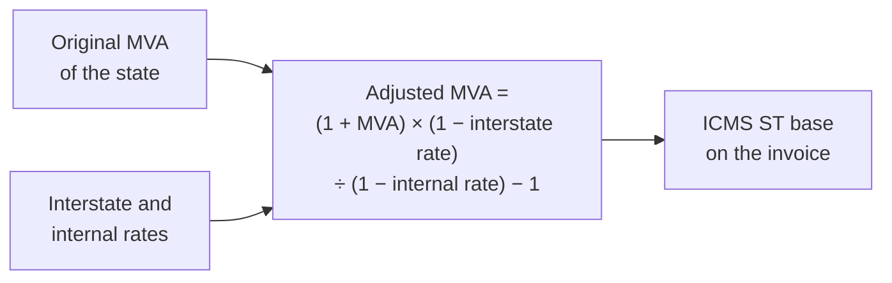
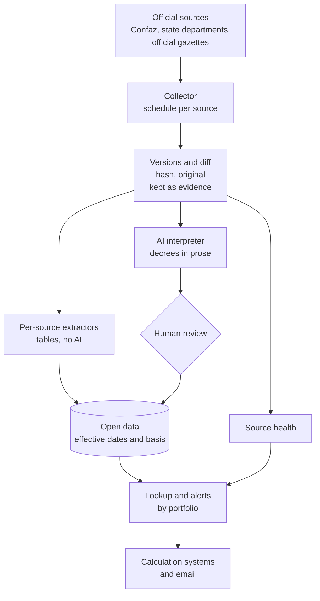

# ICMS ST: watching tax rules that change without notice

**Period:** November 2026 to date · **Role:** concept, source survey, architecture, code, validation and publishing · **Status:** Phase 0 in production (30 sources watched); Phase 1 published (Convênio 142 and protocol matrix); four states with structured goods lists and MVA; parameters already checked against a real company's quoting system

> One-sentence summary: in two days I went from a pain every goods seller in Brazil knows ("the ICMS ST rule changes and nobody tells me") to a monitor in production that watches 30 official sources and emails what changed and since when, plus open data with the history of every item, the matrix that says to which states a São Paulo seller must withhold the tax, and the MVA of Minas Gerais, Paraná, Rio Grande do Sul and Bahia, cross-checked against each other and already used to verify the calculation of a system in production.

## 1. Context and problem

Under ICMS tax substitution (ST), the seller pays in advance the state sales tax for the whole downstream chain. To do that it must know, for each product and each destination state, whether the goods are under the regime, which value-added margin (MVA) applies, which rate, and whether a poverty-fund surcharge is due. These rules change by decree, ordinance or interstate agreement, in 27 states and at Confaz, without notice to those affected.

In my group's distribution company, the sales quote already calculates ST per item. The calculation is fine; the parameter is what goes stale. The accountants do not warn when an MVA changes, because they do not follow everything either, and the market solves this with tax consultancies costing more than a thousand reais a month that, in the end, read the same public sources.

The inspiration came from a project shown in my graduate program's community: an "oracle" for a court's internal rules, with hybrid search over thousands of resolutions. The key difference: here the answer is not a passage of text, it is a number that goes on an invoice. A mistake becomes a tax assessment. That is why the design is a monitor with source and date, not a chat.

## 2. How the rule works

A single answer ("this clamp, from SP to MG, has an MVA of X%") depends on five layers of rules, each with its own source and pace.

| Layer | What it defines | Who publishes |
|---|---|---|
| National goods list | Which goods may be under ST, with CEST, NCM and description (Convênio ICMS 142/2018) | Confaz |
| State adoption | Which items the state puts under ST and with which original MVA | Each state's finance department |
| Interstate agreement | Whether a seller in one state withholds ST for another, by segment | Confaz protocols and agreements |
| Rates | Destination internal rate, interstate rate (4%, 7% or 12%) and poverty fund | State laws and regulations, Senate |
| Modality | Domestic or imported, simplified-regime seller, base reduction | Convênio 142 and state rules |

The adjusted MVA is almost never published: it is calculated from the original MVA and the rates.



Two design consequences: the key is not the NCM but CEST plus description (one NCM may fall into several items); and every number needs an effective date and a legal basis, because tax audits look back in time.

## 3. What the source survey revealed

Before any code, three agents in parallel surveyed how Confaz and six states publish their rules, opening every page and confirming every address. Later, each state that was read brought its own surprise.

| Finding | Evidence (November 2026) | What it changes in the project |
|---|---|---|
| There is no official API or spreadsheet for ST | Confaz publishes Convênio 142 only as an HTML page of about 930 KB; none of the states read has open ST data | The product is, first of all, a page extractor and versioner |
| São Paulo is leaving ST | Auto parts, tools, electrical materials, tyres and paints left on 1 Oct 2026; construction materials leave on 1 Feb 2027 | Removing a segment is a first-class event, with an effective date |
| Every state publishes in a different format | MG in HTML by chapter; PR in a consolidated PDF of about 590 pages; RS the whole regulation in a single 10 MB page; BA one PDF per period, from 2012 to date | One reader per state, all with the same output: item, CEST, NCM, MVA and effective dates |
| Incomplete or closed servers | Two portals do not send the intermediate certificate in TLS; a third answers only a browser and refuses automated collection even from a server in Brazil | Certificate chain completed from the address the certificate itself points to, with verification kept on; the closed state stays out of the monitor until another source exists |
| Competitors sell "daily updates" | Web lookups and calculators; none offers per-item versioned history or alerts matched against an accounting firm's client portfolio | Differentiator: the parameter applied in the system, with what changed, when and under which rule |

The idea was born for the group's company, but the survey showed that the larger value is in serving accounting firms, which handle dozens of companies each, so the monitor is born as a module of [Escrituro](escrituro.md).

## 4. Architecture

The engine is a separate service with its own database; the accounting system talks to it through an internal API. A problem in the collector does not take down the accounting system, and the same engine can serve other systems.



Three design rules that hold in every phase:

- **Nothing is overwritten.** A change ends the effective period of one rule and opens another. Lookups at a past date must work.
- **Tables go straight in; text goes through review.** What comes from a table is extracted deterministically and is testable. What comes from a decree in prose ("item 12 of Annex XV is amended") goes through AI and human review until accuracy per state is measured.
- **Data and decisions are kept apart.** The open data says what the rule says. When the company decides not to apply a rule to a product, that goes into a decision list, with reason and date, in the system that uses the data.

## 5. Phase 0: the monitor in production

The monitor now watches 30 sources: Convênio 142 and Confaz's yearly indexes; the 11 construction-materials protocols São Paulo has signed; São Paulo's goods list and MVA ordinances, rate articles, recent acts and the official gazette search; and the ST rules of MG, PR, RS and BA. Each page becomes text with one line per table item, so that an MVA change shows up as one line:

```
- 2 | Argamassas | 10.002.00 | 3816.00.1 3824.50.00 | 70%
+ 2 | Argamassas | 10.002.00 | 3816.00.1 3824.50.00 | 75%
```

The finest work was avoiding false alarms, because a monitor that cries wolf gets switched off in the first week:

| Rule | Why |
|---|---|
| The portal's "last updated" date is kept out of the comparison | The portal republishes the page without changing the content |
| In lists, only what was added triggers an alert | An act leaving the 30-day window is not news |
| One retry before recording an error | Government portals fail for minutes |
| Extractor version recorded on every collection | Improving the extractor changes the text; without this, every improvement would trigger dozens of false alerts |
| A monitor for the monitor | Alerts when a source keeps failing, stops answering, loses the expected content or suddenly shrinks |
| Rules published as PDF read as text | A regenerated PDF with the same content raises no alert, and a real change shows the passage, not just "the file changed" |

The monitor for the monitor has already paid off: when the single 10 MB page from RS was added, the health check flagged right away that the construction table was not in the watched text (its title used a non-breaking space the selector did not match). Without it, the state would have stayed "unchanged" for months without actually being watched.

## 6. Phase 1: open data

Everything is published at [github.com/thiagogardev/icms-st-dados](https://github.com/thiagogardev/icms-st-dados), with code, tests and an open licence.

### 6.1 Convênio 142 with per-wording effective dates

The national list of goods under ST. Confaz marks each item's history only by colour and free-text notes; the extractor reads those notes, typos and all, and turns each item into rows with start and end of validity.

| Result | Value |
|---|---|
| Valid CEST codes | 1,043, one per CEST |
| Wordings in the history | 1,220 |
| CEST codes from São Paulo's official list found | 762 of 762 |
| Inconsistencies in the source itself, published | 5 |

### 6.2 The protocol matrix: from SP to which states

The 11 construction-materials protocols with SP, read with each item's effective dates, become a matrix: for each NCM and destination state, whether a São Paulo seller withholds ST, under which protocol and with which MVA, when the protocol sets it. That is 2,290 wordings, 486 valid items and 672 rows for 12 states.

What the reading showed that was nowhere else:

- **Two list models.** Nine protocols have their own list. RS and AP/PA replaced the list with a reference to Convênio 142's construction annex, minus the CEST codes the first clause excludes. Anyone reading only "Single Annex revoked" concludes, wrongly, that ST to RS has ended.
- **The MVA is not always in the protocol.** In 6 of 11 it comes from the destination state's law, which defined the next step.
- **The 2026 clean-up.** On 1 Jan 2026 and 1 Aug 2026 the protocols lost dozens of items. A concrete case: the clamp left the protocol with Mato Grosso, and the commercial reference database checked still listed it.
- **Three errors in Confaz's pages**, such as the note revoking item 69 followed by the row "80. REVOKED", published in the open.

### 6.3 The states' MVA, cross-checked against the protocols

For the states whose protocol does not set the MVA, the next step was reading the state law. Each has its own format, and each reader returns the same structure.

| State | Source and format | Items | Cross-check against the SP protocol |
|---|---|---|---|
| MG | RICMS/2023, Annex VII, HTML by chapter | 1,032 | 69 consistent, 4 real conflicts, 3 matching by NCM only |
| PR | SEFA Resolution 571/2019, consolidated PDF | 817 wordings with dates | 43 with a single MVA, 9 with more than one (the description decides), 2 without MVA |
| RS | RICMS, Appendix II, single 10 MB page | 288 | 100% consistent on SP exclusions |
| BA | RICMS-BA, Annex 1, PDF per period | 311 wordings | 77 consistent, 2 real conflicts, 4 by NCM only |

The real conflicts are the kind of thing neither source shows alone. Example: the SP-MG protocol no longer lists concrete roof tiles and copper fittings, but MG's law still says ST applies to goods coming from SP; the other way round, the protocol still lists ceramic tiles and copper pipes that MG treats as an exception for SP. Bahia still cites SP for copper pipes the protocol revoked on 1 Aug 2026.

The PDFs required reading each word by its position on the page: in plain text the MVA is centred in the cell and falls between the item lines. Bahia's previous wordings come in quotes in the middle of the table and are separated with their dates; in Paraná, the table swap of 1 Apr 2026 stays in the history with both values.

### 6.4 Comparison with a commercial database

During a trial of a commercial tax database, I checked item by item the products of a real company. The database was mostly up to date, but stale on points the matrix caught, such as the Mato Grosso protocol above and two São Paulo base ordinances revoked months earlier. The commercial database is a yardstick; none of its content goes into the open data, which comes only from official sources.

### 6.5 Real use: the quoting system

The distribution company's quoting system now checks its ST rules against the open data: a script downloads the published matrix and state MVAs, builds the rules per NCM and state, compares them with what is registered and writes only on explicit order.

The first manual check, before the script, found states missing for products the company actually sells, and the fix was applied. After that, with the script, the production result was: 63 rules equal to the open data, none different, 14 kept where the protocol covers but the state MVA has not been read yet, and three products without rules shown only as suggestions, because ST depends on NCM **and** description. The decision on them was human: one now has ST, two were recorded as not having it.

## 7. How it is measured

The system is only worth something if measured against an independent yardstick, with metrics an accounting firm understands.

| Question | Metric | How to measure | Initial target |
|---|---|---|---|
| Does it notice when a rule changes? | Detection recall | Month's amendments built from the official gazette, compared with the events generated | 98% in SP, 95% elsewhere |
| Does it alert for nothing? | Detection precision | Share of events that match a real parameter change | 90% |
| Is the extracted number right? | Per-field accuracy | Sample checked against the rule and real tax returns, by path (table or text) | 99% tables, 95% text before review |
| Does it arrive in time? | Latency | Time between publication and detection | Median under 24 hours |

What is already measured:

- **Matrix gold set:** 34 NCM-by-state cases checked by hand against the protocol text and a commercial database; the matrix gets all 34 right, including the hard ones (Mato Grosso without the clamp since 1 Jan 2026 but with the nipples, the cable NCM split over two lines in the Alagoas protocol).
- **State MVA:** the values for the company's products match the rule and the commercial database in all four states, for the current and the previous wording.
- **Cross-checking independent sources:** state law against protocol, with the consistency rates in the table in section 6.3. It measures accuracy without depending on a hand-made gold set.
- **Monitor:** repeated collections without false alerts across 30 sources; identical results on the development machine and the server.

For the graduate program, the central experiment is still extracting parameters from regulatory text: comparing AI with a fixed output schema against deterministic extraction, measuring per-field and per-state accuracy. The table readers in this case became the baseline and the label generator for that experiment.

## 8. Numbers

All as of 9 November 2026.

| Measure | Value |
|---|---|
| Official sources watched in production | 30 |
| Protocols read with per-item effective dates | 11 |
| States with structured goods list and MVA | 4 (MG, PR, RS, BA) |
| Rows in the SP-to-destination matrix | 672, for 12 states |
| Matrix gold-set cases right | 34 of 34 |
| Automated tests | 19 in the monitor, 31 in the open data |
| Quoting-system rules confirmed by the open data | 63, none divergent |
| Real conflicts between state law and protocol, published | 6 |

What is not done, said just as plainly: AP and PA are postponed (one portal answers only a browser, the other does not publish findable consolidated text); RS effective dates exist only where the page notes an item-level change; beverages, fuels and medicines in Bahia have cases for review; the change email has not yet fired for a watched rule actually changing; the AI interpreter and the review queue are not built yet.

## 9. Lessons

- **There is no real time in legislation.** What exists is "detected within so many hours of publication, effective from such a date".
- **Two official sources audit each other.** State law and protocol should say the same thing; when they do not, one of them is late, and neither source alone shows it.
- **The official source makes mistakes too.** A note with the wrong number, an old wording formatted as current, two NCM codes stuck together in one cell. Publishing them is worth more than fixing them silently.
- **Silence is not health.** A collector that stopped and one that found no change produce the same log. The monitor for the monitor caught a source being half-watched on the day it was added.
- **Certificate verification is not switched off.** Two portals with incomplete chains were handled by completing the chain from the certificate itself.
- **Data does not decide alone.** The matrix matches by NCM; ST also depends on the product description. The system suggests, a person decides, and the decision is recorded with its reason.

## 10. Next steps

1. **Phase 0, foundation (live).** Gate: 30 days of collection without silent failure and every change detected within 24 hours.
2. **Phase 1, national base (published).** Next: protocols for other segments and for origins other than SP.
3. **States.** AP and PA when an accessible source exists; then SC, ES and RJ. Gate: goods list and MVA cross-checked against the protocol, as for the first four.
4. **AI interpreter and review queue** for decrees in prose, measured against the table readers.
5. **Escrituro.** Alerts by the firm's client portfolio and lookup by NCM with adjusted MVA.

The horizon is part of the design too: the tax reform phases ICMS down from 2029 and ST will tend to shrink. The legislative-watch engine (collect, version, detect, interpret, alert) is the same one accounting firms will need for the new IBS and CBS taxes.

## 11. Stack and code

Python 3 · httpx · lxml · pdfplumber and pypdf for rules published as PDF · SQLite in the monitor, designed for PostgreSQL · cron scheduling on a server in Brazil · email alerts via Resend · hourly backup with an immutable copy · TypeScript in the quoting system.

The open data and the readers (Convênio 142, protocols, MG, PR, RS and BA) are public: [github.com/thiagogardev/icms-st-dados](https://github.com/thiagogardev/icms-st-dados). The monitor is private, because it will run inside a commercial product; it can be shown in an interview or an academic review.
