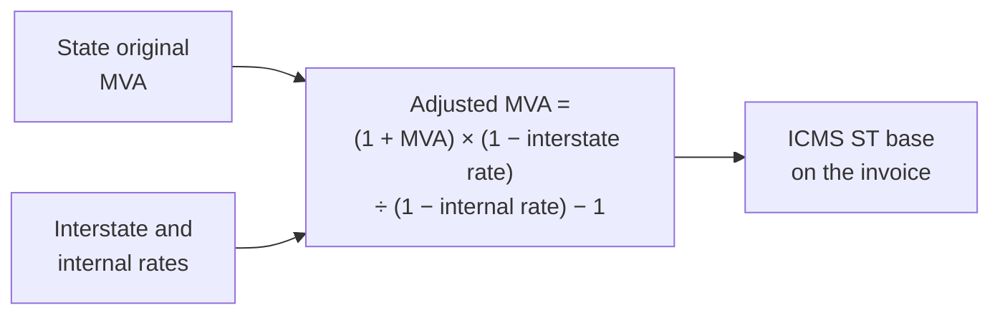
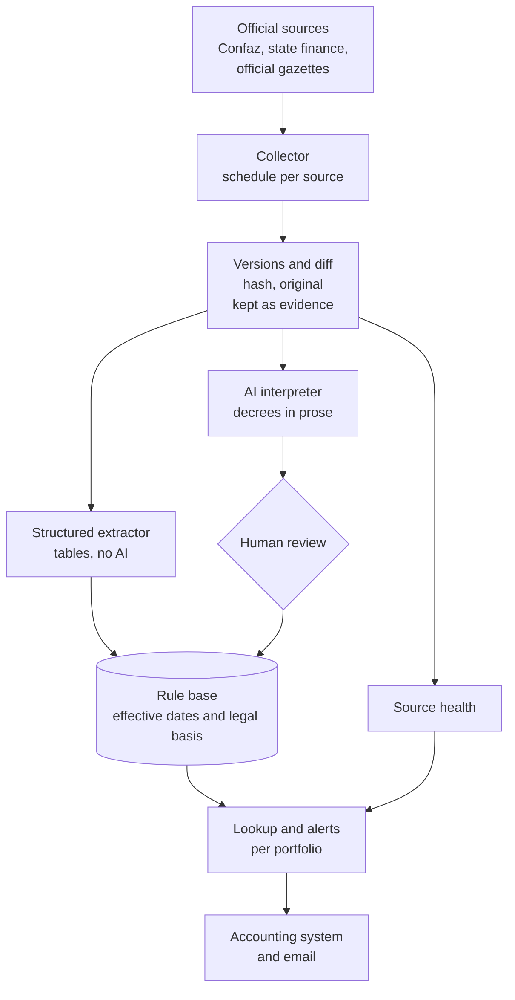

# ICMS ST: watching tax rules that change without notice

**Period:** November 2026 to date · **Role:** concept, source survey, architecture, code, validation and publishing · **Status:** Phase 0 in production (monitor collecting and alerting); Phase 1 in progress, first open dataset published

> One-sentence summary: in one working day I went from a pain every goods seller in Brazil knows ("the ICMS ST rule changes and nobody tells me") to a monitor in production that watches the rules published by Confaz and São Paulo, keeps every version as evidence and emails what changed and since when, plus an open dataset with the 1,043 valid CEST codes of Convênio 142/2018 and the history of each item, validated against São Paulo's official list.

## 1. Context and problem

Under ICMS tax substitution (ST, *substituição tributária*), the seller collects in advance the state VAT for the whole downstream chain. To do that, for each product and each destination state, it must know whether the goods are subject to the regime, the value-added margin (MVA), the tax rate and any poverty-fund surcharge. These rules change by decree, ordinance or interstate agreement, in 27 states and at Confaz (the national council of state finance secretaries), with no notice to those affected.

At my group's distribution company, the sales quote already computes ST per item. The calculation is fine; the parameter is what goes stale. The accounting firm does not warn when an MVA changes, because it does not track everything either, and the market solves this with tax-content subscriptions costing over a thousand reais a month, which in the end read the same public sources.

The inspiration came from a project shared in my graduate program's community: an "oracle" for a court's internal rules, with hybrid search over thousands of resolutions. The key difference: here the answer is not a passage of text, it is a number that goes into an invoice. A wrong number means a tax assessment. So the design is a monitor with source and date, not a chat.

## 2. How the rule works

A single answer ("this hose, from SP to MG, imported, has an adjusted MVA of X%") depends on five layers of rules, each with its own source and pace.

| Layer | What it defines | Published by |
|---|---|---|
| National goods list | Which goods may be under ST, with CEST, NCM (HS) code and description (Convênio ICMS 142/2018) | Confaz |
| State adoption | Which items the state actually puts under ST and with which original MVA | Each state finance department |
| Interstate agreement | Whether a seller in one state withholds ST for another, by segment | Confaz protocols and agreements |
| Rates | Destination internal rate, interstate rate (4%, 7% or 12%) and poverty fund | State laws and regulations, Federal Senate |
| Operation type | Domestic or imported goods, Simples Nacional seller, base reductions | Convênio 142 and state rules |

The adjusted MVA is almost never published: it is computed from the original MVA and the rates.



Two design consequences: the key is not the NCM code, it is CEST plus description (one NCM can fall into several items); and every number needs an effective period and a legal basis, because tax audits look backwards.

## 3. What the source survey revealed

Before any code, three agents surveyed in parallel how Confaz and six states (SP, MG, RJ, PR, RS, SC) publish their rules, opening every page and confirming every address. They also mapped what commercial providers deliver.

| Finding | Evidence (November 2026) | What it changes |
|---|---|---|
| There is no official API or spreadsheet for ST | Confaz publishes Convênio 142 only as a ~930 KB HTML page; none of the six states has open data on ST | The product is, first of all, a page extractor and versioner |
| São Paulo is leaving ST | Auto parts, tools, electrical materials, tires and paints left on 2026-10-01; building materials leave on 2027-02-01 | Removing a whole segment is a first-class event with an effective date, not just a percentage change |
| Every state publishes differently | SC keeps past wordings in its own HTML; MG publishes a PDF with effective-date notes; RJ keeps the consolidated list in a 2023 .doc file; PR has its MVAs in an unconsolidated 565-page PDF | Order of work by source quality: SC and MG first, PR last |
| Some portals block access from abroad | RJ's portal rejects foreign addresses; RS's has an invalid TLS certificate | The collector runs on a server in Brazil and handles certificates per source |
| Competitors sell "daily updates" | Web lookups, simulators and APIs for large companies; none offers a versioned history per item or alerts matched against an accounting firm's client portfolio | Differentiator: the parameter applied inside the accounting system, with what changed, when and under which rule |

An honest course correction: the idea was born for my group's company, but the survey showed that, with São Paulo leaving ST, its gain lies in sales to other states. The larger value is in serving accounting firms, which handle dozens of companies each, so the monitor is born as a module of [Escrituro](escrituro.md).

## 4. Architecture

The engine is a separate service with its own database; the accounting system talks to it through an internal API. A collector problem does not take the accounting system down, and the same engine can serve other systems.



Two design rules that hold in every phase:

- **Nothing is overwritten.** A change closes one rule's effective period and opens another. Looking up a past date must work.
- **Tables go straight in; prose goes through review.** What comes from a table is extracted deterministically and testably. What comes from a decree in prose ("item 12 of Annex XV is amended") goes through the AI and human review until per-state accuracy has been measured.

## 5. Phase 0: the monitor in production

The foundation now watches 12 sources: Convênio 142, Confaz's yearly indexes of agreements, protocols and fuel price acts, and in São Paulo the goods list, the four MVA ordinances still in force, the rate articles, the recent-acts list and a search of the Official Gazette filtered to the Finance department.

Each page becomes text with one line per table item, so an MVA change shows up as a single line (illustrative example):

```
- 2 | Argamassas | 10.002.00 | 3816.00.1 3824.50.00 | 70%
+ 2 | Argamassas | 10.002.00 | 3816.00.1 3824.50.00 | 75%
```

The finest work went into avoiding false alarms, because a monitor that cries wolf gets switched off in its first week:

| Rule | Why |
|---|---|
| The portal's "last updated" date is left out of the comparison | The portal republishes pages without changing the content |
| For lists, only what came in triggers an alert | An act dropping out of the 30-day window is not news |
| One retry before recording an error | Government portals fail for minutes; this happened in the first week and was caught |
| Extractor version recorded with each collection | Improving the extractor changes the text; without this, every improvement would fire dozens of false alerts |
| A monitor for the monitor | Warns when a source keeps failing, stops responding, loses its expected content or suddenly shrinks |

Alerts arrive by email: source problems (repeated only if they change or after 24 hours, with a notice when things are back to normal) and each rule change, exactly once, with the lines that came in and went out and the source link. The database and the original pages are backed up hourly, with an immutable copy off the server.

## 6. Phase 1: Convênio 142 as open data

The first dataset is published at [github.com/thiagogardev/icms-st-dados](https://github.com/thiagogardev/icms-st-dados): the national list of goods under ST, with the effective dates of every wording. Confaz marks each item's history only by color and free-text notes:

```
Nova redação dada ao item 42.0 do Anexo II pelo Conv. ICMS 66/22, efeitos a partir de 02.05.22.
42.0 | 01.042.00 | 8421.32.00 | Depuradores ...        (current wording)
Redação original, efeitos até 01.05.22.
42.0 | 01.042.00 | 8421.39.20 | Depuradores ...        (old wording, in green)
```

The extractor reads these notes, typos and all, and turns each item into rows with start and end dates, status on the reference date and the agreement that made the change.

| Result | Value |
|---|---|
| Valid CEST codes | 1,043, one row per code |
| Wordings in the history | 1,220 (136 previous, 12 revoked, 29 that never took effect) |
| Segments | 25 |
| Annex XXVII items (non-relevant industrial scale) | 222 |
| Change notes left unmatched | 0 |
| Inconsistencies in the source itself, logged | 5 |

Validation had three layers: known cases checked by hand (stoves added on 2026-11-01, the coconut water NCM change on 2024-06-01, an item revoked on 2020-01-01); automatic checks (each valid CEST appears once, every CEST maps to an existing segment, each annex has a single segment); and a cross-check against an independent source, São Paulo's official list. Of the 762 CEST codes it cites, all exist in the dataset; 756 are valid and the remaining 6 are exactly items the agreement itself revoked.

The Confaz page has errors of its own, and I did not "fix the law" on my own authority: the change note for item 85.0 repeats, by a copy error, the number of item 63.0; four old wordings are formatted as if they were current. Each case was resolved from context and logged in a public file, so dataset users know exactly where the source is inconsistent.

## 7. How it is measured

The system is only worth something if measured against an independent reference, with metrics an accounting firm understands. Four questions:

| Question | Metric | How | Initial target |
|---|---|---|---|
| Does it notice when a rule changes? | Detection recall | Monthly list of changes built from the official gazette, compared with the events generated | 98% in SP, 95% elsewhere |
| Does it alert for nothing? | Detection precision | Share of events that match a real parameter change | 90% |
| Is the extracted number right? | Per-field accuracy | Sample checked against the rule text and real tax filings, split by path (table or prose) | 99% tables, 95% prose before review |
| Does it arrive in time? | Latency | Time between publication and detection | Median under 24 hours |

The human review queue is the measuring instrument: every approval, correction and rejection is a label, and in a few months the system builds its own test set per state and per rule type.

For my graduate work, the core experiment is extracting tax parameters from legal text: comparing the AI with a fixed output schema against a regular-expression baseline and against table extraction, measuring per-field and per-state accuracy. A second experiment is matching NCM codes to CEST by description similarity, evaluated with Precision@K, the same metric used in [Genesis](genesis.md).

Already measured in Phase 0: three full collections in a row with no false alert across the 12 sources, and the same output, character for character, on the development machine and on the server. The exit criterion for the phase is 30 days of collection with no silent failure.

## 8. Numbers

All on November 8, 2026.

| Measure | Value |
|---|---|
| Research agents in parallel for the source survey | 3 |
| States with sources mapped | 6, plus Confaz |
| Sources watched in production | 12 |
| Automated tests | 19 in the monitor, 10 in the agreement extractor |
| Full collections in a row with no false alert | 3 |
| Valid CEST codes in the dataset | 1,043 |
| CEST codes from SP's list found in the dataset | 762 of 762 |
| Defects in my own code caught by tests and validation before publishing | 7 (3 in the monitor, 4 in the extractor) |

The last number matters most. In the monitor: two versions collected in the same second overwrote each other's original file; line breaks inside Confaz table cells split each item into pieces; and every extractor improvement fired false alerts. In the agreement extractor: the segment inferred from the annex number (the codes have gaps), item rows with heading formatting being skipped, a validation check in the wrong place and the worst of them: the Confaz page keeps a revoked item as a normal row with the description "REVOGADO", and the first version of the extractor published those rows as valid items. The cross-check caught it before publishing, and a test prevents it from coming back.

What is not done, stated just as clearly: Phase 0 has not completed its 30 days; the real-change email has only been tested with simulated data, because no watched rule has changed since going live; the interstate protocol matrix does not exist yet; no state's MVA is structured yet; the AI interpreter and the review queue have not been built.

## 9. Lessons

- **Real time does not exist in legislation.** What exists is "detected within so many hours of publication, effective from such a date". It is more honest and it is what matters to whoever applies the rule.
- **Cross-validation catches what tests do not.** The tests passed; it was the cross-check against São Paulo's list and the count of valid codes that showed revoked items coming out as valid.
- **The official source makes mistakes too.** A note copied with the wrong item number, an old wording formatted as current. Logging the inconsistency in public is worth more than hiding it in a silent fix.
- **Silence is not health.** A collector that stopped and a collector that found no change produce the same log. Without a monitor for the monitor, 30 days of "no change" would prove nothing.
- **Survey before promising.** The initial assumption was to cover São Paulo's internal ST; the survey showed the state leaving the regime. The focus changed before a single line of code.

## 10. Next steps

Each phase has a verifiable exit criterion.

1. **Phase 0, foundation (live).** Gate: 30 days of collection with no silent failure and every change detected within 24 hours.
2. **Phase 1, national base (in progress).** Convênio 142 published; still missing is the matrix of interstate protocols and agreements by segment, which does not exist anywhere ready-made. Gate: matrix checked by hand on 20 state pairs and published as open data.
3. **Phase 2, São Paulo.** Segments still under ST, the 2026 and 2027 removals with inventory rules, the AI interpreter and review queue, lookup by NCM with adjusted MVA. Gate: 50 lookups matching real tax filings.
4. **Phase 3, South and Southeast.** SC, MG, RJ, RS and PR, in that order, with portfolio alerts and integration into the accounting system. Gate: per-state accuracy above 95% and a pilot accounting firm using it.
5. **Phase 4, remaining states**, in order of demand, with sampled review where accuracy allows.

The horizon is part of the design too: Brazil's tax reform phases ICMS down from 2029 and ST is likely to shrink. The legislative watch engine (collect, version, detect, interpret, alert) is the same one accounting firms will need for the new IBS and CBS taxes.

## 11. Stack and code

Python 3 · httpx · lxml · SQLite in Phase 0, designed for PostgreSQL · cron scheduling on a server in Brazil · email alerts via Resend · hourly backups with an immutable copy.

The dataset and the Convênio 142 extractor are public under open licenses: [github.com/thiagogardev/icms-st-dados](https://github.com/thiagogardev/icms-st-dados). The monitor is private, because it will run inside a commercial product; it can be shown in an interview or academic review.
