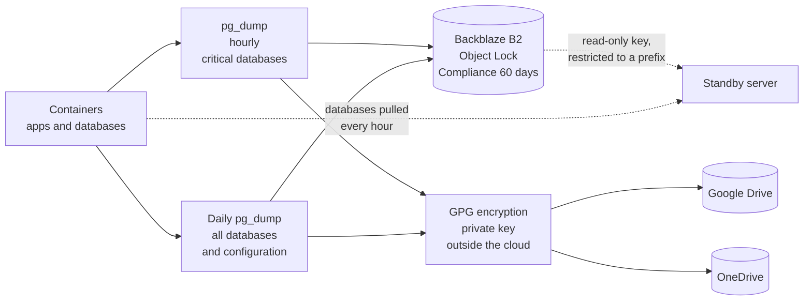

# Infrastructure and disaster recovery: from ransomware to three clouds in five days

**Period:** September 2026 to date · **Role:** architecture, operations, restore tests and migrations · **Status:** in production on an ARM VM on Oracle Cloud in São Paulo since 2026-11-12, with a standby server

> One-sentence summary: after ransomware encrypted the group's physical servers, I rebuilt operations in containers in the cloud, with hourly backups, a copy that not even I can delete, restores proven for real and the ability to switch providers in a single morning, which was done twice in five days.

## 1. Context and problem

On 2026-09-23, ransomware hit the network of the industrial group I run. The virtualization host was compromised and the virtual machines, including the commercial ERP's database server, were encrypted. The ERP never came back.

The rebuild started with what brought in revenue: a quoting system with ICMS tax substitution, in production on 2026-09-30, on a VPS with Docker. Then came management accounting, the websites and Asset Tecnologia's systems. The infrastructure question became a single one: **if it happens again tomorrow, what is lost and how long does it take to come back?**

The answer required three things: a copy that an attacker with full access cannot delete, a proven (not assumed) restore and independence from any single provider.

## 2. Results

| Indicator | Today |
|---|---|
| Maximum data loss on critical databases | 1 hour |
| Immutable copy | Object Lock in Compliance mode, 60 days |
| Restore | tested in a disposable container, with row counts matching production |
| Copies outside the main provider | three destinations, two of them encrypted, plus a standby server |
| Cutover time to another provider | about 16 minutes, measured on 2026-11-12 |
| Cost of the main server | within Oracle Cloud's free tier |

## 3. Backup architecture

- **Hourly.** Since 2026-11-05, the critical databases (quoting, management accounting and the two Asset systems that hold customer data) are exported every hour. Maximum loss in an outage dropped from 24 hours to 1 hour. Databases that can be reloaded from public sources stay on the daily schedule.
- **Immutable.** Since 2026-10-07, a copy goes to Backblaze B2 with Object Lock in Compliance mode and 60-day retention. In this mode, not even the owning account can shorten retention or delete the object before it expires.
- **Encrypted.** Since 2026-11-13, everything that goes to Google Drive and OneDrive is encrypted with GPG. The private key and its passphrase stay outside those clouds.
- **Least privilege.** The standby server's key can only read, and only the hourly dumps prefix: it cannot see the configuration bundle, which contains the write keys. Tested: writing with it returns access denied.

## 4. Tests that prove instead of assume

| Test | Date | Result |
|---|---|---|
| Permanently delete an object in B2 | 2026-10-07 | Denied by the provider. Overwriting created a new version and kept the original |
| Restore the ERP database from B2 | 2026-10-07 and 2026-11-02 | Dump downloaded and restored in a disposable container, with table row counts matching production |
| Restore a new system's database before opening it to users | 2026-11-05 | New database with the same tables, migrations and reference data |
| Standby key writing outside its scope | 2026-11-06 | Access denied |

## 5. Three clouds in five days

The container design, with each system in its own compose file and the data in dumps, was put to the test twice in the same week.

| Date | From | To | Reason | How |
|---|---|---|---|---|
| 2026-11-07 | VPS at Hetzner (Europe) | AWS in São Paulo | Latency: first response dropped from about 0.75 s to 0.05 s, a difference users noticed | System by system, with matching table counts before the DNS switch; about 30 containers; certificates issued in about 1 minute |
| 2026-11-12 | AWS in São Paulo | ARM VM on Oracle Cloud in São Paulo | Zero cost on the ARM free tier, with more memory, keeping data in Brazil | ARM images built on the new server and tested while stopped; at cutover, 9 databases copied with identical row counts, 36 containers, DNS switched and certificates reissued in about 16 minutes |

After the second migration, AWS stayed as a stopped standby with the cutover databases, and a server at Hetzner pulls the production databases every hour. If Oracle goes down, there is somewhere to go back to without relying on the cloud backup.

## 6. Engineering decisions

- **Containers and dumps, not machine images.** What must survive is the database and the configuration. Everything else is rebuilt from code. That is why a migration means copying dumps and starting compose files, not cloning disks.
- **Immutability in the provider, not in discipline.** A copy that depends on nobody deleting it does not protect against whoever took over the server. Compliance mode takes that decision away from everyone, including me.
- **A synced cloud folder is not a backup.** Drive and OneDrive replicate whatever arrives, encrypted ransomware files included. They became an extra, encrypted copy, not the primary one.
- **Measure before migrating.** The first migration came from a latency measurement; the second, from a cost and capacity calculation. Neither from brand preference.
- **Rehearsed cutover.** On Oracle, everything was built and tested with the apps stopped hours before; the cutover was just stop, copy the databases, check and switch DNS.

## 7. Lessons

- **A backup destination failed silently.** On 2026-11-02, a check showed that one destination's authorization had been revoked eight days earlier, after a password change. The other two kept working, the gap was filled, and the lesson stuck: a backup without failure alerts is hope, not a backup.
- **Certificates do not always issue by themselves.** Reloading the proxy did not issue the certificate for a new domain; restarting it did. It went into the deployment runbook.
- **Official servers get it wrong too.** A government portal serves its TLS chain without the intermediate certificate. The fix was adding the intermediate as an extra authority, without turning verification off.
- **A key on screen is a leaked key.** Pasting secrets into a terminal or a screenshot exposed keys twice; all were revoked immediately. Since then, secrets go in through scripts that never display the value.

## 8. Next steps

1. **Failure alerts per backup destination**, so the next silence lasts minutes, not days.
2. **Automatic periodic restores**, with counts checked and the result recorded, instead of manual tests.
3. **Main server outage drill**, bringing up the standby from the latest dump and measuring the real time until the systems respond.

## 9. Stack

Docker Compose · PostgreSQL 16 · Caddy with automatic certificates · nginx for static sites · Ubuntu 24.04 on ARM (Oracle Cloud, São Paulo) · rclone · Backblaze B2 with Object Lock · GPG · cron with a lock against concurrent runs.
