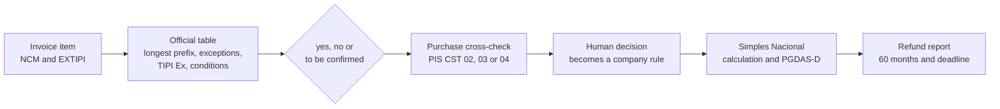

# A tax engine with an official source: single-stage PIS/COFINS under Simples Nacional

**Period:** November 2026 · **Role:** research of the rules, decision logic, code, tests on real invoices and publishing · **Status:** live in [Escrituro](escrituro.md) 0.65.0 since 2026-11-14; the classification and the refund arithmetic published as an [open-source tool](https://github.com/thiagogardev/monofasico-br)

> One-sentence summary: small Brazilian businesses that resell tires, auto parts, medicines or cosmetics often pay the same federal contributions twice on the same product; I built the engine that flags each item sold as **yes, no or to be confirmed**, always with the law and article, carries the flag to the tax return and computes what can be recovered from the last five years.

## 1. Context and problem

For some products, Brazilian law concentrates PIS and COFINS (federal contributions on revenue) at the start of the chain: the manufacturer or importer pays a higher rate, and resellers have a zero rate. This is single-stage, or "monophasic", taxation. It covers fuels, medicines, perfumery and personal hygiene, vehicles, auto parts, tires and inner tubes.

Under Simples Nacional, the simplified regime for small businesses, PIS and COFINS come embedded in a single monthly payment (DAS). A reseller of monophasic products must segregate that revenue in the PGDAS-D return and flag it as monophasic, so the PIS and COFINS share is removed from the payment (LC 123/2006, art. 18, §4-A, I; CGSN Resolution 140/2018, art. 25, §6). When this is not done, the business pays again a contribution the manufacturer has already paid.

In practice the segregation is rarely done, for three reasons:

1. **The list is not a list.** The products are spread across several laws (9,718, 10,147, 10,485, 13,097), annexes of a normative instruction and two SPED tables. They do not always agree.
2. **The product code alone does not always decide.** Some auto parts are monophasic only when made for tractors, excavators or vehicles (Annex II of RFB Normative Instruction 2,121/2022). Some codes count only under a specific "Ex" of the IPI table (TIPI).
3. **Mistakes are expensive both ways.** Flagging as monophasic what is not creates a debt with penalties. Failing to flag means paying twice every month, silently.

## 2. What the engine does



- **Classification with a source.** Each group in the table carries the law, the article and the SPED table code. Every decision comes with a readable reason, such as "Law 10,485/2002, art. 5; SPED table 4.3.10, code 304" or "this NCM is monophasic only under Ex 01 or 02 of the TIPI, and the invoice does not state the Ex".
- **Three answers, not two.** When the law requires a condition the invoice cannot prove, or the official source does not confirm the treatment under Simples Nacional (cold beverages), the answer is "to be confirmed". The item keeps paying PIS and COFINS until a person decides, and the monthly calculation warns how many items are pending.
- **The right return.** Monophasic revenue goes to the PGDAS-D under the resale activity with tax substitution or single-stage taxation, with qualification 9 for PIS and COFINS.
- **The past.** A report recomputes the last 60 months, showing the overpayment for each month and the deadline to claim it.

## 3. Design decisions

**Official table first, the supplier's tax code only as a cross-check.** The tempting shortcut was to trust the PIS tax situation code (CST) on the supplier's invoice (02, 03 or 04 indicate a monophasic product). I did not, because suppliers make mistakes too. The table decides; the CST only raises a flag. If the table says "no" and the supplier sold the same NCM with a monophasic CST, the item becomes "to be confirmed". The CST never turns an item into "yes" on its own, nor downgrades a "yes".

**Longest prefix wins.** The law lists 4-digit headings in some places and 8-digit subheadings in others. Across all groups, the longest prefix that matches the NCM wins. That way 8431.41.00, which is in Annex I of the auto parts, beats 8431.49 from Annex II without any special case in the code. A test ensures no prefix appears in two groups.

**The human decision becomes a rule, but chosen separately.** When the accountant confirms an item, the decision becomes a learned rule of that company for that NCM and applies to all its sales. Escrituro already had a tax grid that picks one rule per item and, with it, the Simples Nacional activity, the bookkeeping CFOP and which shipments to ignore. Had the monophasic rule joined the same contest, it would win for being more specific (it has an NCM), and the item would lose its resale activity, or an ignored shipment would enter revenue. So "monophasic-only" rules are picked in a separate pass and decide only the flag.

**Reclassify the past without touching the books.** Recovering means flagging old sales. The report rereads the stored invoice XMLs (each item's EXTIPI comes from there) and applies the table and rules to the sales of the last 60 months. It only flags items: entries, calculations and returns already filed stay unchanged. Amending a return is a deliberate act, outside the system.

**Refund with a deadline and the origin of each number.** For each month: monophasic revenue, the part already segregated, the bracket's effective PIS and COFINS, the overpayment and the last day to claim (DAS due date plus five years). The report says where the rate came from: the filed return, the calculation stored in the system, or an estimate from revenue history. "To be confirmed" items stay out of the total until confirmed.

**An expiry date written into the code.** PIS and COFINS under Simples Nacional give way to the new CBS and IBS from 2027-01 (CGSN Resolution 190/2026). The flag still exists, but from 2027 on it is only a warning, and the refund report stops at 2026-12.

## 4. Bugs found with real data

The table passed the tests written from the law. The two bugs below only showed up when the engine ran over the pilot's real invoices, in the development environment and before release: neither reached production. Each one became a regression test.

**8431.43.90: a drilling rig part is not an excavator part.** Item 2 of Annex II reaches parts of machines of heading 84.29 (excavators, loaders, crawler tractors), and those parts sit in 84.31. But 84.31 also groups parts of other machines. Code 8431.43.90 came up as an Annex II candidate, and it covers parts of boring and drilling machinery (8430.41 and 8430.49), which the law does not reach. The fix was to read the structure of the heading: only 8431.49 can be a part of an 84.29 machine; 8431.41 and 8431.42 are already in Annex I; the rest of 84.31 is out.

**EXTIPI "0" read as an Ex.** Five auto-part codes are monophasic only under a TIPI Ex (for example, 8481.80.99 only under Ex 01 or 02). Many issuers fill the invoice's EXTIPI field with "0" when the product has no Ex. The code left-padded it, read "Ex 00", did not find it in the list and answered "not monophasic". It was a silent false negative, the kind that makes a business pay twice without anyone noticing. Now empty or all zeros means "no Ex", and the item is "to be confirmed".

A third finding came from reading the sources, not the invoices: SPED table 4.3.10 still lists heading 33.06 (oral hygiene), which left single-stage taxation with Law 12,839/2013. When the table and the law disagree, the law prevails, and a comment in the code says why.

## 5. A principle for tax AI

The engine is deterministic on purpose: the rule is law, and law is not settled by probability. But it made clear how AI should enter this domain. It **answers only with a source**: every statement points to the law, article or table it came from, and that source must exist in the knowledge base consulted. When no official source confirms, the right answer is "to be confirmed", never a well-written guess.

It is the same contract as the table: the source field of each group and the "to be confirmed" state are the model-free version of that idea. For an AI, the rule becomes a check: an answer without a valid citation is rejected before it reaches the user.

## 6. How it is measured

- **Tests from the law:** each group, express exception, TIPI Ex and Annex II condition has a case. In Escrituro, the monophasic suite goes from the table to the refund report, through the tax grid, the monthly calculation and the PGDAS-D, on a temporary database.
- **Regression on real invoices:** the two bugs in section 4 became fixed cases.
- **Arithmetic checked by hand:** the effective rate and the PIS and COFINS split of each Annex I bracket match LC 123/2006, and a test checks a full bracket calculation.
- **Use:** the report separates estimated values from values of a filed return. The number that counts is the one on the amended PGDAS-D.

## 7. Numbers

| Measure | Value |
|---|---|
| Product groups | 9, each with law and article |
| NCM prefixes in the table | 121 |
| NCM codes depending on a TIPI Ex | 5 (and 1 excluded only under an Ex) |
| Refund window | 60 months, up to 2026-12 |
| Check blocks in the Escrituro suite | 13, from the table to the report |
| Tests in the public repository | 20 |
| Bugs found with real invoices | 2, both with regression tests |

## 8. Lessons

- **Doubt is a state, not a defect.** Treating "to be confirmed" as a first-class answer removed the pressure to guess from the code and took the decision to whoever can sign it.
- **Real data finds what the law does not show.** The tests written from the legal text passed. The bugs were in the structure of the nomenclature and in how issuers fill in invoices.
- **A false negative is also a bug.** In taxes, the error nobody sees (overpaying) lasts for years. The EXTIPI "0" only surfaced because the engine explains every "no".
- **When official sources disagree, document which one wins.** Heading 33.06 is in an official table and out of the law. The comment in the code matters as much as the rule.
- **Correct the past without rewriting it.** Flagging old items is safe; touching a filed return is not. Keeping the two apart made the report useful from day one.

## 9. Limits and next steps

- **Cold beverages** stay "to be confirmed" until an official source confirms their treatment on the PGDAS-D.
- **Manufacturers and importers** also segregate the revenue, but pay the concentrated PIS and COFINS separately, outside Simples Nacional. The system warns and does not compute that payment.
- **2027:** CGSN Resolution 190/2026 creates a monophasic IBS/CBS. The table is versioned by effective date and ready for the new list once the rules are final.
- **Watching the sources:** connect the table to the [legislation monitor](icms-st.md), so a change in the law or in the SPED table becomes an alert with source and date.

## 10. Stack and code

- **In Escrituro:** Next.js 16, React 19, Drizzle, PostgreSQL (PGlite in development), Docker; decision logic as pure functions, with no database, tested on their own.
- **Official sources:** LC 123/2006; CGSN Resolutions 140/2018 and 190/2026; Laws 9,718/1998, 10,147/2000, 10,485/2002, 10,560/2002, 11,116/2005, 12,839/2013 and 13,097/2015; RFB Normative Instruction 2,121/2022, Annexes I and II; tables 4.3.10 and 4.3.11 of the EFD-Contribuições; TIPI.
- **Code:** Escrituro is private, and the code can be shown in interviews or academic evaluation with synthetic data. The classification, the CLI and the refund arithmetic are public, under the MIT license: [thiagogardev/monofasico-br](https://github.com/thiagogardev/monofasico-br).

```text
$ npm run ncm -- 84818099 --ex 0
8481.80.99  A CONFIRMAR  (Autopeças (Anexo I))
  o NCM 84818099 só é monofásico no Ex 01 ou 02 da TIPI, e a nota não informa o Ex
  Fonte: Lei 10.485/2002, art. 3º e Anexo I; IN RFB 2.121/2022, Anexo I (códigos da TIPI atual)
```

- **See also:** [Escrituro case study](escrituro.md), the system this engine is a module of, and [ICMS ST case study](icms-st.md), from the same family of tax rules with a source.
