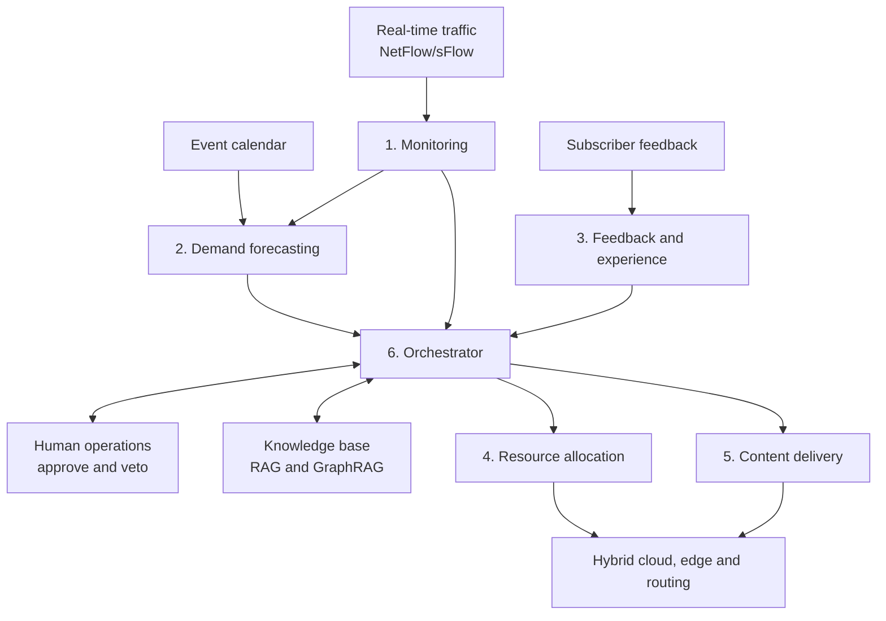

# A streaming network with AI agents: predicting the peak instead of reacting to it

**Period:** November 2026 · **Role:** problem analysis, gap survey, architecture and documentation · **Status:** architecture design, done as the final project of the postgraduate program in Cognitive Systems with AI Agents (Data Science Academy, Brazil); not implemented. Full document in the [open repository](https://github.com/thiagogardev/agentes-rede-streaming)

> One-sentence summary: a streaming company stalls at its moments of highest audience because it only reacts to congestion after it shows up; I designed a six-agent system that **predicts the peak, prepares the network before it and adjusts delivery during it**, keeping the LLM where it is good (language, context, coordination) and out of the decisions the network makes in seconds.

## 1. Context and problem

The project scenario is a telecom company focused on video streaming. During live events and series launches, traffic spikes, the network congests and the subscriber sees the video buffer. The company has real-time network monitoring (NetFlow/sFlow), a data warehouse on BigQuery, Splunk and Apache Spark for analysis, and servers distributed across a hybrid cloud.

The request was a solution with AI agents for three things: predicting demand peaks, allocating network resources dynamically, and adjusting content delivery according to network conditions and user feedback. The brief warned that part of the information was missing on purpose, as happens in real life.

I reduced the problem to two business questions:

1. **How much demand will we have, where and when?** A question about the future, which calls for a predictive model.
2. **Given that demand and the state of the network, what is the best action right now to keep video smooth at the lowest cost?** A question of continuous decision, which calls for agents.

## 2. What the brief did not say

Before designing anything, I listed what the scenario left out. Two items changed the project:

- **The event calendar was not among the available data.** Peaks are caused by live events and launches, but the data list only had traffic, history, feedback and devices. Without the calendar, a model learns seasonality and is surprised by exactly what matters most. The solution requires that source.
- **User feedback arrives too late for real-time adjustment.** Ratings and comments are subjective, sparse and come after the problem. The direct measure of experience is player telemetry (stalled time, quality per session), which was not listed either. In the solution, feedback validates and telemetry measures.

The other gaps became explicit assumptions, each with the effect of being wrong: which actions the network accepts through an API, quality targets, depth of history, cloud cost ceiling, and the level of autonomy operations will accept.

## 3. The solution on one page

| Agent | What it does | How it decides |
|---|---|---|
| 1. Monitoring | Keeps the current state of each region and detects traffic outside the forecast | Stream aggregation (Spark) and statistical anomaly detection |
| 2. Demand forecasting | Forecasts traffic by region, content type and device, from minutes to days | Predictive model with quantile forecasts |
| 3. Feedback and experience | Turns ratings into a structured signal and cross-checks with incidents | Small language model, fine-tuned |
| 4. Resource allocation | Decides where to scale capacity and where to steer traffic | Cost-constrained optimization |
| 5. Content delivery | Adjusts quality by region and device when capacity is not enough | Bounded policies |
| 6. Orchestrator | Coordinates, resolves conflicts, applies guardrails, calls people and explains | LLM on a state graph, with human approval |

An agent exists only where there is a distinct decision to make. Fewer agents means fewer failures and less coordination.

## 4. Design decisions

**Each decision on the right clock.** An LLM takes seconds to answer, costs per call and does not always give the same answer. A streaming network decides in milliseconds. I separated three layers: the data plane (the player's adaptive streaming and load balancers, no agents), tactical control in seconds to minutes (predictive models and optimization, within limits) and strategic control in minutes to days (the LLM planning an event, reading feedback, coordinating and explaining). The most common mistake in agent projects is making the LLM decide everything; here it never touches real-time allocation.

**Quantile forecasts, not the mean.** The cost of error is asymmetric. Under-forecasting causes buffering and lost subscribers; over-forecasting costs idle capacity for a few hours. The network is sized by the 95th percentile of the forecast. The main model is gradient boosting with calendar and event features, measured against a simple statistical baseline: if it does not beat the yardstick, it does not ship.

**Optimization before reinforcement learning.** Reinforcement learning looks like the natural choice for dynamic allocation, but it learns by exploring, and exploring on a production network takes customers down. Constrained optimization is predictable, auditable and respects a cost ceiling. Reinforcement learning stays as a later step, trained in a simulator replaying past events.

**RAG for knowledge that changes, fine-tuning for a task that repeats.** The LLM does not know the company's network or what happened in past events. That knowledge changes every week, so it goes into a base queried at run time: vector search with re-ranking over reports and runbooks, and a graph of the topology (regions, points of presence, links), because "if this point saturates, which neighbors absorb the traffic?" is not a question text similarity can answer. Classifying feedback, on the other hand, is always the same task at high volume: there a small open model with fine-tuning, hosted in-house, is cheaper and keeps subscriber text inside the company.

**A supervisor, not agents negotiating freely.** In a critical operation I want a single accountable point, a traceable flow and one place for guardrails and audit. The orchestrator is an explicit state graph (LangGraph), with persisted state and human approval points before any action above the limit. I considered CrewAI: great for a quick prototype, but it gives less control over the path each decision takes.

**Degrade where nobody notices.** When capacity does not arrive in time, the delivery agent caps quality where the difference is invisible (4K on a small screen) and frees bandwidth for those watching on a TV. It is the shock absorber for the day the forecast is wrong, and it will be.

**Reuse what the company already has.** NetFlow/sFlow, Spark, BigQuery, Splunk and the hybrid cloud stay where they are. What is added is what the agents need to exist: a message bus, a vector store, a graph database, models served as APIs and continuous operations (evaluation before each release, tracing of every step, retraining).

## 5. Guardrails

- **Progressive autonomy.** Shadow mode (the system logs what it would do), then recommendations with human approval, then automation of reversible actions in a pilot region, then expansion. Trust is built on measured evidence.
- **Limits per action.** Maximum change in capacity and cost per cycle; above that, a person approves.
- **Automatic rollback** if the metric gets worse after an action.
- **Fail safe.** If the agents go down, today's static rules take over. The system is never worse than the starting point.
- **User text is untrusted data.** A comment may carry a malicious instruction. The agent that reads feedback only classifies, its output is validated against a schema, and no language model has write access to the network.

## 6. How to prove it works

1. Forecast tested on history with time-based validation, with separate attention to events.
2. Replay of past peaks, to see what the agents would have done.
3. Shadow mode in production, compared with the decisions operations made.
4. A lower-risk region first, with a control group.
5. Final comparison against current operations: stalled video time, cost per GB delivered and cancellations after incidents.

Rollout estimated in five phases, about nine months, starting with forecasting, which already helps operations prepare manually before any automation.

## 7. Limits of this work

It is worth being clear about what this case study is and is not.

- **It is an architecture design.** There is no running code and no real data. The scenario is the exercise proposed by the program, and no decision was validated on a real network.
- **Timeline and team are my own estimates**, consistent with the size of the solution, with no reference from the scenario.
- **There are no improvement figures.** Without the company's baseline, any percentage would be made up. The document says how to measure, not how much it will improve.
- **What backs the choices** is what I have already practiced in live systems: model output validated before it becomes an action, flow as a pure function with tests, AI that answers only with a source, fail safe. The [Genesis](genesis.md) and [Support Center](central-atendimento.md) case studies show that in production.

## 8. Proposed stack

Python · Apache Spark (Structured Streaming) · Google BigQuery and BigQuery ML · Databricks (pipelines, MLflow, model serving) · LightGBM · LangGraph and LangChain · MCP · Pydantic · small language model with LoRA · vector search with re-ranking · graph database · FastAPI · Docker and Kubernetes · Terraform · Splunk

- **Full document:** [github.com/thiagogardev/agentes-rede-streaming](https://github.com/thiagogardev/agentes-rede-streaming) (in Portuguese), with the gaps and assumptions, the data source by source, the two operating scenarios, the risk table and the decision table with the discarded alternative for each one.
- **See also:** [Genesis case study](genesis.md), prospecting agents in production, and [Support Center case study](central-atendimento.md), AI that answers from the manual.
