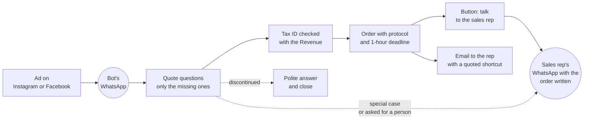

# WhatsApp sales bot: the ad lead reaches the sales rep already qualified

**Period:** November 2026 · **Role:** gathering the rules with sales, architecture, code, Meta integration and operations · **Status:** live since 2026-11-14; first real customers on 2026-11-15

> In one sentence: Acoplin's Meta ads brought conversations that I answered by hand, always with the same questions; now a bot asks those questions, checks the company with the Federal Revenue and hands me an order ready to quote, and the first real customer reached a qualified order in 4 minutes without anyone touching the phone.

## 1. Context and problem

Acoplin makes and sells industrial hoses, couplings and clamps. Its click-to-WhatsApp ads on Meta work: they bring conversations every day. The problem was on our side.

- **Every conversation started the same way.** What is the hose for? What pressure? What size? How many meters? Do you have a company tax ID? Delivery where? Six or seven questions before any quote, typed by hand on an executive's phone.
- **A slow answer loses the lead.** Whoever clicks an ad is comparing suppliers. If the first answer takes long, they have already talked to someone else.
- **Half the questions led nowhere.** Discontinued items, curiosity, people who vanish at the third question. The effort was the same for all of them.
- **There was no measurement.** There was no way to know which ad brought real orders and which brought only chat.

The rule that shaped the project: **the bot qualifies, it does not quote.** Price depends on the price list (retail or reseller), payment terms for new customers, freight and stock. That stays a human decision. The bot delivers everything the person needs to quote in minutes.

## 2. Results

| Indicator | Value |
|---|---|
| From decision to bot live | 1 day (2026-11-14) |
| First real customer from an ad | less than 1 hour after the bot was finished |
| Time from the first customer's message to a qualified order | 4 minutes |
| Promised to the customer | a quote within 1 hour during business hours |
| Test suites | 5 (flow with 28 cases, WhatsApp, deadlines, login and email) |

On the first day, two people came from the ads. One answered everything and became an order with a protocol number: product, size, length, tax ID and delivery, with no human involved. The other stopped at the quantity question, and the panel shows exactly where.

## 3. How it works for the customer

1. The customer clicks the ad and sends the first message. If the text or the ad itself already says the product, the bot skips questions.
2. The bot asks only what is missing: application, pressure or pump, size, length (rounded to a full roll or length), splice and clamp, material, fitting, quantity.
3. It asks for the company tax ID (CNPJ), looks it up with the Federal Revenue and shows the company name for the customer to confirm. Individuals are served too.
4. It creates the order with a protocol number and sends a button that opens the sales rep's WhatsApp **with the order already written**. The customer starts the conversation with the main number, so there is no message cost and no approved template.
5. The sales rep gets an email with the summary, the promised deadline and a shortcut to mark it as quoted.

At any time, "consultor" hands over to a person with everything answered so far, and "menu" starts over. Audio and photos do not break the conversation. Special requests, such as drip irrigation and fire fighting, go straight to the sales rep.

## 4. Architecture

| Part | How it works |
|---|---|
| Webhook | Meta calls the route; the HMAC SHA-256 signature is checked in constant time against the app secret, 200 is returned at once and processing happens afterwards. Each Meta message id is unique in the database, so a redelivery never produces a double reply |
| Flow as a pure function | It takes the conversation and the input and returns the next state and the actions (text, buttons, list, link, look up the tax ID, create the order). No database, network or hidden clock. The 28 test cases walk the paths in milliseconds |
| Product rules | Written with sales before the code and versioned: which product for each pressure range, what to ask for each line, what is discontinued and when to call a person. Sizes and rolls come from the website catalog |
| Source ad | Meta sends the ad the conversation came from. The bot uses it to skip questions and stores it for the per-ad funnel |
| Tax ID | Three public sources in sequence, so the lookup does not fail together with one of them |
| Deadline | Monday to Friday, 8 a.m. to 5 p.m. If a full hour fits before closing, it promises 1 hour; otherwise, the next business hour. Fifteen minutes before it expires, an email alert goes out for orders not yet quoted |
| "Quoted" link | Signed with HMAC and valid only for that order. It opens a page with a confirm button, because email scanners open links on their own and a GET must not change anything |
| Panel | Login with two-factor authentication. Orders (quoted, lost, reopen), conversations (take over, hand back, reply from the bot's number) and indicators per ad: arrived, asked for a quote, asked for a person, discontinued item and stopped midway |

## 5. Engineering decisions

- **A new number just for the ads, not the usual one.** The alternative was to put the company's main number on the API in coexistence mode, which required becoming a Meta tech provider and took WhatsApp off the desktop. With a new number, the main number did not change for existing customers, the website, the catalog and invoices, and the bot got its own business portfolio and app, with no Meta review.
- **Handover by link, not by a sent message.** If the bot messaged the sales rep, it would be a business-initiated conversation, with an approved template and a cost. With a wa.me link and the text ready, the customer starts it.
- **A service separate from the Support Center.** The engine was born from Asset's [Support Center](central-atendimento.md), but became a project of its own, with its own database, Meta app and domain. A block on one app does not take down the other.
- **The bot does not give prices.** A wrong quote at first contact costs more than one minute of waiting. Automation stops where the commercial decision begins.
- **Secrets never go through the chat.** The token, app secret and panel password are entered by a script on the server, which checks the token with Meta before saving it.

## 6. Lessons

- **An unpublished app does not receive customers.** In development mode, a Meta app only receives test webhooks from the dashboard. It was in a notice, not in the step-by-step guide.
- **"Subscribe webhooks" is a separate switch.** A webhook configured in the app is not enough: the WhatsApp account must be subscribed by the app. Without it nothing arrives and no error shows up.
- **The permanent token can get stuck at Meta.** The account verification needed to generate the system user's token did not show the code field. A plan B was ready, with a temporary token exchanged for a 60-day one, until Meta unlocked it the next day.
- **Leads also come on Sunday.** The first real order arrived on a Sunday. The deadline rule promised the quote for the next business hour instead of promising an hour nobody would meet.

## 7. Next steps

1. **Switch the number in every ad** and measure the cost per qualified order, not per conversation.
2. **Phase 2:** register the customer in the ERP from the tax ID and leave a draft quote so the sales rep only checks price and terms.
3. **Transcribed audio** instead of asking for text, and AI to understand the free text that today goes to the sales rep.

## 8. Stack

Next.js 16 · TypeScript · Drizzle ORM · PostgreSQL 16 (PGlite in development) · WhatsApp Cloud API · Amazon SES · Docker Compose · Caddy · Oracle Cloud in São Paulo.

The code is private. This case study describes the design and results without customer data.
